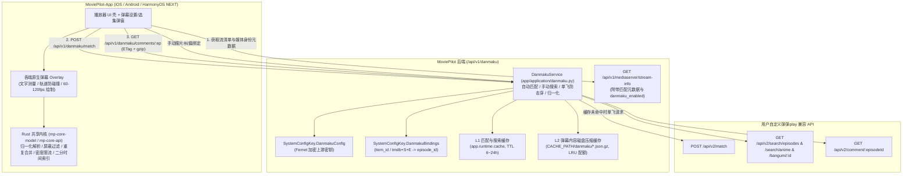

# MoviePilot 自定义弹弹play API 弹幕系统与三端原生渲染设计方案

> 适用仓库：`MoviePilot`（后端 `v3`）、`MoviePilot-App`（Rust 共享内核 + iOS / Android / HarmonyOS NEXT `v2`）、`MoviePilot-Frontend`（可选管理员配置页 `v3`）
> 核心路线：**自定义弹弹play（DandanPlay）兼容 API + MoviePilot 后端统一代理与缓存 + Rust 共享解析过滤 + 三端播放器独立原生叠加层渲染**
> 核心约束：不硬编码争议弹幕源或公共密钥；严格隔离实例凭据与上游弹幕凭据；弹幕渲染层与播放内核解耦（兼容 AVPlayer / MPV / VLC / Media3 / IJK）；源码与文档不引入第三方竞品名称
> 编写日期：2026-11-25

---

## 一、背景与设计目标

在 `MoviePilot-App` 已完成多内核播放架构（见 `docs/multi-engine-playback-design.md`）、媒体服务器直连优先（见 `docs/media-server-direct-play-design.md`）与播放进度同步（见 `docs/playback-progress-sync-design.md`）的基础上，为三端原生视频播放器引入完整的弹幕能力。

### 核心目标

1. **统一配置、零重复配源**：管理员只需在 MoviePilot 后台配置一次自定义弹弹play 兼容 API（如自建聚合弹幕服务或官方开放接口），所有登录用户的 iOS / Android / HarmonyOS 客户端自动获得弹幕能力，无需每台设备单独配置。
2. **后端统一代理与多级缓存**：
   - 保护上游弹幕源免受多端重复请求与限流冲击；
   - 将上游多格式响应统一归一化为紧凑结构，支持 `gzip` 压缩与 `ETag` 协商缓存，显著降低移动网络流量与首屏加载耗时；
   - 手动纠偏/换集绑定持久化在后端，一端纠偏、全端共享。
3. **跨端逻辑一致、渲染原生满帧**：
   - 弹幕解析、去重合并、关键词屏蔽、密度限流与时间索引沉淀在 `shared/core-rust/`，三端行为零漂移；
   - 文字宽度测量、轨道防重叠碰撞与逐帧绘制留在各端原生渲染层，避免 60/120fps 高频跨 FFI 通信导致掉帧；
   - 弹幕作为独立透明 Overlay 挂载在视频画布之上、播控 HUD 之下，天然兼容三端全部播放内核与直连/代理流。
4. **严格安全边界**：
   - 上游弹幕 API 地址与密钥由管理员配置并加密持久化，普通用户只读「是否已启用」状态，绝不向客户端泄露上游地址或密钥；
   - 后端请求上游弹幕服务时绝不透传 MoviePilot 用户令牌、Cookie 或媒体服务器凭据；
   - 仅允许请求管理员配置的受信任上游地址，杜绝客户端参数触发 SSRF。

---

## 二、总体架构与数据流



### 控制面与数据面职责划分

- **视频流数据面不变**：即便视频走 `STRM 直链` 或 `局域网/外网直连媒体服务器`，弹幕仍统一走 MoviePilot 后端同源接口 `/api/v1/danmaku/*`（与外挂字幕、进度心跳保持一致的控制面策略）。
- **播控驱动**：弹幕 Overlay 仅订阅各端统一 `PlaybackEngine` 的 `positionMs`、`isPlaying`、`playbackRate`、`onSeek`、`onPiPChanged` 与视口尺寸变更事件，完全不依赖具体解码引擎。

---

## 三、后端详细设计（`MoviePilot`）

### 3.1 配置存储与安全契约

参照 `MediaServerUserCredentials` 与 `AppPushCredentials` 的现有做法：

- **新增配置键**：在 `app/schemas/types.py` 的 `SystemConfigKey` 中新增：
  - `DanmakuConfig`：弹幕上游服务配置与缓存策略；
  - `DanmakuBindings`：媒体条目与弹幕剧集的手动绑定/时间偏移映射。
- **配置契约登记**：
  - 在 `app/application/settings/contract.py` 将 `DanmakuConfig` 登记为受保护系统配置（`sensitive=True`）；
  - 在 `app/application/security/secrets.py` 登记敏感键，禁止在诊断导出、日志与普通设置快照中明文输出。
- **密钥加密**：复用 `app.application.security.token` 的 Fernet 加密能力（由 `RESOURCE_SECRET_KEY` 派生），`app_secret` 与 `api_token` 仅落盘密文。

#### `DanmakuConfig` 数据结构

```json
{
  "enabled": true,
  "api_base_url": "https://danmu.example.com",
  "auth_mode": "none",
  "app_id": "",
  "app_secret_enc": "",
  "token_header": "Authorization",
  "token_prefix": "Bearer ",
  "token_enc": "",
  "with_related": true,
  "ch_convert": 1,
  "cache_ttl_hours": 24,
  "cache_max_mb": 512,
  "timeout_seconds": 10,
  "use_proxy": false,
  "verify_tls": true
}
```

| 字段 | 说明 |
| :--- | :--- |
| `api_base_url` | 用户自定义弹弹play 兼容 API 根地址（支持含路径前缀，例如 `http://192.168.1.10:9321` 或 `https://danmu.example.com/my-token`）；仅允许 `http://` / `https://`，规范化去除尾斜杠 |
| `auth_mode` | `none`（无额外认证或路径令牌）、`dandanplay_v2`（官方签名认证）、`header_token`（自定义请求头令牌） |
| `with_related` | 拉取弹幕时透传 `withRelated=true/false`，决定是否聚合第三方关联弹幕源 |
| `ch_convert` | 透传上游简繁转换参数：`0` 不转换、`1` 转简体、`2` 转繁体 |
| `cache_ttl_hours` | 弹幕内容缓存有效期（默认 `24`，合法范围 `1~720` 小时） |
| `cache_max_mb` | 磁盘弹幕缓存最大配额（默认 `512 MB`，超限按 LRU 淘汰最久未访问条目） |
| `use_proxy` | 是否复用 MoviePilot 全局 `settings.PROXY` 请求上游 |
| `verify_tls` | 是否校验上游 HTTPS 证书（默认 `true`，允许管理员对自签内网服务关闭） |

#### 上游鉴权实现细节

1. **`auth_mode == "none"`**：不附加额外认证头（适用于无鉴权内网实例或路径自带 Token 的自建 Danmu API）。
2. **`auth_mode == "dandanplay_v2"`**：按弹弹play 开放平台 v2 签名规范生成请求头：
   - `X-AppId`: `app_id`
   - `X-Timestamp`: 当前 Unix 秒级时间戳（字符串）
   - `X-Signature`: `Base64(SHA256(f"{app_id}{timestamp}{api_path}{app_secret}"))`（其中 `api_path` 为不含查询串的接口路径，如 `/api/v2/match`、`/api/v2/comment/12345`）
3. **`auth_mode == "header_token"`**：附加 `{token_header}: {token_prefix}{token}`（例如 `Authorization: Bearer xxx` 或 `X-API-Key: xxx`）。

> 注意：部分自建服务将令牌直接拼在 `api_base_url` 的子路径中（如 `https://host/secret-token`）。后端拼接上游接口时必须保留 `api_base_url` 路径前缀（拼为 `{api_base_url}/api/v2/...`），同时在所有日志与错误响应中对路径和查询串做脱敏处理。

---

### 3.2 扩展 `MediaServerStreamInfo` 匹配元数据

在 `app/schemas/mediaserver.py` 与 `app/api/endpoints/mediaserver.py`（`stream_info()`）中，向后兼容地新增可选字段；相关字段在 `stream_info()` 现有的 `detail: MediaServerItemDetail`、`item` 与 `path` 中均已就绪，**零额外媒体服务器查询**：

```python
class MediaServerStreamInfo(BaseModel):
    # ...既有字段保持不变...
    danmaku_enabled: bool = Field(default=False, description="当前实例是否已启用弹幕代理服务")
    series_name: Optional[str] = Field(default=None, description="所属剧集标题（电视剧/动漫单集）")
    season_number: Optional[int] = Field(default=None, description="季号")
    episode_number: Optional[int] = Field(default=None, description="集号")
    year: Optional[int] = Field(default=None, description="发行或首播年份")
    tmdb_id: Optional[str] = Field(default=None, description="TMDB 标识")
    file_name: Optional[str] = Field(default=None, description="原始文件名（不含敏感目录路径）")
    file_size: Optional[int] = Field(default=None, description="媒体文件字节大小（可选）")
```

> 安全细节：`file_name` 仅下发纯文件名（`Path(raw_path).name`），不下发服务器完整本地磁盘路径。

---

### 3.3 弹幕匹配策略与绑定优先级

新增核心服务 `app/application/danmaku.py`（`DanmakuService`），匹配流程按以下优先级依次执行：

1. **命中手动绑定（`DanmakuBindings`）**：
   - 优先按精确键 `item:{server}:{item_id}` 查找；
   - 次选按规范化媒体键 `tmdb:{tmdb_id}:s{season}:e{episode}`（或电影 `tmdb:{tmdb_id}`）查找，实现跨媒体服务器/多版本自动复用纠偏结果。
   - 绑定记录保存 `{ episode_id, anime_id, anime_title, episode_title, shift_ms, updated_by, updated_at }`，设置容量上限（例如 5000 条按 `updated_at` 淘汰）。
2. **命中 L1 匹配缓存**：基于规范化匹配指纹（`base_url_hash + query_fingerprint`）查询。
3. **自动匹配上游 `POST /api/v2/match`**：
   - 构造结构化 `fileName` 提升命中率：
     - 剧集：`"{series_name} S{season:02d}E{episode:02d}"`（若存在原始 `file_name` 且包含季集信息，也可在首次未命中时二次尝试原始 `file_name`）；
     - 电影：`"{title} ({year})"` 或 `title`。
   - 请求体：`{"fileName": ..., "fileHash": "00000000000000000000000000000000", "fileSize": file_size or 0, "videoDuration": duration_sec or 0, "matchMode": "fileNameOnly"}`。
   - 之所以默认采用 `fileNameOnly`：媒体服务器直连、网盘 STRM 与远程流往往无本地文件可供计算前 16MB MD5；若后续有明确本地文件且需要，可作为可选增强项再补算 `fileHash`。
4. **自动匹配回退 `GET /api/v2/search/episodes`**：
   - 若 `/api/v2/match` 返回空或 `isMatched == false`，且具备 `series_name`/`title`，自动调用 `/api/v2/search/episodes?anime={keyword}&episode={episode}` 做一次兜底候选召回；
   - 单个高置信度结果可直接标为 `matched`，多个候选则返回 `candidates` 供客户端弹出选集确认或一键切换。

---

### 3.4 多级缓存、单飞防击穿与响应压缩

热门番剧或影视单集的弹幕量可达 1 万 ~ 5 万条（原始 JSON 约 1~6 MB），直接塞进内存或 Redis 会造成严重内存膨胀。因此采用**两级分离缓存**：

| 缓存层 | 缓存内容 | 存储介质 | TTL / 淘汰策略 |
| :--- | :--- | :--- | :--- |
| **L1 元数据缓存** | `/match` 结果、`/search` 结果、`/bangumi/{id}` 剧集列表 | `app.runtime.cache`（自动适配 Memory / Redis / File，独立 `region="danmaku_meta"`） | 命中结果 `6h`；上游空结果/网络失败写 `5min` 短负缓存防雪崩 |
| **L2 弹幕内容缓存** | 归一化后的单集弹幕载荷 | 磁盘 gzip 压缩文件：`{settings.CACHE_PATH}/danmaku/{source_hash}/{episode_id}_r{0\|1}_c{0\|1\|2}.json.gz` + 轻量索引元数据 | 默认 `cache_ttl_hours`（24h）；定时及写入时检查总容量超过 `cache_max_mb`（默认 512MB）按 mtime/atime LRU 淘汰 |

#### 关键工程保障

- **单飞锁（Singleflight）**：对同一个 `(source_hash, episode_id, with_related, ch_convert)` 维护进程内锁，多个客户端同时点开热门新番同一集时，仅向外部弹幕 API 发起 **1 次**上游请求，其余请求等待并共享缓存结果。
- **上游格式双兼容**：优先解析标准弹弹play JSON（`comments: [{cid, p, m}]`）；若某自定义上游返回 B 站 XML（`<d p="...">text</d>`），自动兼容解析为同一归一化结构。
- **紧凑载荷协议**：
  - 将每条弹幕压缩为定长紧凑数组 `[time_ms, mode, color_rgb, text, source]`：
    - `time_ms`: `int`（毫秒，原始秒数 `round(sec * 1000)`）
    - `mode`: `int`（`1`=滚动，`4`=底部，`5`=顶部）
    - `color_rgb`: `int`（24 位 RGB 整数，如 `16777215` 代表 `#FFFFFF`）
    - `text`: `str`（去除首尾控制字符）
    - `source`: `str`（可选来源短标，如 `"bilibili"` / `"tencent"` / `""`）
  - 相比对象数组（重复 key），该格式原始 JSON 体积减少约 **55%~65%**，配合 `gzip` 后 2 万条弹幕通常仅 **150~350 KB**。
- **HTTP 协商缓存**：
  - `/api/v1/danmaku/comments/{episode_id}` 返回 `ETag`（基于缓存文件 SHA-256 前 16 位）与 `Cache-Control: private, max-age=300`；
  - 客户端携带 `If-None-Match` 命中时直接返回 `304 Not Modified`；
  - 若客户端支持 `Accept-Encoding: gzip`，直接流式吐出已缓存的 `.json.gz` 字节，**零二次序列化与零二次压缩 CPU 开销**。

---

### 3.5 后端 REST API 契约（`/api/v1/danmaku`）

新增端点文件 `app/api/endpoints/danmaku.py` 并在 `app/api/routers.py` 的 `API_V1_ROUTER_SPECS` 中注册 `RouterSpec(danmaku.router, "/danmaku", ("danmaku",))`；对应 Pydantic 模型定义于 `app/schemas/danmaku.py`。

| 方法与路径 | 权限 | 说明 |
| :--- | :--- | :--- |
| `GET /api/v1/danmaku/status` | 已登录用户 | 返回 `{ "enabled": bool }`，不暴露任何上游 URL 或密钥 |
| `GET /api/v1/danmaku/config` | 管理员（Superuser） | 返回完整配置（`app_secret`/`token` 脱敏，仅返回 `has_app_secret`/`has_token` 布尔值）与当前缓存统计 |
| `PUT /api/v1/danmaku/config` | 管理员 | 更新弹幕配置；若变更 `api_base_url` / `with_related` / `ch_convert` 自动更新 `source_hash` 隔离旧缓存 |
| `POST /api/v1/danmaku/config/test` | 管理员 | 使用表单或已保存配置向上游发起轻量探测（如 `/api/v2/search/anime?keyword=test`），返回延迟与鉴权校验结果 |
| `POST /api/v1/danmaku/match` | 已登录用户 | 传入 `item_id`、`server`、`title`、`series_name`、`season_number`、`episode_number`、`year`、`tmdb_id`、`file_name`、`file_size`、`duration_ms`，返回绑定结果或自动匹配结果（`matched`、`episode`、`candidates`、`shift_ms`、`from_binding`） |
| `GET /api/v1/danmaku/search` | 已登录用户 | 参数 `keyword`、`episode`（可选）、`type`（可选），用于播放页手动搜剧与选集 |
| `GET /api/v1/danmaku/bangumi/{anime_id}` | 已登录用户 | 获取指定作品的完整分集列表（`episode_id`、`episode_title`、`episode_number`），支持播放页手动切换集数 |
| `GET /api/v1/danmaku/comments/{episode_id}` | 已登录用户 | 获取归一化紧凑弹幕载荷；支持 `ch_convert` 覆盖、`force_refresh=true` 跳过缓存、以及 `If-None-Match` 304 协商 |
| `PUT /api/v1/danmaku/bindings` | 已登录用户 | 保存或覆盖某媒体条目的弹幕绑定（`server`、`item_id`、`tmdb_id`、`season_number`、`episode_number`、`episode_id`、`anime_id`、`anime_title`、`episode_title`、`shift_ms`） |
| `DELETE /api/v1/danmaku/bindings` | 已登录用户 | 删除手动绑定，恢复自动匹配 |
| `DELETE /api/v1/danmaku/cache` | 管理员 | 清空磁盘与元数据弹幕缓存 |

#### `GET /api/v1/danmaku/comments/{episode_id}` 响应示例

```json
{
  "success": true,
  "data": {
    "schema_version": 1,
    "episode_id": 123450001,
    "count": 12480,
    "cached": true,
    "updated_at": 1764075000,
    "items": [
      [12500, 1, 16777215, "前方高能", "bilibili"],
      [12840, 5, 16766720, "名场面打卡", "tencent"]
    ]
  }
}
```

---

## 四、共享内核与跨端契约（`MoviePilot-App/shared/`）

### 4.1 跨端偏好与 SSOT 多语言

- 在 `shared/l10n/app.strings.json` 补齐三语（简体 / 繁体 / English）文案，并通过 `python3 tools/sync-all.py && python3 tools/sync-all.py --check` 同步至三端，覆盖：
  - 播放器快捷按钮与轻提示（弹幕已开启/关闭、已匹配《xxx》共 N 条弹幕、未匹配到弹幕、缓存已刷新）；
  - 弹幕设置面板（总开关、透明度、字号、滚动速度、显示区域、同屏上限、时间偏移、类型过滤、关键词屏蔽）；
  - 手动匹配弹窗（搜索框、剧集列表、解绑恢复自动匹配）；
  - 管理员后台弹幕 API 配置页（服务端地址、鉴权方式、连接测试、缓存清理）。
- 三端用户弹幕渲染偏好对齐（本地持久化，各端沿用既有 `PlaybackPreferences` 键前缀）：

| 偏好项 | 枚举 / 范围 | 默认值 | 说明 |
| :--- | :--- | :--- | :--- |
| `danmakuEnabled` | `bool` | `true`（仅当后端 `danmaku_enabled=true` 时生效） | 播放器弹幕总开关 |
| `danmakuOpacity` | `0.2 ~ 1.0` | `0.85` | 不透明度 |
| `danmakuFontScale` | `0.75 ~ 1.5` | `1.0` | 字号缩放倍率（基准字号随手机/平板/横竖屏适配） |
| `danmakuSpeed` | `0.6 ~ 1.6` | `1.0` | 滚动速度倍率（基准滑过屏幕时间约 `7.5s`） |
| `danmakuAreaRatio` | `0.25` / `0.5` / `0.75` / `1.0` | `0.5` | 显示区域占比（自顶向下，默认半屏防挡字幕） |
| `danmakuMaxOnScreen` | `20` / `40` / `60` / `100` | `40` | 同屏最大弹幕数上限 |
| `danmakuAllowScroll` | `bool` | `true` | 是否显示滚动弹幕 |
| `danmakuAllowTop` | `bool` | `true` | 是否显示顶部固定弹幕 |
| `danmakuAllowBottom` | `bool` | `true` | 是否显示底部固定弹幕 |
| `danmakuAllowColor` | `bool` | `true` | 关闭时将所有彩色弹幕统一降级为白色 |
| `danmakuMergeDuplicates` | `bool` | `true` | 合并短时间窗口内相同刷屏弹幕（显示 `×N`） |
| `danmakuBlockKeywords` | `string[]` | `[]` | 用户自定义屏蔽词列表（纯子串 + 可选安全正则） |

### 4.2 Rust 共享弹幕引擎（`shared/core-rust/`）

在 `shared/core-rust/crates/mp-core-model/src/` 新增 `danmaku.rs`（并按需在 `mp-core-api` 封装端点路径构造），通过 `mp-ffi-uniffi`（iOS / Android）和 `mp-ffi-ohos`（HarmonyOS）导出纯函数接口：

```rust
pub enum DanmakuMode {
    Scroll = 1,
    Bottom = 4,
    Top = 5,
}

pub struct DanmakuItem {
    pub time_ms: i64,
    pub mode: DanmakuMode,
    pub color_rgb: u32,
    pub text: String,
    pub repeat_count: u32, // 合并重复弹幕后的计数，默认 1
}

pub struct DanmakuFilterOptions {
    pub allow_scroll: bool,
    pub allow_top: bool,
    pub allow_bottom: bool,
    pub allow_color: bool,
    pub merge_duplicates: bool,
    pub merge_window_ms: i64,       // 默认 3000ms
    pub max_per_second: u32,        // 默认 12，防止高能帧雪崩
    pub block_keywords: Vec<String>,
    pub offset_ms: i64,             // 时间偏移（负值提前、正值延后）
}
```

#### 核心导出函数与职责边界

1. **`prepare_danmaku_timeline_json(raw_payload_json, filter_options_json) -> Result<String>`**：
   - 解析后端返回的紧凑载荷（兼容原始弹弹play JSON 与 B 站 XML 以便单元测试与未来扩展）；
   - 应用 `offset_ms`、丢弃负时间戳或空白内容；
   - 执行类型开关、彩色转白（`0xFFFFFF`）、关键词屏蔽（大小写无关子串优先，正则限制最大模式长度防 ReDoS）；
   - 执行短窗口重复弹幕合并（例如 3 秒内相同文本合并为首条并递增 `repeat_count`）；
   - 按 `time_ms` 稳定排序并按每秒桶做密度平滑限流（优先保留合并计数高的热梗弹幕）；
   - 输出已排序、可直接供原生端二分检索的轻量化时间线列表及统计摘要（原始条数、过滤后条数）。
2. **`normalize_danmaku_query_title(series_name, title, season, episode, file_name) -> String`**：
   - 统一生成展示标题与手动搜索默认关键词，避免三端字符串拼接逻辑不一致。

> **为什么不在 Rust 做逐帧坐标更新？**
> 弹幕渲染以 60Hz~120Hz 刷新，若每帧跨 UniFFI/NAPI 序列化几十条弹幕坐标，会引入显著的桥接与 GC 开销；而且文字渲染宽度高度依赖系统字体与 DPI。将「**离线批处理（加载/改过滤条件时调用一次 Rust）**」与「**在线渲染（原生层直接持数组 + 二分游标 + 轨道碰撞）**」切分，兼顾三端一致性与满帧流畅度。

---

## 五、三端原生弹幕渲染层与交互设计

### 5.1 统一轨道防碰撞算法（三端实现一致）

各端渲染器持有经过 Rust 处理后的有序数组 `items: [DanmakuItem]` 和当前读取游标 `nextIndex`：

1. **视口分轨**：
   - 轨道高度 `rowHeight = fontSize * 1.35`；
   - 可用滚动轨道数 `scrollTrackCount = max(1, floor((viewportHeight * areaRatio - topSafePadding) / rowHeight))`；
   - 顶部固定轨道从顶部向下排；底部固定轨道自字幕安全区上方（预留约 `14%` 底部高度避免遮挡外挂/内封字幕）向上排。
2. **滚动弹幕防追尾碰撞判定**：
   - 设轨道上最后一条仍在屏的弹幕为 `prev`，其右边缘当前位置为 `prevRightX`，剩余离开屏幕时间为 `prevRemainSec = prevRightX / prev.speedPxPerSec`；
   - 新弹幕 `cand` 宽度为 `candWidth`，速度 `candSpeed = (viewportWidth + candWidth) / baseDurationSec * userSpeed * playbackRate`；
   - 当且仅当同时满足以下两个条件时，该轨道可用：
     1. **入口不重叠**：`prevRightX + horizontalGap <= viewportWidth`（前一条尾巴已完全进入画面并留出间距）；
     2. **中途不追尾**：`candSpeed * prevRemainSec <= viewportWidth - horizontalGap`（新弹幕车头不会在前一条离屏前追上其车尾）。
   - 若所有轨道均满或超过 `maxOnScreen`：直接丢弃该条（宁可优雅丢弃，绝不互相叠字变糊）。
3. **时钟同步与状态响应**：
   - 渲染帧按帧间隔 `dt * playbackRate` 推进在屏弹幕位移；
   - 每次收到播放器 `positionMs` 回调时，若与渲染内部时钟偏差大于 `350ms`（例如发生 Seek、卡顿缓冲恢复或内核热切换），**立即清空在屏列表并将 `nextIndex` 二分重置到 `positionMs`**；
   - 暂停或缓冲中冻结位移；进入画中画（PiP）时暂停渲染并隐藏弹幕层以降低功耗；
   - 横竖屏切换、分屏或折叠屏展开时，按新视口尺寸重算 `scrollTrackCount` 与 `rowHeight`。
4. **视觉可读性**：
   - 统一绘制 `1.2~1.5px` 深色描边（`rgba(0,0,0,0.75)`）或柔和阴影，确保高亮画面下白色与彩色弹幕均清晰可读；
   - 合并计数 `repeat_count > 1` 时在文本尾追加轻量化角标（如 `×5`）。

---

### 5.2 各端落地落点

#### 1. iOS / iPadOS（SwiftUI + UIKit）

- **新增目录**：`ios/MoviePilot/Playback/Danmaku/`
  - `DanmakuRepository.swift`：调用 `/api/v1/danmaku/match`、`search`、`bangumi`、`comments`、`bindings`；维护本地 `ETag` 与内存缓存。
  - `DanmakuEngine.swift`：持有 Rust 处理后的有序数组、二分游标、轨道碰撞调度与活跃弹幕状态。
  - `DanmakuOverlayView.swift`：继承 `UIView`（`isUserInteractionEnabled = false`、`clipsToBounds = true`），由 `CADisplayLink` 驱动，使用预分配可复用的 `CATextLayer` / 离屏光栅化 `UILabel` 视图池渲染，支持 ProMotion 120Hz 且不产生 SwiftUI 视图树重建开销。
  - `DanmakuControlSheets.swift`：SwiftUI 原生设置半弹窗（沿用 Liquid Glass / 极简石墨深色风格）与手动搜索选集绑定弹窗。
- **挂载位置**：在 `ios/MoviePilot/MediaPlaybackController.swift` 中，将 `DanmakuOverlayView` 置于视频承载视图之上、播控 HUD 与手势层之下；切集、切核重载与退出播放时同步生命周期。

#### 2. Android（Jetpack Compose + Material 3 Expressive）

- **新增目录**：`android/core-media/src/main/java/com/moviepilot/media/danmaku/`
  - `DanmakuRepository.kt`：通过既有 OkHttp 同源客户端访问 `/api/v1/danmaku/*`，自动处理 `ETag` 与 `gzip`。
  - `DanmakuTimelineController.kt`：对接 UniFFI Rust 函数与轨道碰撞器。
  - `DanmakuOverlayView.kt`：推荐实现轻量自定义原生 `View`（使用 `Choreographer` + `Paint` 双通道描边/填充绘制 + `LruCache<String, Float>` 文本宽度缓存，零逐帧对象分配），通过 `AndroidView` 嵌入 Compose；相比高频重绘的 Compose `Text` 列表，在高密度弹幕与低端机上更稳且彻底避免 GC 抖动。
  - `DanmakuSheets.kt`：Material 3 Expressive `ModalBottomSheet` 弹幕设置页与手动搜索选集弹窗。
- **挂载位置**：在 `android/core-media/src/main/java/com/moviepilot/media/NativePlayerScreen.kt` 的播放器 `Box` 中，叠放在 `PlayerView` / `MpvSurfaceView` 之上、手势与播控覆层之下；兼容 `SurfaceView` 与 `TextureView` 模式切换。

#### 3. HarmonyOS NEXT（ArkTS / ArkUI）

- **新增目录**：`harmony/commons/media_player/src/main/ets/danmaku/`
  - `DanmakuRepository.ets`：复用鸿蒙网络客户端访问 `/api/v1/danmaku/*`。
  - `DanmakuController.ets`：调用 `core_rust_bridge` NAPI 导出函数与轨道防碰撞调度器。
  - `DanmakuOverlay.ets`：基于 ArkUI `Canvas(this.renderingContext)` + `@kit.ArkGraphics2D` `displaySync` 帧回调绘制（`measureText` 结果做定长 Map 缓存，`.hitTestBehavior(HitTestMode.None)` 不拦截手势），支持直板机、折叠屏与平板一多窗口尺寸动态变化。
  - `DanmakuSheets.ets`：基于原生 `bindSheet` 多档半模态提供弹幕设置与手动搜索选集。
- **挂载位置**：在 `harmony/commons/media_player/src/main/ets/NativeMediaPlayerView.ets` 的 `Stack` 中，叠放在视频 `XComponent` 之上、手势及播控顶底栏之下。

---

### 5.3 播放器内交互入口与体验细节

1. **快捷控制栏**：
   - 仅当视频播放且 `danmaku_enabled == true` 时，在播放页控制栏显示「弹幕开关」图标按钮与「弹幕设置」入口；未启用或音乐播放时自动隐藏，不增加界面噪音。
2. **首帧无阻塞异步加载**：
   - 视频起播与弹幕匹配/拉取完全并行，**绝不阻塞视频首帧起播**；
   - 弹幕加载成功后平滑接入当前播放时间点并弹出轻提示（例如：`已加载弹幕：第 1 集（1.2 万条）`）。
3. **手动纠偏与时间微调**：
   - 若自动匹配有误（常见于多季动漫、SP 特别篇或剧场版），用户在弹幕面板点击「更换匹配」→ 搜索剧名 → 选择对应集数，自动调用 `PUT /api/v1/danmaku/bindings` 持久化并立即刷新当前弹幕；
   - 针对不同片源片头长度差异，提供 `-5s / -1s / -0.5s / 重置 / +0.5s / +1s / +5s` 快捷时间偏移调节，并支持一键随绑定保存到后端。
4. **管理员配置入口**：
   - 在 `MoviePilot-App` 的「设置 → 播放与媒体 → 弹幕服务配置」（仅管理员可见）提供配置表单与「测试连接 / 清空缓存」操作；
   - 后续可同步在 `MoviePilot-Frontend` 的系统设置页补充同协议配置表单，方便 Web 端管理。

---

## 六、分阶段实施计划

### 阶段一：MoviePilot 后端代理、缓存与元数据补齐（`MoviePilot`）

1. 在 `app/schemas/types.py`、`app/application/settings/contract.py`、`app/application/security/secrets.py` 登记 `DanmakuConfig` 与 `DanmakuBindings`。
2. 扩展 `MediaServerStreamInfo` 与 `stream_info()` 返回 `danmaku_enabled` 及媒体身份匹配字段。
3. 实现 `app/schemas/danmaku.py`、`app/application/danmaku.py`（上游客户端、3 种鉴权模式、自动匹配/搜索、单飞锁、L1 缓存、L2 gzip 磁盘缓存与 LRU 配额清理）与 `app/api/endpoints/danmaku.py` 路由注册。
4. 编写完整单元测试（Mock 上游 HTTP：覆盖签名计算、3 种鉴权、匹配回退、绑定优先级、XML/JSON 双解析、单飞防击穿、ETag 304、权限隔离与敏感字段脱敏）。

### 阶段二：Rust 共享弹幕处理内核与 SSOT（`MoviePilot-App/shared/`）

1. 在 `mp-core-model/src/danmaku.rs` 实现紧凑载荷解析、过滤、屏蔽词、重复合并、每秒密度限流与排序，补齐黄金夹具单元测试。
2. 在 `mp-ffi-uniffi` 与 `mp-ffi-ohos` 导出 FFI 接口。
3. 在 `shared/l10n/app.strings.json` 新增三语文案并运行 `python3 tools/sync-all.py --check`。

### 阶段三：三端原生弹幕 Overlay 与交互面板（`MoviePilot-App`）

1. 先在一端（建议 **iOS**）完整打通 `DanmakuRepository` → Rust 过滤 → `DanmakuOverlayView` → 弹幕设置/手动匹配/管理员配置页，并在真机验证 1 万+ 弹幕下的帧率、Seek、倍速、切核与 PiP 表现。
2. 按相同交互与防碰撞算法补齐 **Android**（`core-media`）与 **HarmonyOS NEXT**（`media_player`）。
3. 完成三端偏好持久化、切集重载、网络失败静默降级（弹幕失败绝不影响视频播放）。

### 阶段四：体验打磨与 Web 管理端联动（可选）

1. 在 `MoviePilot-Frontend` 补充管理员弹幕服务配置界面，使 Web 与 App 配置体验一致。
2. 视实际反馈扩展高级能力：本地同目录 `.xml` 弹幕作为第二数据源回退、按作品记住自定义片头偏移、云端同步用户个人屏蔽词。

---

## 七、验证与验收清单

### 后端验收（`MoviePilot`）

- [ ] 普通用户调用 `GET /api/v1/danmaku/config`、`PUT /api/v1/danmaku/config`、`DELETE /api/v1/danmaku/cache` 返回 `403`；调用 `GET /api/v1/danmaku/status` 仅返回 `enabled`，不泄露任何上游地址或密钥。
- [ ] `dandanplay_v2` 签名、`header_token` 与 `none`（含路径前缀 Token）三种上游鉴权模式单测全绿，日志无明文密钥泄露。
- [ ] 同集并发请求仅触发一次上游拉取（单飞生效）；二次请求命中 L2 `.json.gz` 缓存，携带 `If-None-Match` 返回 `304`。
- [ ] L2 缓存超出 `cache_max_mb` 时按 LRU 自动清理旧文件，磁盘占用可控。
- [ ] 手动绑定后，再次调用 `/match` 优先返回绑定结果并携带保存的 `shift_ms`；解绑后恢复自动匹配。

### 客户端验收（`MoviePilot-App`）

- [ ] `python3 tools/sync-all.py --check`、`cargo clippy --workspace --all-targets -- -D warnings` 与 `cargo test --workspace` 全绿。
- [ ] Rust 单测完整覆盖：紧凑 JSON / 原始 JSON / XML 解析、关键词屏蔽、短窗口重复合并、彩色降白、每秒密度限流与时间偏移边界。
- [ ] 三端在切换播放内核（原生 / 增强）和切换播放路由（STRM 直链 / 局域网直连 / 后台中转）时弹幕均可正常显示且进度同步准确。
- [ ] Seek、暂停/恢复、0.5x~2.0x 倍速、切集、横竖屏旋转与进出画中画（PiP）时无弹幕残留、无叠字、无崩溃。
- [ ] 上游弹幕接口超时、报错或未配置时，视频播放与进度同步零受阻。
