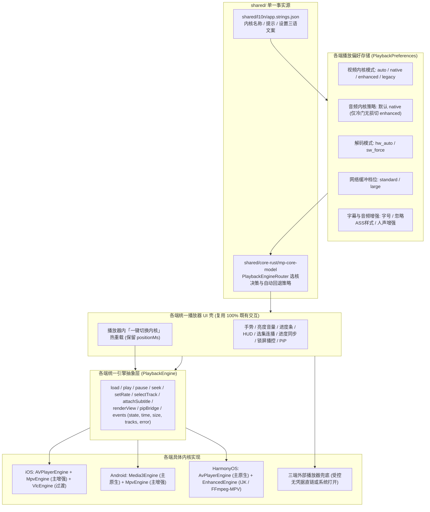
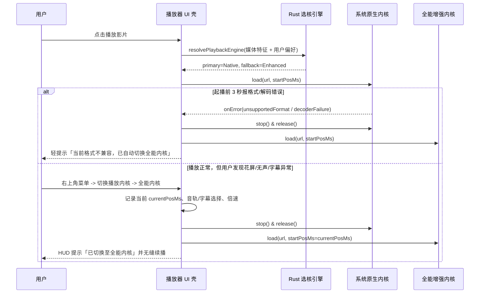

# MoviePilot-App 三端多内核媒体播放架构与用户内核设置设计方案

> 适用仓库：`MoviePilot-App`（Rust 共享内核 `shared/core-rust/` + iOS / Android / HarmonyOS NEXT）
> 许可证兼容性：`MoviePilot-App` 采用 `GPL-3.0-only`，可直接合规集成 `libmpv`、`FFmpeg`、`libass`、`libplacebo`、`VLCKit`、`@ohos/ijkplayer` 等开源播放引擎
> 核心约束：保持三端全原生架构与既有 UI/手势/PiP/锁屏播控/进度同步体验不回退；不引入 WebView 播放器；严格遵守同源鉴权边界，禁止向外部域名或第三方播放器泄露实例凭据
> 编写日期：2026-11-25

---

## 一、背景与三端现状审计

`MoviePilot-App` 面向 NAS、PT、Emby / Jellyfin / Plex / 飞牛 / 极影视 / 绿联及网盘 STRM 观影用户，媒体来源天然呈两极分化：

- **轻量常规场景**：MP4 / HLS 流、标准 H.264/HEVC 剧集、日常音乐、移动网络通勤、AirPlay/系统投屏 —— 追求**极速起播、超低功耗、原生 HDR 与系统级稳定性**；
- **硬核原盘与动漫场景**：4K MKV Remux、DTS / TrueHD / EAC3 多声道音轨、Dolby Vision（Profile 5/7/8）、高码率网盘 STRM、特效 ASS 字幕、蓝光图形字幕（PGS / VobSub） —— 追求**全格式软硬解通吃、完整 `libass` 排版特效、色调映射与大缓冲抗抖动**。

单一播放内核无法在三端同时兼顾这两种诉求。当前三端代码现状与核心短板如下：

| 平台 | 当前内核与关键文件 | 核心优势 | 核心短板与风险 |
| :--- | :--- | :--- | :--- |
| **iOS / iPadOS** | 单一 `VLCKit 4.x` 预览提交 `3d0f0fa7` + `AVKit` 仅用于 PiP 与音频路由<br>（`ios/project.yml`、`ios/MoviePilot/MediaPlaybackController.swift`、`ios/MoviePilot/MediaPictureInPictureController.swift`） | MKV/DTS/TrueHD/ASS/PGS 格式覆盖全；已通过提取 `AVSampleBufferDisplayLayer` 跑通原生 PiP，并有 `teardownQueue` 防销毁死锁 | 1. 依赖 4.x 非正式预览版，存在上游变更与 Seek 稳定性风险；<br>2. 常规 MP4/HLS 与音乐也走 libVLC，起播慢、功耗发热偏高；<br>3. Dolby Vision / HDR10 EDR 与色彩映射偏弱；<br>4. 不走 `URLSession`，缓冲硬编码 `:network-caching=1500`，复杂 302/自签 TLS 可控性弱；<br>5. 无法走原生视频 AirPlay；播放器内无外部播放器呼起入口 |
| **Android** | `Media3 ExoPlayer 1.5.1` + `org.jellyfin.media3:media3-ffmpeg-decoder` + `OkHttpDataSource`<br>（`android/core-media/src/main/java/com/moviepilot/media/NativePlayerScreen.kt`、`PlaybackHttpDataSource.kt`、`MoviePilotPlaybackService.kt`） | 系统融合、续航与起播速度极佳；OkHttp 拦截器实现每跳 302 同源凭据隔离与自签 TLS；音频 FFmpeg 软解完善；已有播放器内外部播放器选择器 | 1. `media3-ffmpeg-decoder` **仅限音频解码**，`hwDecode=false` 只切换音频扩展优先，**无视频软解能力**（AV1/Hi10P/MPEG-2/VC-1/特殊 Profile 仍会黑屏或报错）；<br>2. 原生 `SubtitleView` 对复杂 ASS 样式与蓝光 PGS 渲染弱；<br>3. 未自定义 `DefaultLoadControl`，高码率 4K/STRM 缓冲偏保守；<br>4. 未提供 `SurfaceView`/`TextureView` 渲染视图切换 |
| **HarmonyOS NEXT** | 纯系统 `media.AVPlayer` + `XComponent(SURFACE)` + ArkTS 纯文本字幕解析<br>（`harmony/commons/media_player/src/main/ets/NativeMediaPlayerView.ets`、`HarmonyAudioSession.ets`、`SubtitleAndLyricsParser.ets`） | 零包体膨胀；麒麟硬解功耗低；支持 `showFirstFrameOnPrepare`；`PiPWindow` + `AVSession` + 后台音频任务完整 | 1. **格式兼容短板最明显**：MKV 多轨、DTS/TrueHD/AC3/EAC3 常出现无声、无法解码或 Seek 异常；<br>2. 外挂 ASS 字幕正则清空所有 `{...}` 样式，不支持 PGS/VobSub，倍速受限于 6 档系统枚举；<br>3. 系统 `AVPlayer` 对 NAS 自签 HTTPS 兼容性较弱；<br>4. 播放器内缺少呼起外部播放器的兜底入口 |

同时，三端当前播放器 UI 与底层具体引擎高度耦合在单文件中：
- iOS：`MediaPlaybackController.swift`（约 4070 行，直接持有 `VLCMediaPlayer`）
- Android：`NativePlayerScreen.kt`（约 2910 行，直接操作 `ExoPlayer`）
- HarmonyOS：`NativeMediaPlayerView.ets`（约 2800 行，直接持有 `media.AVPlayer`）

若直接在现有巨型文件中堆叠 `if/else` 多内核分支，将导致维护成本急剧上升。因此本方案采用**「先抽象引擎协议解耦 → 再按 ROI 分阶段接入多内核 → 统一三端用户内核设置与自动兜底」**的演进路线。

---

## 二、总体架构与核心原则

### 2.1 目标架构图



### 2.2 五项架构原则

1. **音视频分流（默认省电）**：音频播放默认走**系统原生内核**（iOS `AVPlayer`、Android `Media3+FFmpeg`、鸿蒙 `AVPlayer`），仅当遇到系统不支持的冷门音频格式（如 `.ape`、`.dsf`、`.dff`、`.wv`、`.ac3`、`.dts` 等）且平台具备增强内核时自动切换增强内核。
2. **智能自动 + 用户显式覆盖**：默认模式为 `auto`，普通用户零学习成本；高级用户可在「播放偏好」固定内核，或在播放中右上角菜单**单片一键切核重载**并保留当前播放进度。
3. **两级自动兜底链（沿用既有容错思想）**：
   - 已有链路：`STRM 直链` 失败 → 自动回退 `服务端代理流`；
   - 新增链路：`auto` 模式下原生内核在起播前 3 秒内发生解码/封装/音轨致命错误 → 自动无缝切换至增强内核并保留 `resumePositionMs`，同时弹出轻提示；若已是增强内核仍失败，再走代理回退或提示外部打开。
4. **UI 与引擎彻底解耦**：所有手势（双击暂停、长按 2x、左右滑动进度、上下亮度音量）、锁屏、连播倒计时、Rust 播放进度同步状态机（`PlaybackProgressReporter` / `PlaybackSyncSessionTracker`）全部留在外层容器，不与具体引擎绑定。
5. **严格同源与安全边界**：
   - 同源代理流继续复用各端安全凭据策略（同源注入 Cookie/Bearer，302 跨源剥离）；
   - 外部播放器唤起仅允许传递无实例凭据的 STRM 直链、本地文件 URI 或受控临时签名流，**严禁泄露实例主 `Authorization` / `Cookie` 给外部应用**。

---

## 三、共享契约与 Rust 决策层（`shared/`）

将三端一致的内核枚举、默认路由规则和能力判定沉淀到 Rust 共享内核（`shared/core-rust/crates/mp-core-model/`），再通过 `mp-ffi-uniffi`（iOS / Android）与 `mp-ffi-ohos`（HarmonyOS）暴露，确保三端在 `auto` 模式下的行为可单测、零漂移。

### 3.1 统一偏好 Schema（跨端对齐）

在 `shared/contracts/` 新增 `playback-engine-policy.yaml`（或文档化为统一键表），三端持久化存储按下列语义对齐：

| 设置项 | 语义值枚举 | 默认值 | 适用平台 | 说明 |
| :--- | :--- | :--- | :--- | :--- |
| `videoEngine` | `auto` / `native` / `enhanced` / `legacy` | `auto` | 全三端 | `legacy` 仅 iOS 过渡期用于保留 `VLCKit` |
| `decodeMode` | `hw_auto` / `sw_force` | `hw_auto` | 全三端 | 硬解优先（失败回退软解）vs 强制软解（仅增强内核支持视频软解） |
| `bufferProfile` | `standard` / `large` | `standard` | 全三端 | 标准缓冲 vs 大缓冲（高码率 4K Remux / 外网 STRM 推荐） |
| `audioNightMode` | `bool` | `false` | 全三端 | 多声道下混人声增强 / 动态范围压缩（手机外放看电影防人声过小） |
| `ignoreAssStyle` | `bool` | `false` | 全三端 | 忽略 ASS 特效样式并以统一纯文本排版显示（小屏竖屏场景） |
| `subtitleScale` | `0.85` / `1.0` / `1.15` / `1.3` | `1.0` | 全三端 | 字幕字号缩放倍率 |
| `androidSurfaceType` | `surface` / `texture` | `surface` | 仅 Android | 解决极少数机型 `SurfaceView` HDR/旋转异常 |
| `externalPlayerTemplate` | `string`（空则走系统默认） | `""` | iOS / Android / 鸿蒙 | 可选用户自定义外部播放器 URL Scheme 模板（支持 `{url}`、`{title}` 占位符，不含任何硬编码第三方品牌） |

各端持久化 Key 约定（延续现有命名风格）：
- **iOS（`UserDefaults`）**：`nativeV2.playback.videoEngine`、`nativeV2.playback.decodeMode`、`nativeV2.playback.bufferProfile`、`nativeV2.playback.audioNightMode`、`nativeV2.playback.ignoreAssStyle`、`nativeV2.playback.subtitleScale`、`nativeV2.playback.externalPlayerTemplate`
- **Android（`PlaybackPreferencesStore` in `AppearanceStore.kt`）**：`video_engine`、`decode_mode`（兼容迁移旧 `hw_decode`）、`buffer_profile`、`audio_night_mode`、`ignore_ass_style`、`subtitle_scale`、`surface_type`
- **HarmonyOS（`PlaybackPreferencesStore.ets`）**：`mp_playback_video_engine`、`mp_playback_decode_mode`、`mp_playback_buffer_profile`、`mp_playback_audio_night_mode`、`mp_playback_ignore_ass_style`、`mp_playback_subtitle_scale`

### 3.2 Rust 选核决策函数（`mp-core-model/src/playback_engine.rs`）

新增纯函数与黄金单元测试：

```rust
pub enum PlatformKind { Ios, Android, Harmony }
pub enum PlaybackEngineChoice { Auto, Native, Enhanced, Legacy }
pub enum ResolvedPlaybackEngine { Native, Enhanced, Legacy }

pub struct EngineResolutionInput {
    pub platform: PlatformKind,
    pub preferred: PlaybackEngineChoice,
    pub is_audio: bool,
    pub decode_force_software: bool,
    pub has_enhanced_engine: bool,
    pub has_legacy_engine: bool,
    pub url_or_filename: String,
    pub container_hint: Option<String>,      // 例如 "mkv", "mp4", "hls", "ts", "flv"
    pub audio_codec_hint: Option<String>,    // 例如 "dts", "truehd", "eac3", "ac3", "aac"
    pub video_codec_hint: Option<String>,    // 例如 "hevc", "av1", "vc1", "mpeg2"
    pub has_ass_or_pgs_subtitle: bool,
    pub allow_self_signed_tls: bool,
}

pub struct EngineResolutionPlan {
    pub primary: ResolvedPlaybackEngine,
    pub fallback: Option<ResolvedPlaybackEngine>,
    pub reason_code: String, // 例如 "user_pinned", "audio_native", "mkv_or_ass_enhanced", "harmony_self_signed_tls"
}
```

**`auto` 模式默认决策矩阵**：
1. 若 `preferred != Auto` 且目标内核在当前平台可用 → `primary = preferred`，且设置另一个可用内核作为手动切换建议（不静默篡改用户强制锁定的内核，除非用户开启「失败自动切核」）。
2. 若 `decode_force_software == true` 且 `!is_audio` 且 `has_enhanced_engine` → `primary = Enhanced`（因为原生内核不提供完整视频软解）。
3. 若 `is_audio == true`：
   - 常规格式（`mp3`, `aac`, `m4a`, `flac`, `alac`, `wav`, `ogg`, `opus`）→ `primary = Native`，`fallback = Enhanced`；
   - 冷门格式（`ape`, `wv`, `dsf`, `dff`, `dts`, `ac3`）→ `primary = Enhanced`（若可用），否则 `Native`。
4. 若 `is_audio == false`（视频）：
   - **iOS**：
     - 标准 `mp4`/`m4v`/`mov`/`m3u8` 且无 ASS/PGS 外挂、非 DTS/TrueHD、非自签 TLS → `primary = Native (AVPlayer)`，`fallback = Enhanced (MPV)`；
     - 其余（`mkv`/`ts`/`avi`/含 ASS 或 PGS/DTS/TrueHD/未知直链或代理流）→ `primary = Enhanced (MPV)`，`fallback = Legacy (VLCKit)` 或 `Native`。
   - **Android**：
     - 大多数流（包括 MP4/HLS/MKV + AC3/EAC3/DTS/TrueHD，因 Media3 已有 FFmpeg 音频扩展）→ `primary = Native (Media3)`，`fallback = Enhanced (MPV)`；
     - 显式检测到 **ASS/SSA 特效字幕（且未开启忽略样式）**、**PGS/VobSub 图形字幕**、或已知硬解弱项（`vc1`/`mpeg2`/`hi10p`/`rmvb`）→ `primary = Enhanced (MPV)`，`fallback = Native (Media3)`。
   - **HarmonyOS**：
     - 标准 `mp4`/`m3u8` 且音频非 DTS/TrueHD/AC3/EAC3、无自签 HTTPS、无 ASS/PGS → `primary = Native (AVPlayer)`，`fallback = Enhanced`；
     - 检测到 `mkv`/`ts`/`flv`/`rmvb`/DTS/TrueHD/AC3/EAC3/自签 HTTPS/ASS 特效字幕（且 `has_enhanced_engine == true`）→ `primary = Enhanced`，`fallback = Native`。

### 3.3 多语言 SSOT 同步

所有新增设置文案与提示语统一写入 `shared/l10n/app.strings.json`（简中 / 繁中 / 英文三语齐备），并执行 `python3 tools/sync-all.py && python3 tools/sync-all.py --check` 同步至三端，严禁绕过 SSOT 硬编码散落文案。

---

## 四、三端统一播放引擎抽象（`PlaybackEngine`）

在接入第二内核前，三端需先建立语义一致的引擎协议，彻底隔离播放器 UI 与具体内核库。

### 4.1 统一能力契约

| 接口分类 | 方法 / 属性 | 语义约定 |
| :--- | :--- | :--- |
| **生命周期** | `load(source: EngineMediaSource, options: EngineLoadOptions)` | 注入 URL/FD、同源与跨源请求头、自签 TLS 开关、起始位置 `startPositionMs`、缓冲档位、解码模式、音频增强参数 |
| **播控操作** | `play()` / `pause()` / `stop()` / `release()` | `release()` 必须异步安全释放底层原生解码器，严禁阻塞 UI 主线程（延续 iOS `teardownQueue` 经验） |
| **进度与倍速** | `seek(toMs: Long, exact: Boolean)` / `setRate(rate: Float)` | 支持至少 `0.5x ~ 2.0x`（增强内核支持扩展至 `3.0x`） |
| **画面与渲染** | `renderHostView` / `setScaleMode(mode)` | 提供宿主视图（iOS `UIView`、Android `View`、鸿蒙 `XComponentController`）；支持 `fit` / `fill` / `stretch` |
| **轨道与字幕** | `audioTracks` / `subtitleTracks` / `selectAudioTrack(id)` / `selectSubtitleTrack(id?)` / `addExternalSubtitle(source)` | 统一封装内封轨道与外挂字幕加载；统一对外暴露 `EngineTrack(id, label, language, codec, isExternal, isSelected)` |
| **状态事件流** | `onStateChanged` / `onTimeChanged` / `onVideoSizeChanged` / `onTracksChanged` / `onSubtitleText` / `onError` | 明确区分 `PlaybackEngineErrorKind`（`network` / `auth` / `unsupportedFormat` / `decoderFailure` / `unknown`），供外层决定切核还是切代理 |
| **能力声明** | `capabilities: EngineCapabilities` | 声明 `supportsPiP`、`supportsAirPlayVideo`、`supportsAssStyling`、`supportsSoftwareVideoDecode`、`maxRate`，UI 按能力动态展示/隐藏控件 |

### 4.2 拆分目录建议

- **iOS**：新增 `ios/MoviePilot/Playback/` 目录
  - `PlaybackEngine.swift`（协议、模型、错误分类、能力集）
  - `PlaybackEngineFactory.swift`（调用 Rust 决策 + 创建引擎）
  - `Engines/AVPlayerPlaybackEngine.swift`
  - `Engines/MpvPlaybackEngine.swift`
  - `Engines/VlcPlaybackEngine.swift`（从 `MediaPlaybackController.swift` 抽离现有 VLCKit 逻辑）
  - `ExternalPlayerLauncher.swift`（iOS 外部播放器自定义模板与安全校验）
  - `MediaPlaybackController.swift` 瘦身为纯 UI 与流程协调器（只依赖 `any PlaybackEngine`）
- **Android**：扩展 `android/core-media/src/main/java/com/moviepilot/media/engine/`
  - `PlaybackEngine.kt`
  - `PlaybackEngineFactory.kt`
  - `Media3PlaybackEngine.kt`（抽离现有 `buildConfiguredExoPlayer`、`PlayerView`、轨道与 `DefaultLoadControl`）
  - `MpvPlaybackEngine.kt`（封装 `libmpv` JNI、`SurfaceView` 渲染、属性订阅与 `MediaSession` 转发）
  - `NativePlayerScreen.kt` 瘦身为纯 Compose UI + `PlaybackEngine` 协调层
- **HarmonyOS**：扩展 `harmony/commons/media_player/src/main/ets/engine/`
  - `PlaybackEngine.ets`
  - `PlaybackEngineFactory.ets`
  - `AvPlayerPlaybackEngine.ets`（抽离现有 `media.AVPlayer` 与 `attachSourceToAvPlayer`）
  - `EnhancedPlaybackEngine.ets`（封装 `@ohos/ijkplayer` 或自编译 NDK FFmpeg/MPV 引擎）
  - `HarmonyExternalPlayerLauncher.ets`（基于 `Want` 拉起系统外部视频播放器）
  - `NativeMediaPlayerView.ets` 仅依赖 `PlaybackEngine` 接口

---

## 五、各端多内核详细设计

### 5.1 iOS / iPadOS：`AVPlayer` + `libmpv (MPVKit)` + 过渡期 `VLCKit`

1. **原生内核 `AVPlayerPlaybackEngine`（`AVFoundation` + `AVKit`）**：
   - **定位**：音频默认主力 + 标准 MP4/HLS 视频省电模式 + 原生视频 AirPlay。
   - **关键实现细节**：
     - 使用 `AVURLAsset` + `AVURLAssetHTTPHeaderFieldsKey` 注入同源 Cookie 或外部 STRM 请求头；对需精细控制 302 剥离或自签 TLS 的同源流，使用 `AVAssetResourceLoaderDelegate` 或本地回环/URLSession 代理，避免凭据泄露。
     - 直接对接系统 `AVPictureInPictureController(playerLayer:)`，获得最稳的系统画中画；开放 `player.allowsExternalPlayback = true` 支持原生 AirPlay 视频直投。
     - 音频场景完美替代当前用 VLCKit 播音乐的高耗电实现，支持无损 FLAC / ALAC / AAC / MP3 与 `MPNowPlayingInfoCenter` 锁屏同步。
2. **全能增强内核 `MpvPlaybackEngine`（基于 `MPVKit` / `libmpv` + Metal/`libplacebo`）**：
   - **定位**：替代 `VLCKit 4.x` 成为硬核视频默认增强内核。
   - **依赖引入**：在 `ios/project.yml` 引入官方/成熟预编译 SPM 二进制包（`MPVKit` / `KSPlayer` 底层 FFmpeg+libmpv+libass+MoltenVK/libplacebo XCFramework，支持 GPL 版本以获得完整解码器）。
   - **关键参数映射**：
     - 硬件解码：`hwdec=videotoolbox`（`hw_auto`）或 `hwdec=no`（`sw_force`）；
     - 色彩与 HDR：`vo=gpu-next` + `gpu-api=vulkan`（MoltenVK）或 `libmpv` 原生 Metal 渲染管线，`target-colorspace-hint=yes` 启用 HDR/EDR 输出，自动处理 Dolby Vision Profile 5/7/8 色调映射；
     - 网络与缓冲：`cache=yes`；`standard` 对应 `demuxer-max-bytes=64MiB`、`demuxer-readahead-secs=20`；`large` 对应 `demuxer-max-bytes=180MiB`、`demuxer-readahead-secs=60`；支持 `http-header-fields` 与 `tls-verify=no`（仅当实例显式开启自签名证书开关时）；
     - 字幕：`sub-ass-override=yes/no` 绑定 `ignoreAssStyle`，`sub-scale` 绑定 `subtitleScale`，内置中文字体回退（系统 PingFang SC）避免 ASS 缺字变方块；
     - 音频人声增强：`audioNightMode=true` 时挂载 `af=acompressor=ratio=4:makeup=4`（或 `lavfi=[dynaudnorm]`）；
     - 画中画（PiP）：若使用 `AVSampleBufferDisplayLayer` 输出模式（参考成熟 iOS mpv/Metal 渲染路径），复用现有 `MediaPictureInPictureController` 实现无断流系统 PiP；若某版本渲染模式暂不支持 PiP，通过 `capabilities.supportsPiP = false` 明确隐藏 PiP 按钮而非静默报错。
3. **过渡期兼容内核 `VlcPlaybackEngine`**：
   - 先将现有 `VLCMediaPlayer` 抽离到 `VlcPlaybackEngine`，并将 `:network-caching` 由硬编码 `1500` 改为 `standard=2000` / `large=6000`；
   - 待 `MpvPlaybackEngine` 在真机完成 2 个小版本稳定验证后，可在后续版本移除 `VLCKit 4.x` 依赖，大幅减小 IPA 体积。
4. **iOS 外部播放器支持**：
   - 在视频右上角更多菜单新增「使用外部播放器打开」；
   - 支持两种模式：① 系统 `UIActivityViewController` 分享/打开文件或直链；② 若用户在设置中配置了自定义 `externalPlayerTemplate`（如 `scheme://play?url={url}`），先校验 Scheme 合法性（禁止 `javascript:`/`file:` 等危险协议）与链接无实例主凭据后调用 `UIApplication.shared.open`。

---

### 5.2 Android：`Media3 (ExoPlayer)` 增强调优 + `libmpv` 全能内核

1. **原生内核 `Media3PlaybackEngine`（既有主力内核深度优化）**：
   - **自定义 `DefaultLoadControl`**：
     - `standard`：`minBufferMs = 15_000`、`maxBufferMs = 50_000`、`bufferForPlaybackMs = 2_500`、`bufferForPlaybackAfterRebufferMs = 5_000`；
     - `large`：`minBufferMs = 30_000`、`maxBufferMs = 120_000`、`bufferForPlaybackMs = 4_000`、`bufferForPlaybackAfterRebufferMs = 8_000`（显著改善高码率 4K 与外网 STRM 播放流畅度）。
   - **支持 `SurfaceView` / `TextureView` 切换**：依据 `androidSurfaceType` 构造对应 `PlayerView`（通过 XML inflate 或自定义 surface type），解决极少数国产 ROM 上 HDR 偏色或旋转黑边问题。
   - **修正旧「硬件解码」语义**：将 `hwDecode` 升级为 `decodeMode`（`hw_auto` / `sw_force`）；在 Media3 内核中标注「视频强制软解需切换至全能增强内核（MPV）」，不再让用户误以为关闭开关就能视频软解。
   - **音频人声增强**：通过 `AudioSessionId` 绑定 Android 原生 `DynamicsProcessing`（API 28+，本项目 `minSdk = 29` 全覆盖）实现零额外依赖的多声道人声动态增强。
2. **全能增强内核 `MpvPlaybackEngine`（`libmpv` JNI + OpenGL ES / Vulkan）**：
   - **定位**：按需切换或自动路由，彻底解决视频软解（AV1/Hi10P/MPEG-2/VC-1）、完整 `libass` 动漫特效字幕、蓝光 PGS/VobSub、复杂 MKV/Dolby Vision 映射。
   - **模块隔离与 ABI 对齐**：
     - 新建独立 Gradle 模块 `android/core-media-mpv`（或接入成熟开源 `libmpv-android` AAR），严守 `android/AGENTS.md` 约定：原生 `.so` 架构与 `MOVIEPILOT_ABI_FILTERS`（`arm64-v8a` 主包、`arm64-v8a + armeabi-v7a + x86_64` 通用包）完全对齐；
     - 渲染：`SurfaceView` 绑定 `MPVLib.attachSurface(surface)`，`vo=gpu`（或 `gpu-next`），`hwdec=mediacodec-copy`（硬解优先，兼容滤镜/字幕叠加）或 `hwdec=no`（强制软解）；
     - 鉴权与同源安全：复用现有 `PlaybackHttpDataSource` 安全规则 —— 对于需要跨源 302 剥离凭据的同源代理流，可在 Android 端起一个**仅监听 `127.0.0.1` 随机端口 + 一次性随机 Token 校验的极简 OkHttp 本地转发代理**（仅生命周期内存活），让 `libmpv` 经本地转发复用 OkHttp 的自签 TLS 证书信任与跨源凭据剥离能力！这是同时解决 libmpv 网络层安全与自签 TLS 的最稳妥方案；
     - 系统集成：实现轻量 `SimpleBasePlayer`（Media3 提供的官方抽象基类）包装 `MpvPlaybackEngine`，无缝接入现有的 `MoviePilotPlaybackService`（锁屏、通知栏、蓝牙车机、耳机拔出暂停全部自动复用，零重复开发！）。
3. **Android 外部播放器增强**：
   - 保留现有 `ExternalPlayerLauncher.launchExternalPlayerChooser`，在设置页新增「默认使用外部播放器」选项，同时加强安全校验：同源代理流不把实例主 `Authorization` / `Cookie` 暴露给外部应用。

---

### 5.3 HarmonyOS NEXT：系统 `AVPlayer` + 增强内核（分两步演进）+ 外部拉起

鸿蒙端是当前三端中格式兼容差距最大的一端，但同时需要兼顾 HarmonyOS NEXT 生态成熟度与 CI 打包稳定性（`tools/harmony/Dockerfile.ohos-ci`）。建议采用**清晰的两步演进**：

1. **原生内核 `AvPlayerPlaybackEngine`（优化保留）**：
   - 抽离现有 `media.AVPlayer` 代码；
   - 按 `bufferProfile` 动态设置 `PlaybackStrategy.preferredBufferDuration`（`standard = 20`，`large = 60`）；
   - 增强 `SubtitleAndLyricsParser.ets`：补充字号倍率 `subtitleScale` 与安全区底部偏移；支持更多编码自动检测（UTF-8 / UTF-16 / GBK 常见中文字幕不再乱码）。
2. **全能增强内核 `EnhancedPlaybackEngine`（二选一渐进落地）**：
   - **路线 1（P1 快速落地，推荐优先）：接入 OpenHarmony-SIG 官方维护的 `@ohos/ijkplayer`**
     - 通过 `ohpm` 引入 `@ohos/ijkplayer`，底层基于 FFmpeg 封装，原生对接鸿蒙 `XComponent(SURFACE)` + NAPI；
     - **立即收益**：补齐 MKV / FLV / TS / M2TS 封装与 **DTS / TrueHD / AC3 / EAC3 / FLAC** 音轨解码，支持软件视频解码、0.5x~3.0x 自由倍速、以及自定义 HTTP Headers 与弱网缓冲策略；
     - 需注意验证 CI 环境（`Dockerfile.ohos-ci`）下的 HAR / `.so` 架构（`arm64-v8a`）打包与 `verify-hap.py` 校验通过。
   - **路线 2（P2 终极形态，可选演进）：基于现有 NDK 流水线交叉编译 `libmpv`（或 FFmpeg + `OH_AVCodec` + `libass`）**
     - 当团队需要鸿蒙端也达到与 iOS/Android 一致的 **满血 `libass` 动漫特效字幕 + PGS 图形字幕 + Dolby Vision 色调映射** 时，在 `tools/harmony/` 已有 OHOS NDK 基础上构建 `arm64-v8a` 静态/动态库，复用同一个 `EnhancedPlaybackEngine` 接口无缝替换，上层 UI 与设置页零改动。
3. **鸿蒙外部播放器兜底（`HarmonyExternalPlayerLauncher.ets`）**：
   - 在视频播放器右上角更多菜单新增「使用其他应用播放」，通过 `UIAbilityContext.startAbility` 发起 `ohos.want.action.viewData`（附 `uri` 与 `type: 'video/*'`）拉起系统或用户已安装的其他本地视频应用（同样遵循仅传无主凭据直链或本地文件 URI 的安全边界）。

---

## 六、用户可见设置与交互设计

### 6.1 设置页「播放偏好」统一布局（三端对齐原生视觉）

在三端现有「播放偏好」页面（iOS `NativePlaybackPreferencesPage`、Android `PlaybackSettingsScreen`、HarmonyOS `SettingsPages.ets`）新增「播放内核与解码」分组：

1. **播放内核**（分段/列表选择，附副标题说明）：
   - **自动选择（推荐）** —— 常规影片与音乐走系统原生内核省电秒开；MKV、多声道原盘或特效字幕自动切至全能内核
   - **系统原生内核** —— 起播最快、最省电（iOS 支持原生视频 AirPlay）
   - **全能增强内核** —— 全格式直播、支持视频软解、特效字幕与 DTS/TrueHD 音轨
   - *（仅 iOS 过渡期）* **兼容内核（VLCKit）** —— 旧版全格式兼容备用
2. **解码模式**：`硬件解码优先（推荐）` / `强制软件解码`（若当前固定为原生内核且选强制软解，页内给出轻提示说明仅全能内核支持视频软解）
3. **网络缓冲**：`标准` / `大缓冲（4K / 网盘 STRM 推荐）`
4. **声音与字幕**（可折叠或紧随其后）：
   - `夜间模式 / 人声增强`（开关）
   - `忽略 ASS 字幕特效样式`（开关）
   - `字幕字号`（小 / 标准 / 大 / 特大）
5. **外部播放器**：
   - Android / 鸿蒙：开关「默认调用外部播放器」
   - iOS：自定义外部播放器 URL Scheme 模板（选填，留空则播放器内走系统打开方式）

### 6.2 播放器内「一键切换内核」与自动回退交互



**关键体验细节**：
- 切核重载期间**不触发 `stopped` 进度上报给媒体服务器**，避免 Emby/Jellyfin/Plex 仪表盘会话闪断；保持同一个 `play_session_id` 与进度同步状态机连续运行。
- 播放器右上角「更多」菜单显示当前实际生效内核徽标（如 `内核：系统原生` / `内核：MPV 全能`），排查用户反馈问题一目了然。

---

## 七、安全边界、性能与构建包体约束

1. **凭据零泄露红线**：
   - 无论原生内核还是增强内核，跨源 301/302/307/308 重定向必须剥离实例 `Authorization` 与 `Cookie`；
   - Android `MpvPlaybackEngine` 通过本地环回一次性 Token OkHttp 代理复用 `PlaybackHttpDataSource` 全部安全拦截逻辑；
   - iOS / Android / 鸿蒙的外部播放器拉起**严禁**将实例主 JWT 或登录 Cookie 拼入外部 URL 或 Intent Headers。
2. **包体体积控制**：
   - **iOS**：引入 `MPVKit` 后预计增重约 25~45 MB；待稳定替代 `VLCKit 4.x`（当前约 40~60 MB）后总包体反而可持平或更小。
   - **Android**：
     - `arm64-v8a` 主包引入 `libmpv` 预计增重约 15~22 MB，完全可接受；
     - `MOVIEPILOT_ABI_FILTERS` 必须同步约束 `libmpv` `.so` 裁剪，防止 `arm64-v8a` 单架构包混入多余 ABI；
     - 本地构建缓存严格位于 `/Volumes/DISK/Android/gradle-home` 与 `/Volumes/DISK/TmpBuild/`，严禁污染 `/tmp`。
   - **HarmonyOS**：`@ohos/ijkplayer` 仅打包 `arm64-v8a` `.so`（约 10~18 MB），须确保 `tools/harmony/verify-hap.py` 与 `Dockerfile.ohos-ci` 离线/在线构建链路稳定。
3. **Swift 6 / ArkTS / Kotlin 规范约束**：
   - iOS：所有引擎回调通过 `@MainActor` / `Sendable` 边界隔离，底层释放放专用串行队列，通过 `xcrun swift-format lint --strict`；
   - Android：新增类型与公共方法补齐中文 KDoc；确保 `SimpleBasePlayer` 线程回调在 `Looper.getMainLooper()` 执行；
   - HarmonyOS：严格 ArkTS 静态类型（无 `any`/隐式对象索引），半模态菜单统一使用原生 `bindSheet`。

---

## 八、分阶段实施路线图与验收清单

建议按以下 **4 个独立可合入的阶段（Phase）** 交给 AI 分步实施，每阶段均可独立编译、单测并交付可用增量：

### Phase 1：架构解耦、Rust 选核层与现有内核立即可得优化（低风险 / 零新二进制依赖）
- **改动范围**：
  1. `shared/core-rust/crates/mp-core-model` 新增 `playback_engine.rs` 选核决策与单元测试，经 `mp-ffi-uniffi` 与 `mp-ffi-ohos` 导出；
  2. `shared/l10n/app.strings.json` 补充三端新设置文案并运行 `tools/sync-all.py`；
  3. 三端各自抽象 `PlaybackEngine` 接口，将现有内核（iOS `VLCKit`、Android `Media3`、鸿蒙 `AVPlayer`）迁入独立 Engine 类，播放器主界面改为面向接口编程；
  4. 立即可得调优：
     - iOS：放开 `:network-caching` 档位配置 + 新增自定义模板/系统外部播放器呼起；
     - Android：新增 `DefaultLoadControl` 缓冲档位 + `SurfaceView`/`TextureView` 切换 + `DynamicsProcessing` 人声增强；
     - 鸿蒙：放开 `preferredBufferDuration` 档位 + 字幕 GBK 编码兼容与字号设置 + `Want` 外部播放器呼起。
- **验收标准**：
  - `python3 tools/sync-all.py --check`、`cargo test --workspace` 全绿；
  - 三端既有播放器功能、PiP、锁屏播控、STRM 回退、进度同步单元测试与构建全部通过，零回归。

### Phase 2：HarmonyOS 引入第二内核（消除最大格式兼容短板）
- **改动范围**：
  1. 在 `harmony/commons/media_player` 引入 `@ohos/ijkplayer`（或预研确认的 NDK FFmpeg 内核）实现 `EnhancedPlaybackEngine.ets`；
  2. 接入 `PlaybackEngineFactory.ets`、设置页内核选项、播放器内「一键切换内核」及起播 3 秒内自动回退；
  3. 验证 `tools/harmony/build-harmony.sh` 与 `tools/harmony/verify-hap.py`。
- **验收标准**：
  - 鸿蒙端可流畅播放 **MKV + DTS/AC3/EAC3 音轨** 与 **4K H.265 MKV**，且支持 0.5x~2.0x+ 倍速与无断流切换内核；
  - 常规 MP4/HLS 默认走 `AVPlayer`，PiP 与 `AVSession` 保持正常。

### Phase 3：Android 引入 `libmpv` 全能增强内核
- **改动范围**：
  1. 新增 `android/core-media-mpv` 模块集成 `libmpv` 与 ABI 过滤配置；
  2. 实现 `MpvPlaybackEngine.kt`、本地环回一次性 Token OkHttp 安全转发器，以及 `SimpleBasePlayer` 桥接 `MoviePilotPlaybackService`；
  3. 打通设置页「播放内核 / 解码模式（真正支持视频软解）/ 忽略 ASS 样式 / 字幕字号」与播放器内一键切核重载。
- **验收标准**：
  - Android 端可流畅播放 **ASS 复杂特效动漫字幕、PGS 蓝光图形字幕、强制软件解码视频流**；
  - 切核重载保留进度且不中断 Emby/Jellyfin/Plex 正在播放会话；
  - `bash tools/android/build-android.sh artifacts` 产出 `arm64-v8a` 与 `universal` 包通过 ABI 与签名结构校验。

### Phase 4：iOS 引入 `AVPlayer` + `MPVKit` 双内核（并评估退休 `VLCKit 4.x`）
- **改动范围**：
  1. 实现 `AVPlayerPlaybackEngine.swift`（音频默认内核 + 常规 MP4/HLS + 原生视频 AirPlay + 原生 `AVPictureInPictureController`）；
  2. 在 `ios/project.yml` 引入 `MPVKit`（外置依赖目录 `-clonedSourcePackagesDirPath /Volumes/DISK/Xcode/SourcePackages`），实现 `MpvPlaybackEngine.swift`（VideoToolbox 硬解、HDR/Dolby Vision 色调映射、libass 特效、大缓冲配置与人声增强）；
  3. 保留 `VlcPlaybackEngine.swift` 作为一个大版本周期的 `legacy` 兼容项，并在设置页与播放器菜单开放三核切换；
  4. 充分真机验证后，按需决定是否彻底移除 `VLCKit 4.x` 依赖。
- **验收标准**：
  - iOS 音频播放默认走 `AVPlayer`，待机功耗与起播速度显著改善；
  - 4K HDR10 / Dolby Vision MKV + 特效 ASS / PGS 字幕在 `MPV` 内核下画质、字幕与 Seek 流畅无撕裂；
  - `zsh tools/ios/test-core.sh`、`xcrun swift-format lint --strict` 与 `bash tools/ios/build-ipa.sh` 全绿。
