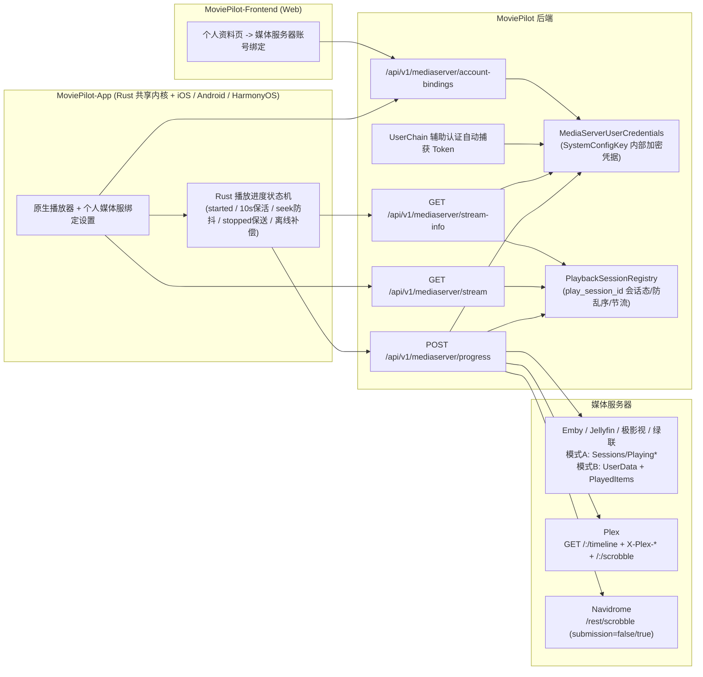

# MoviePilot 全平台媒体播放进度与实时会话同步设计方案

> 适用仓库：`MoviePilot`（后端 `v3`）、`MoviePilot-Frontend`（Web 前端 `v3`）、`MoviePilot-App`（Rust 共享内核 + iOS / Android / HarmonyOS NEXT `v2`）
> 编写日期：2026-11-25

---

## 一、背景与目标

当用户在 `MoviePilot-App`（iOS / Android / HarmonyOS NEXT）内播放已入库影视或音乐时，期望源媒体服务器（Emby / Jellyfin / Plex / 极影视 / 绿联媒体库服务 / Navidrome 等）能够完整感知播放状态与进度，实现：

1. **播放进度可靠持久化**：断点续播位置（继续观看）与完播自动标记已看在所有配置模式下稳定生效，不依赖用户重配密码也能兜底写入；
2. **实时「正在播放（Now Playing）」仪表盘展示与 Webhook 联动**：Emby / Jellyfin / Plex 仪表盘实时呈现独立客户端卡片（如 `MoviePilot (iPhone)`、`MoviePilot (Android)`、`MoviePilot (HarmonyOS)`），多台设备并发播放互不覆盖，并可关联原始流连接与触发播放 Webhook；
3. **多用户隔离与安全边界**：支持每名 MoviePilot 用户绑定各自的 Emby / Jellyfin / Plex 账号凭据（辅助认证自动捕获 + 个人中心/App 一键绑定），服务端加密持久化令牌且**绝不保存明文密码、绝不向客户端暴露媒体服务器 API Key 或用户令牌**；
4. **三端一致的容错状态机**：在 Rust 共享内核（`shared/core-rust/`）沉淀统一播放进度状态机与离线终态补偿规划，修复三端现有上报缺陷，覆盖起播、10 秒保活心跳（含暂停态）、Seek 即时上报、音轨字幕切换、终态保送防乱序、弱网补偿与退出刷新。

---

## 二、现状审计与根因分析

### 2.1 后端现状与核心缺口

1. **Emby / Jellyfin（`app/modules/_base/embybrowse.py`）**：
   - 仅用全局服务端 `?api_key=...` 调用 `Sessions/Playing/Progress` 与 `Sessions/Playing/Stopped`，缺少起播 `POST /Sessions/Playing` 与 `Authorization / X-Emby-Authorization` 客户端头；
   - 服务端全局 API Key 不绑定具体用户会话，在 Emby 4.8+ / Jellyfin 10.9+ 上往往直接返回 400/401 或静默 204 无效，导致不仅看不到「正在播放」，连 `PlaybackPositionTicks` 和已看状态也无法写入；
   - 缺少仅配置全局 API Key 时的 `UserData` / `PlayedItems` 兜底路径；
   - `authenticate()` 原固定使用 `DeviceId="1"`，多用户认证时存在同设备 ID 令牌互踢风险。
2. **Plex（`app/modules/_base/plexbrowse.py`）**：
   - 每次进度心跳都先调用 `plex.fetchItem()` 产生额外元数据请求；
   - 通过 `item.updateTimeline()` 沿用 `python-plexapi` 全局固定 `X-Plex-Client-Identifier` 与 `X-Plex-Product="PlexAPI"`，缺少单次会话独立的 `X-Plex-Session-Identifier`，多设备同时播放互相覆盖；
   - 拉流代理未透传同一组 `X-Plex-*` 会话头，且未支持按用户专属 Token 上报。
3. **其他媒体服务器**：
   - **极影视（ZSpace）/ 绿联（媒体库服务模式）**：已有用户登录 Token，可直接受益于 Emby 完整会话协议升级；
   - **Navidrome（Subsonic）**：尚未实现 `report_progress`（可补齐 Subsonic `/rest/scrobble`）；
   - **飞牛影视（TrimeMedia）/ 绿联内部模式**：上游暂无公开写回进度协议，需明确返回 `unsupported` 而非静默伪造成功。

### 2.2 客户端现状与具体缺陷

1. 三端均未在首帧起播时发送 `state="started"`，也未维护 `play_session_id`、`seq` 与累计实际播放时长 `playback_time_ms`；
2. iOS 与 HarmonyOS 暂停后停止定时器，超过 60~90 秒会被媒体服务器判定会话超时；
3. 三端拖动进度 / 快进退 / 从头开始后均未即时上报；
4. **iOS 特定缺陷**：`max(lastObservedPositionMs, Int(player.time.intValue))` 会导致向后拖动进度后立刻暂停/关闭时上报旧的更大位置；`progressReportTask?.cancel()` 叠加页面销毁会掐断 `stopped` 请求；`isTrustedMediaURL` 查询白名单未放行 `play_session_id`；
5. **Android 特定缺陷**：`NativePlayerScreen.kt` 的 `onDispose` 未在异常关闭路径兜底补发 `stopped`，视频与后台音频上报逻辑分散；
6. **HarmonyOS 特定缺陷**：视频与音频暂停即停止心跳，且缺少 Seek 上报与退场保送；
7. 退出播放后未通知详情页与「继续观看」列表刷新。

---

## 三、总体架构与数据流

所有播放进度和会话控制均由 `MoviePilot-App` 统一发往 `MoviePilot` 后端，再由后端按服务器类型与用户凭据状态路由至目标媒体服务器。即便启用「STRM 直链播放」，视频流量直连目标地址，进度心跳仍由 App 发往 MoviePilot 后端，同样具备完整进度同步与「正在播放」能力（外调第三方播放器脱离 App 控制，属于客观边界）。

---

## 四、后端详细设计（`MoviePilot`）

### 4.1 加密用户媒体服务器凭据存储与三级凭据策略

- **持久化键**：新增内部敏感配置键 `SystemConfigKey.MediaServerUserCredentials`（参照 `AppPushCredentials`，在 `app/application/settings/contract.py` 登记为 `_internal_contract("media_servers", ..., sensitive=True)`，在 `app/application/security/secrets.py` 登记敏感键，并更新 `system_settings_catalog.json`）。
- **加密方式**：使用 `app.application.security.token.encrypt_message` / `decrypt`，密钥从 `RESOURCE_SECRET_KEY` 经 SHA-256 + URL-safe Base64 派生为 Fernet 密钥，密文按 `username -> server_name` 存储：
  - `token_enc`：加密后的媒体服务器用户 `AccessToken` 或 `X-Plex-Token`；
  - `remote_username` / `remote_user_id`：媒体服务器侧展示用户名与用户 ID（可选）；
  - `source`：`"manual"` 或 `"auxiliary_auth"`；
  - `invalid`：布尔值，上游返回 401 时置为 `true`；
  - `updated_at`：最近更新时间戳（Unix 秒）。
- **绝不保存明文密码，绝不向客户端或日志输出令牌**。
- **三级凭据获取**：
  1. **辅助认证自动捕获**：`UserChain._process_auth_success()` 认证通过时，若来源为媒体服务器且返回了 `credentials.token` 与 `credentials.service`，自动加密保存至 `MediaServerUserCredentials`；
  2. **个人一键绑定 API**：
     - `GET /api/v1/mediaserver/account-bindings`：列出当前用户对各已启用媒体服务器的绑定状态与有效同步模式；
     - `POST /api/v1/mediaserver/account-bindings`：提交 `server`、`username`、`password`（Plex 也支持直接提交 `token`），调用对应模块验证并换取用户级令牌后加密保存；
     - `DELETE /api/v1/mediaserver/account-bindings/{server}`：解绑并删除当前用户在该服务器上的加密令牌；
  3. **零配置兜底**：Emby/Jellyfin 无用户令牌（或令牌失效 401）时，自动降级为全局 API Key 写入 `UserData` + `PlayedItems`；Plex 无绑定令牌时自动尝试 Plex Home 用户名匹配或回退服主令牌。

### 4.2 进程内播放会话注册表（`app/application/playback.py`）

新增 `PlaybackSessionRegistry`（`threading.RLock` 保护，容量上限 2048，TTL 12 小时）：

- 记录每次 `play_session_id` 对应的上下文：`user_id`、`username`、`server`、`server_type`、`item_id`、`media_source_id`、`upstream_play_session_id`、`client_id`、`device_name`、`platform`、`app_version`、`play_method`、`upstream_headers`、`started_reported`、`stopped_reported`、`last_seq`、`last_userdata_write_at`、`scrobbled`。
- **防乱序与终态幂等**：若收到 `seq <= last_seq` 或 `stopped_reported == True` 时的旧非终态包，直接幂等返回已接受，避免网络乱序导致旧的 `playing` 心跳把已关闭会话重新拉起。
- **会话自愈**：Emby/Jellyfin 完整会话模式下，若首次到达的是 `playing`/`paused` 且 `started_reported == False`，后端自动补发一次 `POST /Sessions/Playing`。

### 4.3 REST API 契约升级（全量向后兼容）

1. **`GET /api/v1/mediaserver/stream-info` 与 `POST /api/v1/mediaserver/stream-info/music`**：
   - 可选接收客户端身份查询参数或请求头：`X-MP-Client-Id`、`X-MP-Device-Name`、`X-MP-Platform`、`X-MP-App-Version`；
   - `MediaServerStreamInfo` 新增可选字段：
     - `play_session_id: Optional[str]`
     - `server_type: Optional[str]`
     - `progress_sync_mode: Optional[Literal["session", "userdata", "scrobble", "none"]]`
   - `content_url` 附带 `play_session_id` 参数，供 `/stream` 关联同一次拉流与会话头。
2. **`GET /api/v1/mediaserver/stream`**：
   - 可选接收 `play_session_id: Optional[str] = None`；
   - 核验会话归属当前用户及 `(server, itemid)` 后，将 `upstream_play_session_id` 与同源 `upstream_headers` 透传给 `_open_upstream_stream()`；
   - `_open_upstream_stream()` 仅在与初始上游 `(scheme, host, port)` 同源时附带 `extra_headers`，**遇到跨源 301/302/303/307/308 重定向（如网盘 CDN）立即剥离认证与会话头**。
3. **`POST /api/v1/mediaserver/progress`**：
   - `MediaServerProgressReportRequest` 扩展可选字段：
     - `state: Literal["started", "playing", "paused", "stopped"]`
     - `event_name: Optional[Literal["Start", "TimeUpdate", "Pause", "Unpause", "Seek", "AudioTrackChange", "SubtitleTrackChange", "Stop"]]`
     - `play_session_id: Optional[str]`
     - `client_id: Optional[str]`
     - `device_name: Optional[str]`
     - `platform: Optional[Literal["iOS", "Android", "HarmonyOS", "Web"]]`
     - `app_version: Optional[str]`
     - `play_method: Literal["DirectPlay", "DirectStream", "Transcode"] = "DirectPlay"`
     - `playback_time_ms: Optional[int]`
     - `audio_stream_index: Optional[int]`
     - `subtitle_stream_index: Optional[int]`
     - `seq: Optional[int]`
   - 响应 `Response[MediaServerProgressReportResult]` 返回 `reported`、`mode`（`"session" | "userdata" | "scrobble" | "unsupported"`）、`play_session_id`、`needs_account_bind`、`detail`。

### 4.4 各媒体服务器协议适配细节

1. **Emby / Jellyfin / 极影视（ZSpace）/ 绿联媒体库模式（`app/modules/_base/embybrowse.py`）**：
   - **完整会话模式（有用户级 `AccessToken`，含 ZSpace/Ugreen 内置用户态）**：
     - 构造规范请求头（对双引号和控制字符清洗转义）：
       `Authorization: MediaBrowser Client="MoviePilot", Device="{device_name}", DeviceId="{client_id}", Version="{app_version}", Token="{user_token}"`（Emby 同时附带 `X-Emby-Authorization`）；
     - `stream-info` 阶段请求 `POST /{prefix}Items/{item_id}/PlaybackInfo?UserId={user_id}` 获取服务端签发 `PlaySessionId`（失败回退本地 UUID）；
     - 严格执行 `POST /{prefix}Sessions/Playing`（`started` / 自愈）→ `POST /{prefix}Sessions/Playing/Progress`（`playing` / `paused` / `Seek` / 切轨）→ `POST /{prefix}Sessions/Playing/Stopped`（`stopped`）；
     - 若返回 `401`，将用户绑定标记为 `invalid=True` 并立即在同次请求内回退至 API Key `UserData` 模式。
   - **API Key 兜底模式（仅配置管理员 API Key）**：
     - `playing` 按 30 秒节流，`paused` / `Seek` / `stopped` 立即执行；
     - 未达完播阈值且 `position_ms >= 5000`：写入 `PlaybackPositionTicks`（Emby：`POST /emby/Users/{uid}/Items/{id}/UserData`；Jellyfin：`POST /UserItems/{id}/UserData?userId={uid}`，404 回退 `/Users/{uid}/Items/{id}/UserData`），不强行覆写 `Played=False`；
     - `stopped` 且 `duration_ms > 0` 且 `position_ms / duration_ms >= 0.9`：调用 `POST /{prefix}Users/{uid}/PlayedItems/{id}`（Jellyfin 优先 `POST /UserPlayedItems/{id}?userId={uid}`）标记已看并清零断点。
   - **登录隔离修复**：`Emby.authenticate` / `Jellyfin.authenticate` 使用按用户名哈希派生的 `DeviceId` 与 `Device="MoviePilot"`，避免不同用户共享 `DeviceId="1"` 导致令牌互踢。

2. **Plex（`app/modules/_base/plexbrowse.py` + `app/modules/plex/plex.py`）**：
   - 弃用每次心跳 `plex.fetchItem()` + `item.updateTimeline()`；改为直接请求 `GET {host}/:/timeline`；
   - 规范化 `ratingKey`（从 `/library/metadata/{id}` 提取纯数字）与 `key`；
   - 每次请求动态携带完整 `X-Plex-*` 请求头（`X-Plex-Token`、`X-Plex-Client-Identifier`、`X-Plex-Session-Identifier`、`X-Plex-Product="MoviePilot"`、`X-Plex-Version`、`X-Plex-Platform`、`X-Plex-Device`、`X-Plex-Device-Name`）；
   - `stream_item_content` 代理拉取 `/library/parts/...` 时同源透传同一套 `X-Plex-*` 会话头；
   - 停止时达到 `>= 90%` 阈值且未触发 scrobble 时，补调 `GET /:/scrobble?identifier=com.plexapp.plugins.library&key={ratingKey}` 兜底；
   - 多用户支持：优先取当前用户绑定的 `X-Plex-Token`，否则按需尝试匹配 Plex Home 受管用户并缓存令牌，最终回退服主 Token。

3. **Navidrome（`app/modules/navidrome/navidrome.py`）**：
   - 实现 `report_progress`：
     - `started` 或首次 `playing` 调用 Subsonic `scrobble?id={item_id}&submission=false` 展示「正在播放」；
     - `stopped` 且未 scrobble 且满足 `duration_ms > 0 and (position_ms / duration_ms >= 0.5 or playback_time_ms >= 240_000 or position_ms >= 240_000)` 时，调用 `scrobble?id={item_id}&submission=true&time={epoch_ms}` 计入播放历史与次数。

4. **飞牛影视 / 绿联内部模式 / 其他不支持写回的服务器**：
   - 明确返回 `mode="unsupported"`，客户端继续维护本地续播断点。

---

## 五、Web 前端改造设计（`MoviePilot-Frontend`）

1. **API 封装（`src/api/mediaServer.ts`）**：
   - 新增类型与接口：`MediaServerAccountBinding`、`MediaServerAccountBindPayload`、`listMediaServerAccountBindings()`、`bindMediaServerAccount()`、`unbindMediaServerAccount()`。
2. **个人资料页集成（`src/views/user/UserProfileView.vue` + `src/components/dialog/MediaServerBindingDialog.vue`）**：
   - 在个人资料页「账号绑定」区块提供「媒体服务器账号绑定」入口与弹窗（风格与现有 `ChannelBindingDialog` 一致）；
   - 展示各已启用媒体服务器的品牌图标、类型、当前同步模式徽标（`实时会话同步` / `仅进度同步` / `音乐记录` / `凭据已失效` / `暂不支持`）、已绑定远端账号名；
   - 支持对 Emby / Jellyfin / Plex 输入远端账号与密码（Plex 亦支持可选 Token 绑定）一键绑定，或一键解绑；成功后立即刷新列表，不留存明文密码；
   - 同步补齐 `zh-CN.ts`、`zh-TW.ts`、`en-US.ts` 三语词条并补齐 Vitest 单元测试。

---

## 六、App 共享内核与三端原生改造设计（`MoviePilot-App`）

### 6.1 Rust 共享内核（`shared/core-rust/`）

在 `mp-core-model` 新增 `playback_sync.rs` 并通过 `mp-ffi-uniffi`（iOS / Android）和 `mp-ffi-ohos`（HarmonyOS）同步导出：

- **`PlaybackProgressPlanner`（纯无 I/O 状态机）**：
  - 统一管理每会话 `play_session_id`、`seq`、累计有效播放耗时 `playback_time_ms`、`started_sent`、`stopped_sent`、上次心跳时间 `last_heartbeat_ms`、连续暂停耗时 `paused_elapsed_ms`；
  - 规则统一：
    - 首次进入播放态立即产出 `state="started", event_name="Start"`；
    - 播放态每 **10 秒**产出 `state="playing", event_name="TimeUpdate"`；
    - 暂停态暂停瞬间产出 `Pause`，后续每 **12 秒**产出 `state="paused", event_name="TimeUpdate"` 保活；若连续暂停超过 **15 分钟**自动产出 `stopped` 释放远端活跃会话，恢复播放时自动开启新会话并重发 `started`；
    - Seek 防抖 **300ms** 产出 `Seek`；切音轨/字幕立即产出 `AudioTrackChange` / `SubtitleTrackChange`；
    - 结束/切换/关闭幂等产出唯一终态 `stopped`；
    - 离线终态补偿记录序列化/去重/过期（7 天 TTL，最多保留 30 条）。
- 同步更新 `shared/contracts/v3-endpoints.yaml`（登记 `mediaserver_account_bindings`）与 `shared/l10n/app.strings.json`（三语词条），通过 `python3 tools/sync-all.py` 单向同步到三端。

### 6.2 三端原生改造（iOS / Android / HarmonyOS NEXT）

1. **统一独立上报器（`PlaybackProgressReporter`）**：
   - 脱离播放器视图生命周期，App 级串行队列执行；
   - 合并堆积的普通 `TimeUpdate` 心跳，但 **`started` 与 `stopped` 绝不被取消**；
   - 维护匿名稳定随机 UUID `playback_client_id` + 可读 `device_name` + `platform` + `VERSION`；
   - 请求 `stream-info` / `stream-info/music` 时附带客户端身份头，消费返回的 `play_session_id` 与 `progress_sync_mode`；
   - `stopped` 失败时写入本地离线补偿队列，网络恢复或切回前台时自动补发一次终态进度；
   - `stopped` 发送后发出本地事件，触发详情页 / 剧集列表 / 首页「继续观看」卡片刷新。
2. **各端专项修复**：
   - **iOS**：
     - `isTrustedMediaURL` 白名单放行 `play_session_id`；
     - 修复 `MediaPlaybackController.swift` 中 `max(lastObservedPositionMs, ...)` 回拖吃进度缺陷；
     - 发送 `stopped` 时短暂申请 `UIApplication.shared.beginBackgroundTask` 保底送达；
     - 在「播放偏好」页新增「媒体服务器进度同步与账号绑定」区域与原生绑定弹窗。
   - **Android**：
     - 统一视频（`NativePlayerScreen.kt`）与后台音乐（`MoviePilotAppShell.kt`）接入同一 `PlaybackProgressReporter`；
     - 修复 `onDispose` 异常退出漏发 `stopped` 缺陷，补充 Seek / 轨道切换即时上报；
     - 在「播放偏好」页（`SystemSettingsScreens.kt`）新增「媒体服务器进度同步与账号绑定」区域与 `NativeGlassSheet` 绑定半模态。
   - **HarmonyOS NEXT**：
     - 统一 `NativeMediaPlayerView.ets` 与 `HarmonyAudioSession.ets` 接入 `HarmonyPlaybackProgressReporter`；
     - 修复暂停停表断心跳缺陷，补充 `started`、Seek 即时上报与离场保送；
     - 在「播放偏好」页（`SettingsPages.ets`）新增「媒体服务器进度同步与账号绑定」区域与原生 `bindSheet` 绑定半模态。

---

## 七、分期实施清单（本次全量交付）

- **第一期**：后端 `stream-info` / `stream` / `progress` 契约升级 + Emby/Jellyfin API Key `UserData` & `PlayedItems` 兜底 + Plex 直调 `/:/timeline` & 同源流会话头 + 极影视/绿联完整起播 + 三端统一进度上报器与缺陷修复 + 退出刷新。
- **第二期**：后端 `MediaServerUserCredentials` 加密凭据存储 + 辅助认证自动捕获 + `/api/v1/mediaserver/account-bindings` 管理接口 + Emby/Jellyfin 完整 `PlaybackInfo` & `Sessions/Playing*` 会话链路 + Plex 多用户支持 + Web 前端与 App 三端「媒体服务器账号绑定」UI。
- **第三期**：Navidrome Subsonic `scrobble`（正在听 + 完播）+ App 三端离线 `stopped` 终态补偿队列 + 后端 / 前端 / Rust / 三端全量单测与构建验收。
