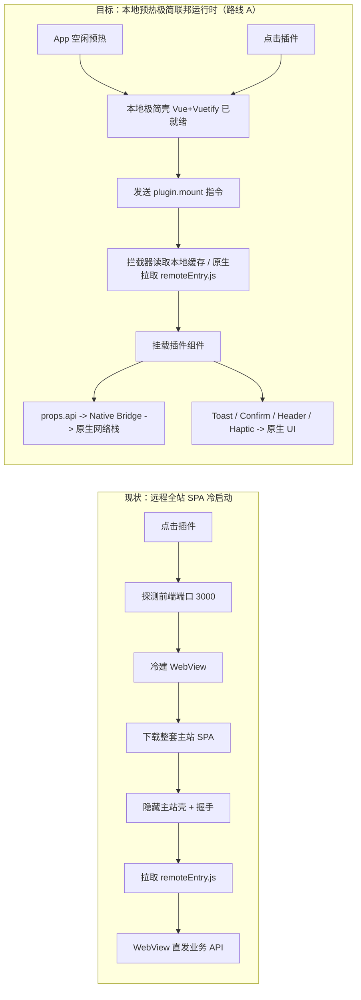
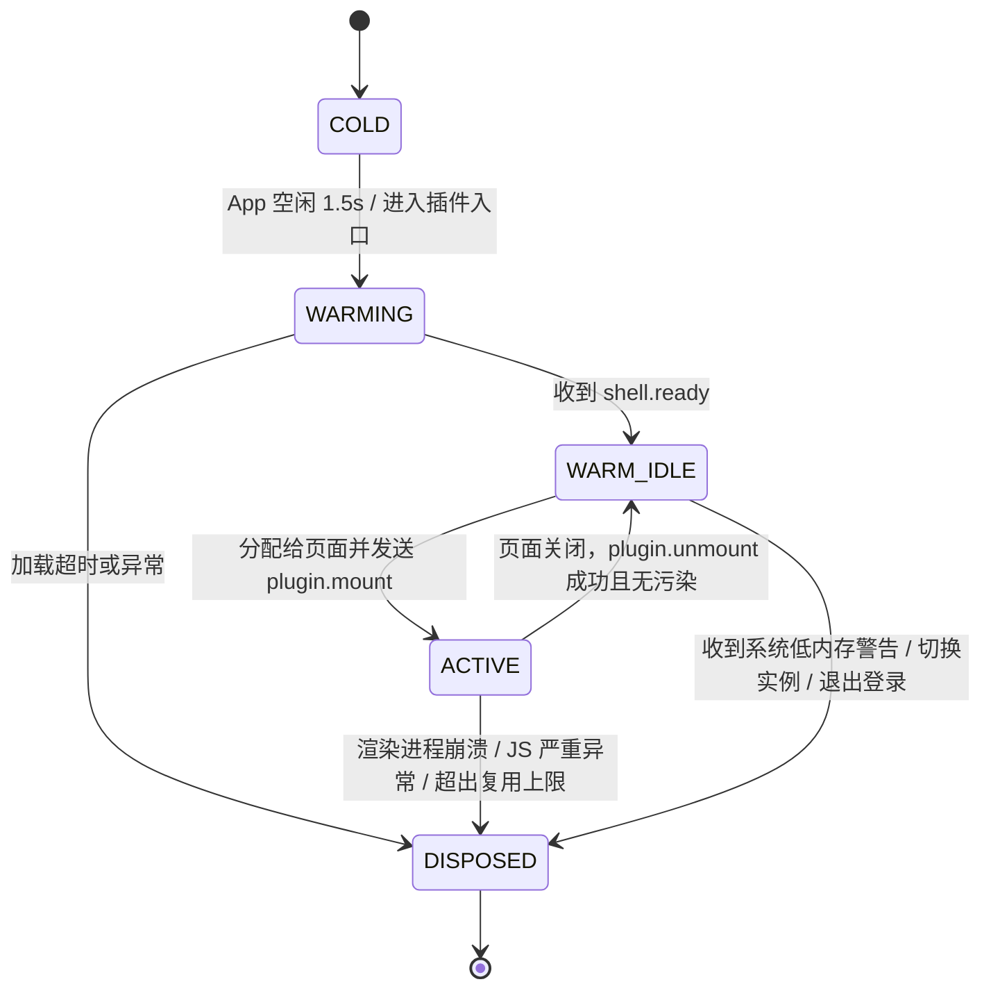

# Vue 联邦插件本地预热运行时（路线 A）架构设计方案

> 适用仓库：`MoviePilot-App`（iOS / Android / HarmonyOS NEXT）、`MoviePilot-Frontend`、`MoviePilot`（可选小增强）
> 核心约束：**不重写任何存量 Vue 模块联邦插件（`render_mode == "vue"`）**，零改动兼容 `@originjs/vite-plugin-federation` 与 `@module-federation/vite` 构建的 `remoteEntry.js`
> 编写日期：2026-11-25

---

## 一、背景与当前痛点定位

### 1.1 现行 WebView 方案的执行链路

目前三端原生 App 仅在 `render_mode == "vue"` 的联邦插件场景下使用受控隔离 WebView（iOS：`NativePluginDataPageView.swift` / `PluginWebFrontend.swift`；Android：`core-plugin-host/NativePluginHostView.kt`；HarmonyOS：`commons/plugin_host/NativePluginFormView.ets`）。单次打开一个联邦插件的完整链路如下：

1. 探测前端入口（`PluginWebFrontend.candidates`：当前实例地址 → `NGINX_PORT` → `APP_DOMAIN`），确认返回含 `id="app"` 的网页前端文档；
2. 现场冷创建一个全新的系统 WebView 实例，注入 `localStorage` 登录态/主题脚本与隐藏主站外壳的 CSS；
3. 向远端请求完整的 `MoviePilot-Frontend` SPA（`index.html`、Pinia、Vue Router、全站依赖与语言包）；
4. 执行主站启动逻辑、路由跳转与 `moviepilot.chrome` v1 握手协商，隐藏主站导航与页头；
5. 再调用 `/api/v1/plugin/remotes` 并经由 Module Federation 下载并解析目标插件的 `remoteEntry.js` 及子 chunk；
6. 最后执行插件初始化业务请求并首帧渲染。

### 1.2 核心体验瓶颈

| 瓶颈维度 | 具体表现 | 根因 |
| :--- | :--- | :--- |
| **启动慢、白屏/骨架屏久** | 首次打开常需 2~4 秒，弱网或跨公网访问 NAS 更长 | 每次冷建 WebView + 远程拉取并解析整套全站 SPA |
| **部署强耦合** | App 直连 3001 后端 API 时，若前端 3000 端口未暴露或反代配置复杂，联邦插件无法打开 | 强依赖远端部署的完整前端入口 |
| **网络与鉴权脆弱** | 自签名 HTTPS、资源 Cookie 跨域写回、Token 刷新易产生 401 或图片裂图 | WebView 网络栈与 App 原生网络栈割裂 |
| **交互割裂** | Toast、确认弹窗、菜单、标题栏、返回手势、键盘遮挡和桌面多栏布局偏网页感 | 缺少宿主级原生原语接管，依赖 `MutationObserver` 嗅探 DOM |
| **安全暴露面偏大** | 需将完整 Bearer Token 注入 WebView 的 `localStorage.auth` | 插件 API 请求在 WebView 内部直发 |

### 1.3 设计目标与边界

- **零插件重写**：所有存量与社区 Vue 联邦插件（`./Page`、`./Config`、`./Dashboard`、`./AppPage`、`./AppPage{Pascal}`）一行代码不改即可运行。
- **秒开体验**：预热命中 + 插件资源命中磁盘缓存时，从点击到插件首帧可交互控制在 **200~400ms** 内。
- **摆脱前端端口依赖**：只要 App 能连通 MoviePilot 后端 API（如 3001 端口），即可直接渲染联邦插件，不再需要探测 `NGINX_PORT`。
- **原生网络与安全边界收紧**：插件业务请求统一由 App 原生网络栈代理，天然兼容 NAS 自签名 HTTPS、系统代理与 Token 刷新；WebView 内不再写入裸 Bearer Token。
- **彻底替换 Web 原有背景与视觉融合**：干掉 Web/Vuetify 默认不透明灰白底板，让三端 WebView 物理透明并 100% 透出 App 原生动态背景（iOS `CinematicBackground` / Android Material 3 Expressive & AMOLED 纯黑 / 鸿蒙色板与动态光感），同时把 `shared/design-tokens` 完整注入 Vuetify 与玻璃卡片材质层，消除“App 里贴了一块异质网页”的割裂感。
- **三端一致与渐进可回退**：iOS / Android / HarmonyOS 共享同一份本地极简联邦基座资产与桥接协议；保留回退到旧版远程 SPA 容器的兜底开关。

---

## 二、总体架构设计

### 2.1 新旧架构对比



### 2.2 跨仓库职责划分

遵循工作区 `AGENTS.md` 边界：

| 仓库 | 职责范围 | 改动规模 |
| :--- | :--- | :--- |
| **`MoviePilot-Frontend`** | 新增独立轻量入口与构建配置 `vite.plugin-shell.config.ts`，只打包 `vue` + `vuetify` + `@module-federation/enhanced/runtime` + 轻量宿主 SDK + 移动端样式适配层，产出可嵌入 App 的静态目录 `dist-plugin-shell/` | 中（核心前端产物） |
| **`MoviePilot-App`** | 1. `shared/plugin-shell/` 作为 SSOT 存放构建产物与版本校验清单，由 `tools/sync-all.py` 同步到三端资产目录；<br>2. `shared/contracts/` 新增 `plugin-host-bridge-v2.json` 桥接契约；<br>3. `shared/core-rust` 增加插件资源路径校验、同源安全判定与磁盘缓存 Key 规范化；<br>4. 三端实现：本地资源拦截器、WebView 预热实例池、原生请求/UI Bridge 与降级回退 | 中~大（三端宿主实现） |
| **`MoviePilot`**（后端） | **原则上 0 改动即可工作**；可选小增强：`/api/v1/plugin/remotes` 响应补充 `version` / `etag`（或文件 mtime 摘要），让客户端实现零协商强缓存 | 极小（可选） |
| **`MoviePilot-Plugins`** | **0 改动** | 无 |

---

## 三、核心模块一：极简本地联邦运行时壳（`plugin-shell`）

### 3.1 产物瘦身与共享依赖对齐

在 `MoviePilot-Frontend` 中新建独立入口（如 `plugin-shell.html` + `src/plugin-shell/main.ts` + `vite.plugin-shell.config.ts`），与全站主 SPA 完全解耦构建：

- **必须保留的核心能力**：
  - `vue`、`vuetify`、`vuetify/styles`（通过 `@module-federation/vite` 注册为 `shared: ['vue', 'vuetify']`，保证与现有所有插件的 `shared` 契约 100% 匹配）；
  - `@module-federation/enhanced/runtime`（复用现有 `src/utils/federationRuntime.ts`，同时兼容 OriginJS 与 `@module-federation/vite` 产出的 ESM `remoteEntry.js`）；
  - MDI 图标字体（`@mdi/font`）与 Vuetify 基础样式变量（`src/styles/variables/_vuetify.scss`）；
  - 移动端 Vuetify 全局包装控件（复用 `src/plugins/vuetify/AppDialog.ts`、`AppMenu.ts`、`AppInput.ts`）；
  - 轻量版 `providePluginHostSDK` 注入键与契约（`PLUGIN_HOST_SDK_KEY`、`moviepilot:toast`、`moviepilot:dialog`、`moviepilot:confirm`、`moviepilot:nativeSubscribe`、`moviepilot:subscriptionManager`、`moviepilot:agent`）。
- **彻底剔除的重型模块**：
  - 全站业务页面、Vue Router 全站路由表、完整 Pinia 业务 Store、PWA Service Worker、ECharts/Markdown 编辑器/主站动画资源、Agent 宠物与侧边栏布局外壳。
- **体积预期**：
  - 本地未压缩约 1.8~2.8 MB（其中主要是 Vuetify 全量组件 + MDI 字体；因为随 App 本地零延迟直读，解析速度比远程全站 SPA 快一个数量级）。

### 3.2 热复用宿主组件（`PluginShellHost.vue`）

为了支撑 WebView 实例池复用，本地壳不是“一页一插件”，而是一个**常驻的远程组件挂载器**：

- 启动时只初始化 Vue 应用、Vuetify 主题、原生 Bridge 监听器，随后向原生发送 `shell.ready`，进入空闲待命状态（空视图，几乎不占渲染开销）。
- 收到原生 `plugin.mount` 指令后：
  1. 同步最新主题（`dark`/`light`、强调色 Hex、表面背景变量）、语言（`zh-CN`/`zh-TW`/`en-US`）与安全区 inset；
  2. 根据 `pluginId`、`remoteUrl`（指向本地虚拟拦截路径 `/plugin-remote/{pluginId}/...`）与 `version` 向 `federationRuntime` 注册或刷新远程容器；
  3. 按 `surface` 解析候选 expose：
     - `config` → `./Config`
     - `dataPage` → `./Page`
     - `dashboard` → `./Dashboard`
     - `appPage` → 与 `federationLoader.ts` 一致的解析链 `./AppPage{Pascal}` → `./AppPage` → `./Page`
  4. 挂载 `<component :is="activeComponent" :key="mountSessionId" :api="scopedApi" v-bind="surfaceProps" @close="onClose" @action="onAction" />`；
  5. 首帧 `nextTick` + `requestAnimationFrame` 后向原生上报 `plugin.mounted`（原生据此淡出骨架屏）。
- 收到原生 `plugin.unmount` 指令后：
  - 立即将 `activeComponent` 置空，触发组件 `onUnmounted` 清理定时器和监听，重置所有打开的 Vuetify Overlay/Dialog 与滚动位置，准备服务下一次打开。

### 3.3 原生背景替换与三端视觉深度融合（消除“网页异物感”核心设计）

为彻底替换掉原来 Web 端 Materio/Vuetify 的灰黑或纯白背景，让插件页面看起来与 App 其他原生页面浑然一体，采用**「四层视觉融合架构」**：

#### 第一层：WebView 容器物理透明 + 透出原生动态背景

页面最底层完全交给 App 原生渲染，WebView 只负责绘制前景内容与半透明玻璃卡片，**绝不在 Web 内再画一套静态底色**：

| 平台 | 底层原生背景 | WebView 透明化配置 | 避坑要点 |
| :--- | :--- | :--- | :--- |
| **iOS** | `CinematicBackground()`（支持 `palette.json` 6 套预设渐变与自定义色阶） | `webView.isOpaque = false`<br>`webView.backgroundColor = .clear`<br>`webView.scrollView.backgroundColor = .clear`<br>`webView.underPageBackgroundColor = .clear` | 必须同时设 `underPageBackgroundColor = .clear`，否则下拉橡皮筋回弹（rubber-banding）时会露出系统黑/白底边 |
| **Android** | Compose 原生背景（预设渐变 / Material You 动态壁纸取色 / AMOLED 纯黑） | `webView.setBackgroundColor(Color.TRANSPARENT)`，外层 `AndroidView` 不设置不透明底色 | 避免切回软件渲染导致滚动掉帧；硬件加速下配合 CSS 透明即可正常透底 |
| **HarmonyOS NEXT** | 鸿蒙 5 套色板与动态光感背景 | `Web` 组件设置 `.backgroundColor(Color.Transparent)` | 同步开启安全区延展，避免顶部状态栏与底部导航区出现硬截断色块 |

同时在 `plugin-shell` 根样式中强制全链路容器透明：

```css
html,
body,
#app,
.v-application,
.v-application__wrap,
.v-main,
.mp-shell-root {
  background: transparent !important;
  background-color: transparent !important;
}
```

#### 第二层：三端实时原生 Design Token 全量下发 → 接管 Vuetify 与玻璃材质

不再只同步 `dark/light + accentHex`，而是直接把三端当前实际生效的 `shared/design-tokens/palette.json`、`surfaces.json`（含 Android Material You 动态取色、AMOLED 纯黑、鸿蒙当前色板与自定义背景色）打包为 `NativeVisualTokens`，在 `plugin.mount` 和 `theme.update` 时实时注入本地壳：

```json
{
  "mode": "dark",
  "platform": "ios",
  "backgroundPreset": "cinematic",
  "isAmoledBlack": false,
  "highContrast": false,
  "accentHex": "#9E7AF5",
  "onAccentHex": "#FFFFFF",
  "textPrimaryHex": "#F5F2FF",
  "textSecondaryHex": "#B8B2CC",
  "surfaceGlassRgba": "rgba(255, 255, 255, 0.08)",
  "surfaceElevatedRgba": "rgba(48, 43, 66, 0.84)",
  "surfaceBorderRgba": "rgba(255, 255, 255, 0.14)",
  "surfaceBlurPx": 18,
  "solidSurfaceHex": "#473B52",
  "fieldFillRgba": "rgba(255, 255, 255, 0.09)",
  "fieldBorderRgba": "rgba(255, 255, 255, 0.14)",
  "chipFillRgba": "rgba(255, 255, 255, 0.09)",
  "chipBorderRgba": "rgba(255, 255, 255, 0.15)",
  "dividerRgba": "rgba(255, 255, 255, 0.11)",
  "panelRadiusPx": 24,
  "sheetRadiusPx": 28,
  "borderWidthPx": 0.7,
  "semantic": {
    "success": "#75E6A3",
    "warning": "#FFCC6B",
    "danger": "#FF8A94",
    "info": "#75C7FF",
    "brand": "#D6BDFF"
  },
  "fontFamily": "-apple-system, BlinkMacSystemFont, 'SF Pro Text', sans-serif"
}
```

`plugin-shell` 收到后立即做三件事：
1. **接管 Vuetify 3 主题色板**：动态写入 `vuetify.theme.themes.value[mode].colors`（`primary`、`success`、`warning`、`error`、`info`、`on-surface`、`on-background`、`surface`），让所有 Vuetify 组件与原生色板一致；
2. **注入 MoviePilot 透明材质 CSS 变量**：写入 `--transparent-blur`、`--transparent-opacity`、`--transparent-opacity-heavy`、`--v-border-color`、`--v-border-opacity`（像 `BrushFlowWorkbench.vue` 等官方插件本身已消费这些变量，无需修改即可自动获得毛玻璃吸顶栏与半透明面板效果）；
3. **加载 App 专属原生皮肤覆写层（Native Skin Layer，仅在 `plugin-shell` 生效，不影响 Web 浏览器端）**：
   - **卡片与面板（`.v-card`, `.v-sheet`, `.v-expansion-panel`, `.v-list`）**：替换掉 Materio 死板的纯色卡片和厚重阴影，统一改为 `surfaces.json` 同款玻璃面板（`background: var(--mp-surface-glass)` + `backdrop-filter: blur(var(--mp-surface-blur))` + `var(--mp-border-width) solid var(--mp-surface-border)` + 圆角 `20~24px`）；在 Android AMOLED 纯黑或低端机降级模式下自动切换为细腻微边框实色卡片以保流畅度；
   - **弹窗 / 下拉菜单 / 浮层（`.v-overlay__content > .v-card`, `.v-menu > .v-overlay__content`）**：采用高不透明重磨砂底（`var(--mp-surface-elevated)`，深色 0.80~0.88 / 浅色 0.86~0.92 + 强模糊），保证浮层内容在动态渐变背景上绝对清晰不穿底；
   - **输入框、开关、Chip 与表格**：`.v-field` 对齐 `fieldFill`/`fieldBorder`，`.v-chip` 对齐 `chipFill`/`chipBorder`，`.v-table`/`.v-data-table` 背景全透明并采用 `dividerRgba` 分割线；
   - **字体与触控体感**：三端分别对齐系统原生字体栈（iOS SF Pro、Android Roboto、HarmonyOS Sans），统一禁用双击缩放与网页点击灰框（`-webkit-tap-highlight-color: transparent`），隐藏生硬的 Web 滚动条。

#### 第三层：插件硬编码背景的智能清洗（不改插件代码）

部分社区插件可能在最外层根 `<div>` 或页面包装类名（如 `.xxx-page`）上直接写了不透明 `background-color`（如 `#ffffff` / `#1e1e2e` / `rgb(var(--v-theme-background))`），导致整页重新被涂死。

`plugin-shell` 在组件挂载完成（`plugin.mounted` 前）执行一次极轻量的根节点检查：
- 仅检查插件挂载点向下 **1~2 层占满整页宽度的根包装容器**（跳过卡片、弹窗、按钮、徽章、进度条、图表等局部元素）；
- 若其计算样式存在覆盖全页的不透明背景色或与 `v-theme-background` 一致的底色，自动为其添加透明覆写标记 `data-mp-shell-transparent-root`，让底层原生渐变背景重新透出；
- 若插件内某个区块明确带有自定义视觉背景图（`background-image: url(...)`）或小面积语义色块，则完整保留不误伤。

#### 第四层：首帧零闪烁无缝衔接

- 预热池中的 WebView 在加载完成进入 `WARM_IDLE` 时就已经处于**透明底 + 同步好当前主题 Token**的状态；
- 原生加载骨架屏直接绘制在同一个 `CinematicBackground` / 原生背景之上；
- 收到 `plugin.mounted` 后仅做 160ms 交叉淡入（`opacity 0 → 1`），全程不会出现“先闪一下白底或深灰 Web 底 → 再变成原生背景”的违和跳变。
- 桌面端宽屏布局自动收敛：超出视口宽度的表格自动横向惯性滚动，窄屏按钮栏自动换行，注入安全区变量 `--mp-safe-top` / `--mp-safe-bottom` 避让刘海与底部悬浮条。

---

## 四、核心模块二：虚拟同源协议与原生网络/缓存拦截

这是路线 A 能否**彻底稳定、不踩三端坑**的最关键设计。

### 4.1 为什么不能用 `file://`，以及“双通道分流”原则

1. **严禁使用 `file://` 加载本地壳**：现代 WebView 在 `file://` 下禁止 ESM `import()`（Module Federation 直接失效），且无标准 Origin，诸多 Web API 不可用。
2. **三端拦截器的经典限制**：
   - iOS `WKURLSchemeHandler` **不能**拦截 `http://` / `https://`，只能拦截自定义 Scheme（如 `mp-plugin://`）；且自定义 Scheme 下 `fetch()` 的 POST Body / `FormData` 文件上传在某些 iOS 版本存在丢失风险。
   - Android `WebViewClient.shouldInterceptRequest` 可以拦截虚拟 HTTPS 域名，但 `WebResourceRequest` **无法读取 POST/PUT 请求体**。
   - HarmonyOS `ArkWeb` `onInterceptRequest` 同样主要适用于 GET 静态资源拦截。

因此采用**「静态资产走拦截器 + 业务 API 走 JS Bridge」双通道分流架构**：

| 流量类型 | 承载通道 | 实现方式 | 优势 |
| :--- | :--- | :--- | :--- |
| **本地壳资源** (`/shell/*`) | 平台资源拦截器 | 直接从 App Bundle / Rawfile 同步返回 | 0 网络耗时、支持 ESM `import()` |
| **联邦插件 JS/CSS/字体** (`/plugin-remote/{id}/*`) | 平台资源拦截器 | 优先命中磁盘缓存；未命中则由原生网络栈附带 `resource_token` 向后端 `/api/v1/plugin/file/{id}/*` 拉取并缓存后返回 | 天然支持 `import()` 动态分片、按版本强缓存、免暴露 Cookie 给 JS |
| **插件被动媒体资源** (`` 指向 `/api/v1/...`) | 平台资源拦截器 | 校验路径白名单后由原生网络栈代拉（附带 `resource_token`），支持 ETag 缓存 | 解决插件内图片/图标 401 与自签名 HTTPS 裂图 |
| **插件全部业务 API** (`props.api.get/post/put/delete/patch/request`) | **Native Bridge (`api.request`)** | 本地壳的 `scopedApi` 封装直接通过 Bridge 调用 App 原生网络栈（iOS `URLSession` / Android `OkHttp` / 鸿蒙 `@kit.NetworkKit`） | **彻底绕开所有 WebView POST Body 截断、CORS、Cookie 跨域、自签名证书和 401 刷新问题**；且 WebView 内完全无需存放 Bearer Token |

> **兼容兜底**：如果少数插件绕过 `props.api` 直接调用原生 `window.fetch('/api/v1/...')` 或 `axios`，本地壳可在启动前安装一层轻量 `fetch` / `XMLHttpRequest` 同源拦截垫片，把指向 `/api/v1/*` 的请求同样透明转发到 `Native Bridge (api.request)`，确保 100% 兼容。

### 4.2 三端虚拟 Origin 与拦截器选型

| 平台 | 虚拟 Origin | 拦截机制 | 关键实现细节 |
| :--- | :--- | :--- | :--- |
| **iOS** | `mp-plugin://shell/` | `WKWebViewConfiguration.setURLSchemeHandler(_:forURLScheme: "mp-plugin")` | 响应头明确补齐 `Content-Type`（`.js`/`.mjs` 必须为 `application/javascript; charset=utf-8`）、`Access-Control-Allow-Origin: mp-plugin://shell`；在 `WKURLSchemeTask` 取消回调中取消在途原生下载任务，防止崩溃 |
| **Android** | `https://plugin-shell.moviepilot.local/` | `WebViewAssetLoader` + `WebViewClient.shouldInterceptRequest` | 标准 HTTPS Secure Context；`/shell/` 映射到 APK `assets/plugin-shell/`；`/plugin-remote/` 与 `/api/v1/` 走 OkHttp 代理；通过 `WebMessageCompat` / `JavascriptInterface` 提供 Bridge |
| **HarmonyOS NEXT** | `https://plugin-shell.moviepilot.local/` | `Web` 组件 `onInterceptRequest` 返回 `WebResourceResponse` | `/shell/` 读取 `resourceManager.getRawFileContentSync`；`/plugin-remote/` 走鸿蒙原生网络与本地沙箱文件缓存；通过 `javaScriptProxy` 注册原生 Bridge |

### 4.3 远程插件包磁盘缓存策略

- **缓存目录隔离**：`<AppCacheDir>/plugin-remote-cache/<sha256(instance_origin)>/<plugin_id>/<version_or_rev>/`
  - 不同实例（多服务器切换）严格物理隔离，避免跨实例缓存污染。
- **版本失效机制**：
  1. App 打开插件前已持有插件列表或详情里的 `plugin_version`（若后端后续在 `/api/v1/plugin/remotes` 补充了 `etag`/`hash`，则优先使用更细粒度的 hash）；
  2. 构造给本地壳的入口路径显式带上版本段：`/plugin-remote/{plugin_id}/{version}/assets/remoteEntry.js`；
  3. ESM 子 chunk 使用相对路径加载（如 `./chunk-xxx.js`），浏览器会自动拼接为 `/plugin-remote/{plugin_id}/{version}/assets/chunk-xxx.js`，天然享受同版本隔离与零冲突强缓存；
  4. 拦截器向上游真实后端请求时，剥离 `{version}` 段，请求真实路径 `/api/v1/plugin/file/{plugin_id}/assets/...`；
  5. 当检测到某插件新版本时，异步清理该插件旧版本缓存目录。
- **容量与清理**：设置总上限（建议 50MB，按最后访问时间 LRU 淘汰），并在 App「设置 → 清理缓存」及「插件更新/重装」后自动触发清理。

---

## 五、核心模块三：WebView 预热实例池与生命周期管理

### 5.1 池状态机设计



### 5.2 关键策略约束

1. **池规模控制**：
   - 默认常驻预热 **1 个** `WARM_IDLE` 实例；
   - 嵌套打开第二个插件页面（如 AppPage 里再弹 Config Sheet）时按需创建第 2 个实例，关闭后若池中已有空闲实例则直接销毁多余实例，避免常驻内存膨胀。
2. **复用安全与防内存泄漏**：
   - 每个实例记录复用次数（如达到 15 次）或检测到插件执行期间产生未捕获错误 / 渲染进程终止（iOS `webViewWebContentProcessDidTerminate`、Android `onRenderProcessGone`、HarmonyOS `onRenderExited`）时，用完即销毁并异步补预热一个干净实例。
   - 若插件曾在同一实例里重复加载过相同 `remoteId` 但版本号变更：由于每次带版本号的 URL 不同，且旧版本 ESM 模块留在模块图中无法 GC，因此**检测到同 `pluginId` 升级新版本时，直接标记旧实例在卸载后销毁重建**，彻底规避 ESM 模块缓存脏态。
3. **预热时机与能耗**：
   - 不阻塞 App 冷启动首帧：主界面首帧渲染完成且主线程空闲 1.5~2 秒后再创建预热实例（或在用户首次切到「更多/插件」Tab 时触发）。
   - App 退到后台超过阈值或收到系统内存压力回调（`didReceiveMemoryWarning` / `onTrimMemory` / `onMemoryLevel`）时，主动释放 `WARM_IDLE` 实例。
4. **账号与实例切换安全重置**：
   - 切换服务器实例、切换用户或登出时，**同步销毁池内所有实例**（无论空闲还是复用缓存），避免上一个实例的插件内存状态泄露到新实例。

---

## 六、核心模块四：原生桥接协议（`moviepilot.pluginHost` v2）

在 `MoviePilot-App/shared/contracts/plugin-host-bridge-v2.json` 中定义三端唯一事实源协议。

### 6.1 Host → Web 指令

| 消息类型 | 关键载荷 | 说明 |
| :--- | :--- | :--- |
| `plugin.mount` | `mountId`, `pluginId`, `sourcePluginId`, `surface`, `navKey`, `remoteEntryUrl`, `props`, `user`, `visualTokens`, `locale`, `safeArea` | 挂载目标联邦插件组件并注入完整原生视觉 Token |
| `plugin.unmount` | `mountId` | 卸载当前组件并恢复 `WARM_IDLE` |
| `theme.update` | `visualTokens`（完整的 `NativeVisualTokens` 快照，含色板、玻璃表面透明度、模糊半径、圆角、语义色与 AMOLED 标记） | 实时切换深浅色、背景预设、强调色与材质参数，无需刷新页面 |
| `locale.update` | `locale` | 实时同步语言 |
| `safeArea.update` | `top`, `bottom`, `left`, `right` | 响应横竖屏/分屏/键盘变化 |
| `nav.back` | `mountId` | 原生返回手势/物理返回键触发：若插件内有打开的 Dialog/Menu 则先关闭浮层并返回 `handled: true`，否则原生直接退页 |
| `host.action` | `actionId` | 用户点击原生顶部导航栏按钮后回传给插件执行 |
| `bridge.response` | `requestId`, `ok`, `data` / `error` | 对 `api.request`、`ui.confirm`、`ui.actionSheet` 等异步请求的响应 |

### 6.2 Web → Host 指令

| 消息类型 | 关键载荷 | 原生行为 |
| :--- | :--- | :--- |
| `shell.ready` | `shellVersion`, `vuetifyVersion` | 标记预热池实例进入 `WARM_IDLE` |
| `plugin.mounted` | `mountId`, `title`, `durationMs` | 淡出原生骨架屏并记录性能指标 |
| `plugin.error` | `mountId`, `stage` (`register`/`load`/`render`), `message`, `recoverable` | 展示原生错误玻璃面板，并提供「重试」与「用远程网页模式打开」按钮 |
| `plugin.close` | `mountId` | 关闭当前 Sheet / 退出页面 |
| `plugin.action` | `mountId`, `payload` | 通知宿主刷新父页面插件状态（对齐现有 `@action` 事件） |
| `api.request` | `requestId`, `method`, `path`, `query`, `headers`, `body`, `bodyEncoding` (`json`/`base64`/`multipart`), `timeoutMs` | 走 App 原生网络栈访问当前实例后端（严格校验相对路径 `/api/v1/`，拒绝外域凭据透传），结果通过 `bridge.response` 返回 |
| `api.abort` | `requestId` | 取消在途原生网络请求 |
| `ui.toast` | `level` (`success`/`info`/`warning`/`error`), `message` | 调用三端原生 Toast/Snackbar + 轻触感反馈 |
| `ui.confirm` | `requestId`, `title`, `message`, `confirmText`, `cancelText`, `destructive` | 弹出原生 Alert / ConfirmationDialog，回传布尔结果 |
| `ui.header` | `title`, `subtitle`, `actions: [{ id, icon, label, disabled, loading }]` | 同步标题与操作按钮到原生导航栏（Liquid Glass / TopAppBar / 鸿蒙沉浸顶栏） |
| `nav.openRoute` | `deepLink` (`moviepilot://...`) | 由 App 原生路由接管跳转到影视详情/订阅/下载等原生页 |
| `nav.openExternal` | `url` | 校验 `http`/`https` 后调用系统浏览器打开 |
| `device.haptic` | `style` (`light`/`medium`/`success`/`warning`/`error`) | 触发系统原生触感反馈 |
| `device.clipboard` | `text` | 写入系统剪贴板并提示 |

### 6.3 导航栏与弹窗接管演进

- 本地壳中的 `AppDialog` 与宿主容器可以直接上报结构化的 `ui.header`、`ui.confirm` 和浮层栈状态，**逐步替代**当前通过 `MutationObserver` 正则嗅探 `.v-dialog` DOM 标题与图标按钮的脆弱逻辑；
- 对插件内部自己手写 `<header>` 的非标弹窗，保留一份极简 DOM 兜底采集逻辑，确保旧插件的原生顶栏按钮不退化。

---

## 七、安全边界与降级策略

### 7.1 严格安全约束（对齐 `AGENTS.md`）

1. **零裸 Token 暴露**：不再向 WebView `localStorage.auth` 写入 JWT Access Token，也不向 WebView Cookie 池写入明文认证凭据；所有需要鉴权的 API 请求均通过 `api.request` 由原生层附带 Token 发出。
2. **严格路径与同源校验（下沉至 `shared/core-rust`）**：
   - `api.request` 仅允许相对路径或同源 `/api/v1/` 路径（拒绝 `..` 路径穿越、拒绝任意外域 URL 附带凭据）；
   - `/plugin-remote/{plugin_id}/...` 严格限制在目标插件路径前缀下，禁止跨插件读取文件。
3. **非敏感用户信息脱敏注入**：仅为兼容部分插件读取 `localStorage.user` 或上下文权限，注入只含 `userName`、`superUser`、`level`、`permissions` 的只读脱敏快照，不含 Token/密码/Cookie。
4. **外链隔离**：插件内 `window.open` 或 `<a target="_blank">` 一律拦截并交由原生二次确认或系统浏览器打开，禁止在插件 WebView 内导航离开虚拟 Origin。

### 7.2 降级与兼容兜底

- 在「设置 → 高级 / 实验室」及插件错误面板中保留「切换为兼容网页容器（远程前端）」选项；
- 若某小众第三方插件依赖了极其特殊的全站内部全局状态（例如直接强依赖主站私有 Pinia Store 或主站特定路由组件）导致在本地壳中 `plugin.error`，自动提供一键回退到原有 `PluginWebFrontend` 远程容器，保证 100% 功能不倒退。

---

## 八、分阶段实施计划与改动清单

### Phase 1：前端极简联邦壳与 SSOT 同步管线（预计 2~3 天）

1. **`MoviePilot-Frontend`**：
   - 新增 `vite.plugin-shell.config.ts`、`plugin-shell.html`、`src/plugin-shell/`（入口、Bridge 客户端、`scopedApi` 适配器、轻量 `providePluginHostSDK`、`PluginShellHost.vue`、移动端增强样式）；
   - 在 `package.json` 增加 `build:plugin-shell` 脚本，并新增基于 Vitest 的单测（验证 `plugin.mount`/`unmount`、主题同步、`api.request` 代理与错误处理）；
   - 用本地 mock Bridge 实测加载真实插件：`BrushFlow`、`AgentResourceOfficer`、`CourseOrganizer`、`LunaTvSource`、`OidcAuth`。
2. **`MoviePilot-App` SSOT 与 Rust 内核**：
   - 新增 `shared/contracts/plugin-host-bridge-v2.json`；
   - 新增 `shared/plugin-shell/` 目录及构建产物导入/同步逻辑到 `tools/sync-all.py`（含 SHA256 清单与 `--check` 零漂移校验）；
   - 在 `shared/core-rust/mp-core-plugin` 补齐插件远程 URL 路径规范化、版本缓存 Key 生成与同源安全校验函数，并写黄金夹具单测。

### Phase 2：iOS 端试点落地与性能压测（预计 2~3 天）

- 涉及目录：`ios/Sources/MoviePilotCore/`、`ios/MoviePilot/NativeV2/Pages/NativePluginDataPageView.swift`（拆分为独立模块 `ios/MoviePilot/PluginWeb/`）：
  - 实现 `PluginShellSchemeHandler`（`WKURLSchemeHandler` 拦截 `mp-plugin://shell/` 的 `/shell/*`、`/plugin-remote/*` 与被动 `/api/v1/*` 图片）；
  - 实现 `PluginRemoteDiskCache`（按实例 Hash + 插件 ID + 版本 LRU 缓存）；
  - 实现 `PluginWebViewPool`（空闲预热 1 个实例、复用、内存警告释放、登出/切实例销毁）；
  - 实现 `PluginHostBridgeV2`（接入 `NativeSession` 原生网络栈处理 `api.request`，接入原生 Toast / Confirm / Sheet 导航栏 / Haptic）；
  - 实测对比优化前后：冷/热打开耗时、直连 3001 后端可用性、自签名 HTTPS 可用性。

### Phase 3：Android 与 HarmonyOS NEXT 对齐落地（预计 3~4 天）

- **Android**（`android/core-plugin-host/src/main/java/com/moviepilot/pluginhost/`）：
  - 基于 `WebViewAssetLoader` + `shouldInterceptRequest` 托管 `https://plugin-shell.moviepilot.local/`；
  - 复用 `OkHttpClient` 处理远程包拉取与 `api.request` Bridge；
  - 实现 `AndroidPluginWebViewPool`（绑定 `Application` 生命周期与 `ComponentCallbacks2.onTrimMemory`）及 Compose 原生弹窗/Snackbar/TopAppBar 桥接；
  - 拦截系统返回手势先发 `nav.back`。
- **HarmonyOS NEXT**（`harmony/commons/plugin_host/src/main/ets/`）：
  - 基于 `ArkWeb` `onInterceptRequest` 返回 `WebResourceResponse` 托管虚拟 HTTPS 域名；
  - 结合鸿蒙 `NodeController` / 离屏 `Web` 能力实现预热池复用；
  - 通过 `javaScriptProxy` 接入鸿蒙原生网络栈与 `promptAction` / `bindSheet` / 沉浸顶栏。

### Phase 4：后端可选增强与全链路验收（预计 1 天）

- **后端可选增强**（`MoviePilot/app/api/endpoints/plugin.py`）：
  - 在 `/api/v1/plugin/remotes` 响应模型 `_SchemaPluginRemoteInfo` 中增加 `version: Optional[str]` 与 `bundle_hash: Optional[str]`（基于 `remoteEntry.js` 文件大小+mtime 或 SHA256 前 12 位），客户端无需猜测文件变更。
- **验收清单**：
  - [ ] 首屏性能：预热命中 + 缓存命中下，三端打开 `BrushFlow` / `CourseOrganizer` 首帧 < 400ms；
  - [ ] 无前端端口场景：App 仅连接后端 3001 端口（关闭 3000 前端），所有 Vue 联邦插件正常打开、配置保存、刷新与图片显示；
  - [ ] 自签名 HTTPS + 反向代理子路径：插件 JS 加载与 POST/PUT/Multipart 请求均零报错；
  - [ ] 视觉与背景融合：三端彻底去除 Web 默认灰/白底板，插件页面 100% 透出 App 原生动态背景（切换星夜紫玫/深海极光/静谧松林/暖阳琥珀/极简石墨/自定义/AMOLED 纯黑/浅色模式均实时无缝跟随，下拉回弹无白边黑边）；卡片、输入框、Chip、弹窗呈现出与原生一致的玻璃质感且文字对比度清晰；
  - [ ] 交互体验：深浅色与强调色实时切换零闪烁刷新、原生 Toast/Confirm/返回手势正常、键盘不遮挡表单输入框；
  - [ ] 安全隔离：检查 WebView `localStorage` 与 Cookie 不含明文 Bearer Token；切换实例/退出登录后缓存与预热池彻底清空；
  - [ ] 降级可用：模拟本地壳加载失败时，可一键回退到远程网页容器并正常展示。
