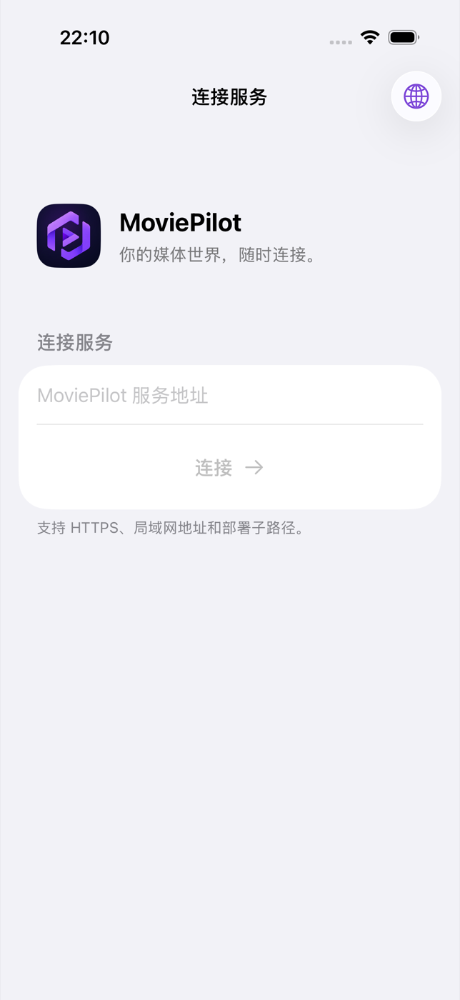
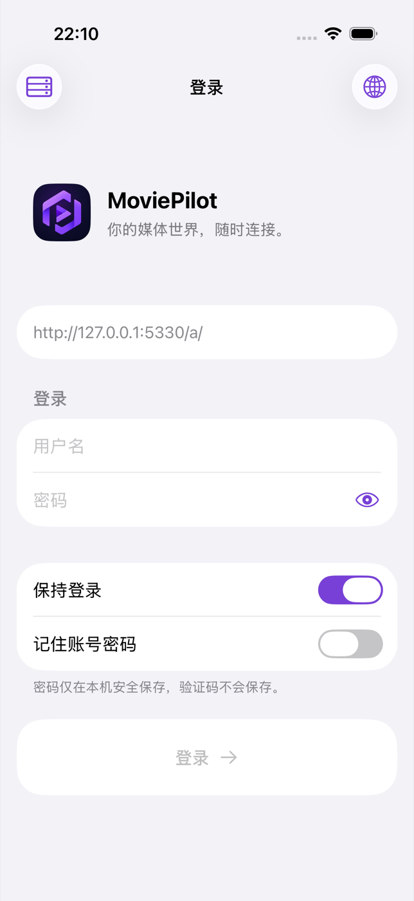
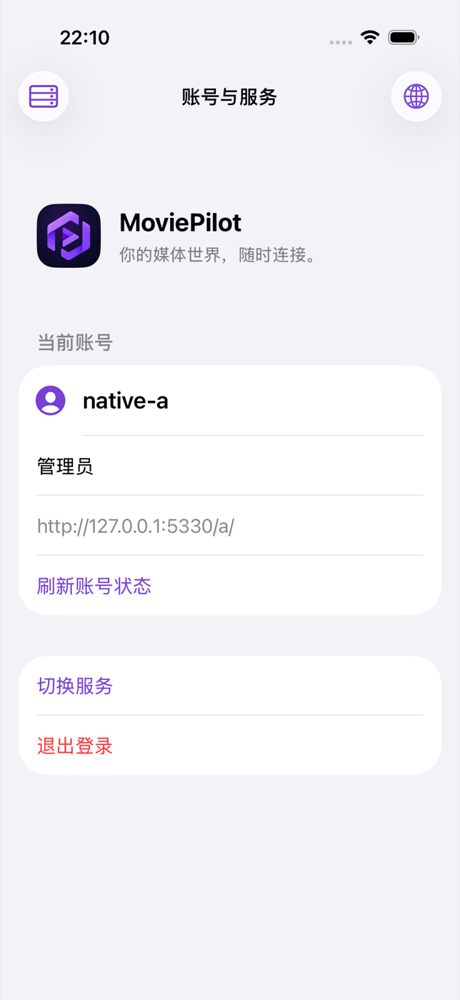
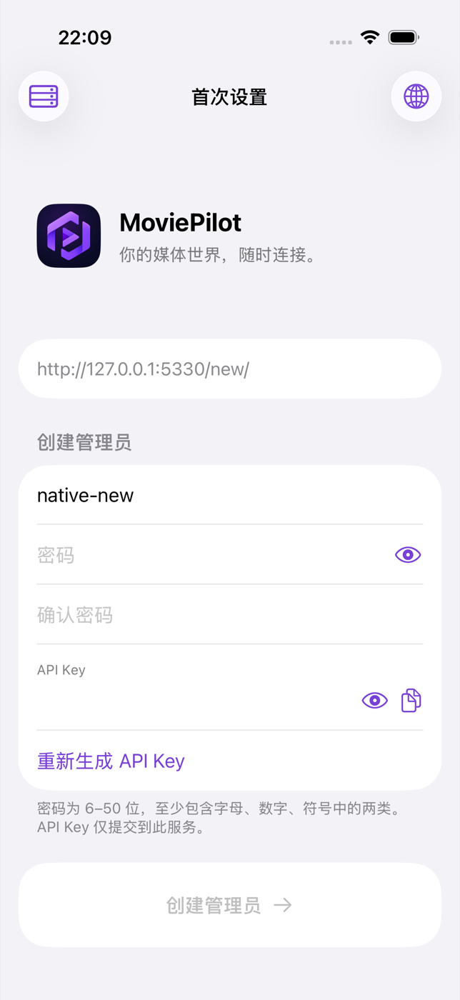
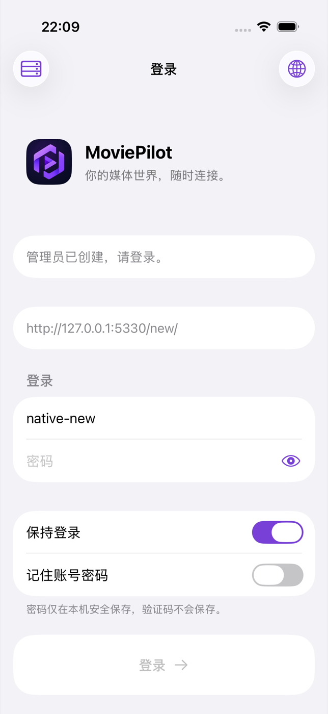
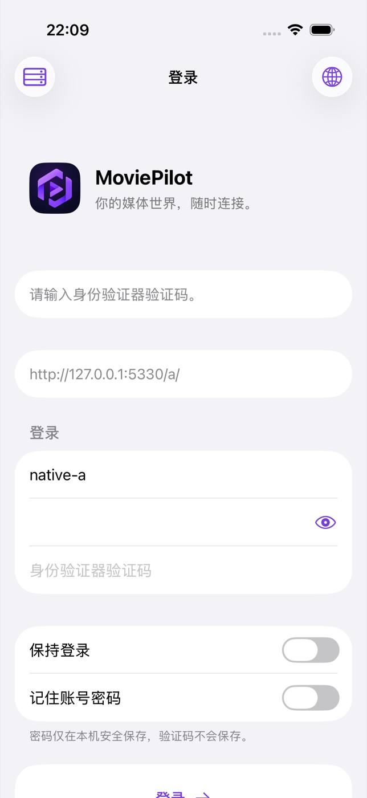
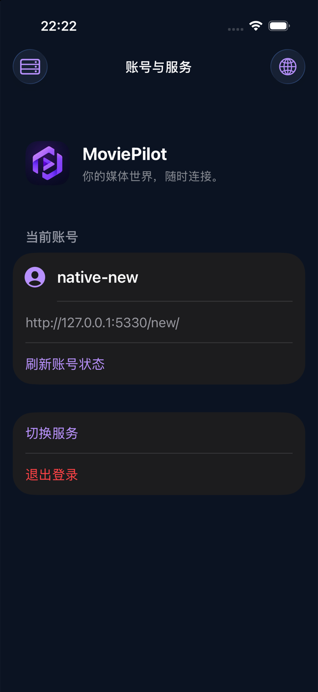
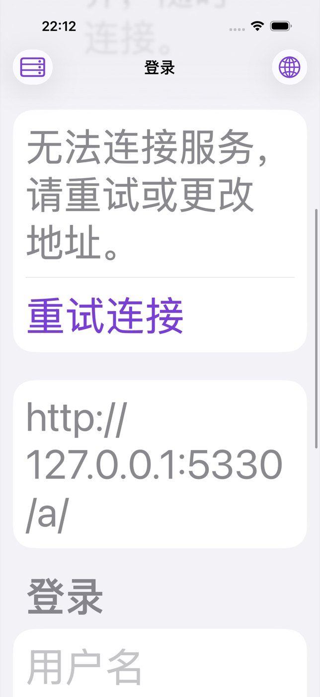
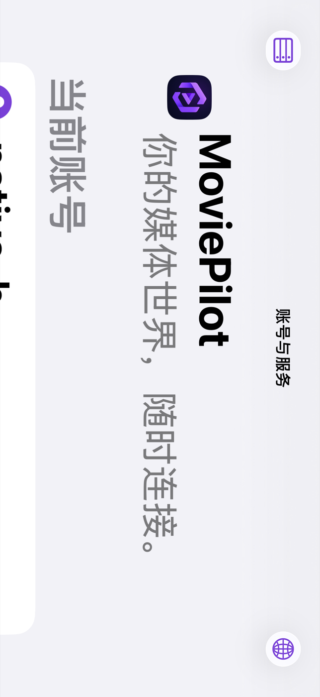

# P1.3 原生入口本地验收

日期：2026-11-19。分支：本地 v2；初始化协议准备提交为 69daaa8，本文与原生 UI 同一提交保存。没有推送、发布、覆盖正式设备或修改真实服务。

**视觉历史说明：** 本文图片记录基础入口的首次功能验收。用户随后提供 Rex 参考并明确否定这种普通系统表单风格；这些图片不作为 v2 的视觉定稿。全局渐变、玻璃卡片/表单及海报主导的新设计由 P0.2 接续。

## 实现边界

- SceneDelegate 每次场景连接选择独立驱动；DEBUG 参数 `--native-v2` 启用 NativeV2SceneDelegate → SwiftUI 原生窗口。Release 与无参数默认仍用原有实现，最终默认切换属于 P8。
- 旧 SceneDelegate 原文迁至 LegacyWebSceneDelegate，仅更改类名；已逐字比较。Info.plist、版本、最低系统、Bundle ID、签名配置和其它业务代码保持原样。
- 原生连接、历史服务、确认删除、首次管理员、密码/OTP、保持登录、可选记住密码、恢复、刷新身份、退出与换地址直接使用 NativeSessionManager；未复用旧连接/登录控制器或 WebCoordinator。
- 标准化地址和 UUID、TokenStore 与 LoginCredentialStore 均沿用现有记录。密码只在明确选择并成功登录后保存；取消记忆即时删除；OTP 不保存。创建管理员不自动登录，初始化 400/422 映射为输入校验而非连接失败。
- 进入后台清理明文草稿、取消未完成认证；离开认证/换实例遮回明文显示。普通切换停止 Widget 旧代次，注销/过期清理当前实例资料，通知解除旧 coordinator；完整系统能力仍待 P7。
- 唯一接触 WebKit 的新适配为 PluginWeb/LegacyWebsiteStorage，只清理确认忘记实例时的旧网站存储，不创建 WebView 或加载文档。

## 实际执行

工具链：Xcode 27.2（27B52），iOS Simulator SDK 27.2；实际运行设备为新建专用 iPhone 17 Pro / iOS 26.1（23B86）。未使用已有模拟器里的账号或真实设备。

| 层级 | 结果 | 证据 |
| --- | --- | --- |
| 认证/权限/生命周期 | 45 项 Swift Testing 定义通过，含参数化校验 | 最后一次完整 `scripts/test-core.sh`；初始化 400/422 不自动重发且不改变 current 端点错误语义 |
| 既有 Core 与 API | 166 项既有 Swift Testing、4 项 XCTest、19 项 API Swift Testing 通过 | 同次完整核心回归；不将参数组合展开后另加成“新测试数” |
| 脚本 | Python 13 项、Node 3 项通过 | 夹具新增 4 项真实 HTTP 测试；包含拒绝 HTML/JS、跨实例令牌、确认字段、OTP 前导零 |
| 格式与工程 | Swift 全目录严格 lint、diff 检查、App/Widget/UI 测试目标编译通过 | 只增加原生源文件/测试引用；临时模拟器 ad-hoc 签名，不修改项目签名身份 |
| 选定原生 UI | 5 项实际执行、0 失败、0 跳过 | [完整汇总](2026-11-19-entry/tests.json)；最终一轮复用已编译产物，`TEST EXECUTE SUCCEEDED` |
| 初始化校验修正后 | 单独再次构建并执行首次创建/明确登录，通过 | [补充汇总](2026-11-19-entry/initialization-validation.json)；其余成功路径未因该错误分类修正改变 |
| 后台内存会话补充 | 额外 1 项实际 UI 回归通过，0 失败/跳过 | [后台会话汇总](2026-11-19-entry/background-session.json)；刷新期间暂离只取消请求，不因未保持登录而丢弃活跃内存身份 |

5 项 UI 测试分别验证：

1. **首次设置**：固定用户名不可修改；密码确认与生成 API Key 通过真实表单 POST；仅一次创建，创建后登录次数为 0；再次手动输入密码后登录。
2. **OTP/不保持登录**：第一次提交得到挑战，再明确提交保留前导零的 OTP；关闭保持登录后，重启不读取已删除令牌，也不重发密码。
3. **实例/凭据**：A→B→A 独立身份，已保存服务选择及冷启动恢复不额外登录；过期只回填本实例密码；注销、取消密码记忆后再次选择为空表单。
4. **场景/语言**：简体、英语、繁体即时切换；无原生参数仍进入原有连接页，再次冷启动带参数正确回到原生入口。
5. **错误/取消/布局**：503 后可重试，延迟旧实例不能接管新实例；最大辅助功能字号下滚动到达输入/重试/登录；横屏实际完成登录。

补充的第 6 项在“不保持登录”的账号内开始延迟刷新，实际按 Home、等待系统进入后台后重新激活，确认原身份保留、忙碌结束且登录请求仍只有一次。提交前审阅发现原实现会在 busy 时无条件断开会话，已限定为没有活跃身份的认证尝试才断开。

另外手动冷启动检查了深色外观与保存令牌恢复，画面是夹具的真实当前账号，而非静态设计数据。

## 无主体网页的证据与限度

本机夹具只在 `127.0.0.1:5330` 提供四种 API 方法/路径组合，拒绝所有前端 HTML、JS 和未声明路径；不使用前端 dist。测试内部逐次断言请求次数、身份和无额外登录；最后一轮[路径计数](2026-11-19-entry/requests.json)的 unexpected 为空。该快照摄于完整 5 项测试结束，之后补充的初始化/深色检查不混入此快照。

覆盖流程的运行中可访问性树 WebView 数为 0。源码审阅也确认：NativeV2 入口不导入 WebKit，不构造 WebCoordinator、旧账号控制器或网页桥；当前 App 的两处 WKWebView 构造均仍在旧 WebCoordinator，原生驱动不进入它。

这里**不是全进程分配计数器或整个 App 的去 WebKit 证明**。旧源码/桥/资源仍在同一 App 目标供对照，插件专用容器、全部业务流程、构建依赖隔离和完整运行分配审计仍属于 P2/P8。不能把这次基础入口验收写成整个客户端已无 WebView。

## 运行画面

下列为实际模拟器画面，等比缩小，未裁切或拼接；仅有合成地址/账号，安全字段由系统遮挡。它们是基础入口的运行证据，**不是仪表板/推荐等主要业务页面的设计稿**。

| 连接 | 登录 | 当前账号 |
| --- | --- | --- |
|  |  |  |

| 首次设置 | 创建后明确登录 | OTP |
| --- | --- | --- |
|  |  |  |

| 深色账号页 | 最大字号错误/重试 | 横屏最大字号 |
| --- | --- | --- |
|  |  |  |

最大字号不强行缩字以塞进一屏，内容与按钮通过真实表单滚动到达。横屏截图停在账号页顶部品牌区；账号名称及操作的检查由实际 UI 测试完成。

## 已知问题与未覆盖

- 汇总中保留一条 `Invalid frame dimension (negative or non-finite)` SwiftUI 运行时警告，目前尚未定位来源。关键画面已检查，正常流程/大字/横屏交互通过；P1.4 组件设计与 P8 布局/性能出口仍需继续定位，不能当作已消失。
- 当前 SDK 的 XCTest/XCUIAutomation 链接最低版本警告与测试后 `simctl` 诊断采集路径错误已保留在原始日志；没有把它们改成跳过或改高 App 最低版本。测试汇总确认所选 5 项真实执行成功；不宣称已经取得完整系统诊断。
- 首轮无完整模拟器签名时安全存储失败，不能算功能通过；随后使用临时 ad-hoc 完整签名，真实 Keychain 的保存、读取和删除才通过。
- 首次设置的系统强密码预览曾阻挡手动输入。本次通过原生显示/隐藏密码选择手动输入并在截图前遮回；完整密码管理器/系统生成 AutoFill、Passkey/OIDC、其它 MFA 及 GitHub 初始化授权留给 P6，不宣称已验收。
- 没有验证真实账号/后端、iOS 16 运行时、iPad、真机、APNs/Widget 新入口、媒体业务和插件 UI。深浅主题检查也不替代全范围外观/可访问性矩阵。

## 重放与保存

在专用模拟器运行，避免覆盖正常使用实例。先启动夹具，再选择已安装运行时的设备：

~~~sh
/Users/jxxghp/MPProjects/MoviePilot/.venv/bin/python scripts/native-v2-fixture.py --port 5330

# 另一终端；将目标设备替换为专用模拟器，并使用尚不存在的 result bundle 路径。
DEVELOPER_DIR=/Applications/Xcode.app/Contents/Developer \
TMPDIR=/Volumes/DISK/TmpBuild/moviepilot-ios-v2/tmp \
TEST_RUNNER_MOVIEPILOT_NATIVE_V2_E2E=1 \
xcodebuild -project ios/MoviePilot.xcodeproj -scheme MoviePilot -configuration Debug \
  -destination 'platform=iOS Simulator,id=77E90161-AC2B-4930-8B76-436FF2E85FD8' \
  -derivedDataPath "$HOME/Library/Caches/MoviePilotSimulator/native-v2-entry-20261119/DerivedData" \
  -clonedSourcePackagesDirPath /Volumes/DISK/Xcode/SourcePackages \
  -resultBundlePath "$HOME/Library/Caches/MoviePilotSimulator/native-v2-entry-20261119/replay.xcresult" \
  -parallel-testing-enabled NO -only-testing:MoviePilotUITests/NativeV2EntryTests \
  CODE_SIGN_IDENTITY=- CODE_SIGNING_ALLOWED=YES test
~~~

本机原始通过结果与日志保留在外置盘 `/Volumes/DISK/TmpBuild/moviepilot-ios-v2/`，仓库仅保存精简汇总和约 1.2 MiB 截图。已清理首次验收的一次性内置盘目录，补充回归及紧接的原生视觉预览暂复用任务缓存，阶段结束再清理；其它模拟器、缓存任务和用户配置不清理。
