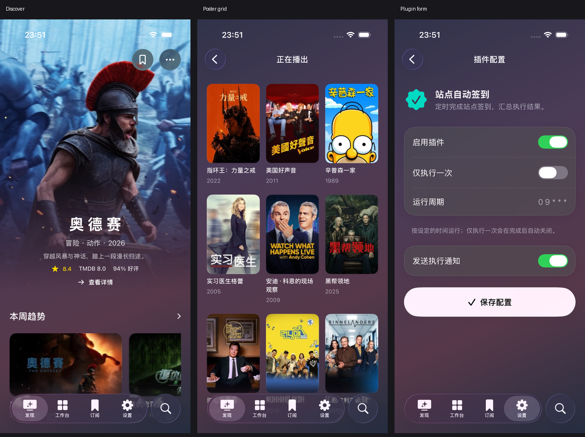

# Rex 单一风格原生预览

P0.2 于 2026-11-19 开始，2026-11-20 完成本批本地视觉/交互检查。唯一方向为用户指定的 **全局连续渐变、玻璃卡片与表单、海报主导、Apple 原生语言**，使用 `swiftui-liquid-glass`；不做多主题、浅色方案、皮肤或主题切换。

这些是独立 SwiftUI App 的实际模拟器画面，具有可操作导航、内存订阅/队列、表单开关与保存；并非静态设计图或网页。媒体、指标及服务状态均为演示数据，不接触主 App 的实例或凭据。业务 API 和动态 JSON 渲染继续分阶段接入。

## 打开方式

1. 在 `ios/MoviePilot.xcodeproj` 选择 **MoviePilotDesignPreview** Scheme，运行到 iPhone/iPad 模拟器。
2. 显示名称是 **MoviePilot预览**，独立 Bundle ID `com.moviepilot.app.v2preview`。主 App 的 `--native-v2` 是账号功能入口，与此预览分开。
3. 可选参数为 `--screen discover`、`dashboard`、`subscriptions`、`settings`、`search`；默认进入发现。参数只选择初始页，不注入后端或身份。
4. 演示状态随进程结束重置；“关于本预览”保留说明。没有真实订阅/下载/配置写入。

App 最低声明仍为 iOS 16；XCTest 目标最低为 iOS 17。实际运行是 iOS 26.1，尚未完成最低系统验收。新目标不依赖主 App、WebKit、Core、VLC、Widget 或后端。

~~~sh
# 在 App 仓运行；模拟器构建使用工作区允许的内置盘专用缓存例外。
DEVELOPER_DIR=/Applications/Xcode.app/Contents/Developer \
TMPDIR=/Volumes/DISK/TmpBuild/moviepilot-ios-v2/tmp \
xcodebuild -project ios/MoviePilot.xcodeproj \
  -scheme MoviePilotDesignPreview -configuration Debug \
  -destination 'platform=iOS Simulator,name=MoviePilot Native v2 Entry' \
  -derivedDataPath "$HOME/Library/Caches/MoviePilotSimulator/native-v2-preview/DerivedData" \
  -clonedSourcePackagesDirPath /Volumes/DISK/Xcode/SourcePackages \
  -resultBundlePath "$HOME/Library/Caches/MoviePilotSimulator/native-v2-preview/preview.xcresult" \
  -parallel-testing-enabled NO CODE_SIGN_IDENTITY=- CODE_SIGNING_ALLOWED=YES test
~~~

重复运行需使用新的 resultBundlePath 或先归档旧结果。不能把大型缓存/结果放入 `/tmp`。

## 组件与技能落点

- [`CinematicSurfaces.swift`](../../ios/NativeDesignSystem/CinematicSurfaces.swift)：固定渐变、24pt 连续圆角面板、原生材质/降低透明度降级、圆形动作及主操作。
- 内容卡片/表单采用原生 Material；导航与浮动动作采用 iOS 26 原生 Liquid Glass，旧系统保留原生材质。多个玻璃动作放入 GlassEffectContainer，效果在布局之后，interactive 只用于真正动作。
- 标准 TabView 搜索角色在当前 iPhone 形成悬浮底栏与独立搜索，iPad 使用系统顶部导航。没有仿制系统状态栏、设备框或手画底栏。
- [艺术图裁切清单](references/rex/preview-assets.json) 对应用户参考里的独立图像，未将整页 UI 当成资源。素材仅供本地评审，不代表已获对外分发许可；正式业务使用后端高清图片管线。

## 画面与验收

- [发现](evidence/2026-11-20-rex/screenshots/iphone/discover.png)、[九项网格](evidence/2026-11-20-rex/screenshots/iphone/poster-grid.png)、[详情](evidence/2026-11-20-rex/screenshots/iphone/detail.png)。
- [工作台](evidence/2026-11-20-rex/screenshots/iphone/dashboard.png)、[设置](evidence/2026-11-20-rex/screenshots/iphone/settings.png)、[插件配置](evidence/2026-11-20-rex/screenshots/iphone/plugin-form.png)。
- [iPad](evidence/2026-11-20-rex/screenshots/ipad/discover.png)、[iPad 横屏](evidence/2026-11-20-rex/screenshots/ipad/landscape.png)、[大字](evidence/2026-11-20-rex/screenshots/iphone/large-text.png)、[降低透明度/提高对比度](evidence/2026-11-20-rex/screenshots/accessibility/plugin-form.png)。
- [实际测试记录](evidence/2026-11-20-rex.md)、[设计 QA 与修正历史](../../design-qa.md)。

P0.2 本地检查通过不等于用户已批准每个细节。后续 P1.4 把共用组件接入真实入口/业务/JSON 表单；页面反馈不阻塞 P2.1 的纯协议模型。长期 Goal 保持 active，功能覆盖状态以 [coverage.md](coverage.md) 为准。
