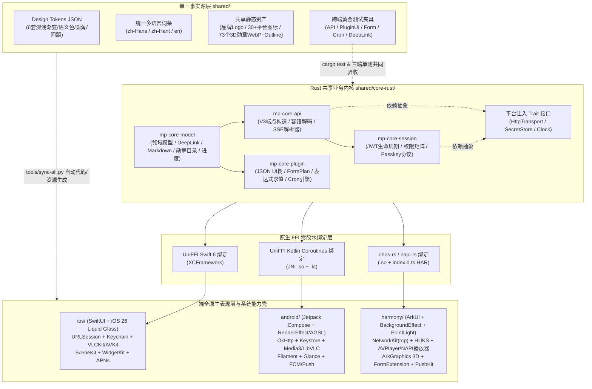
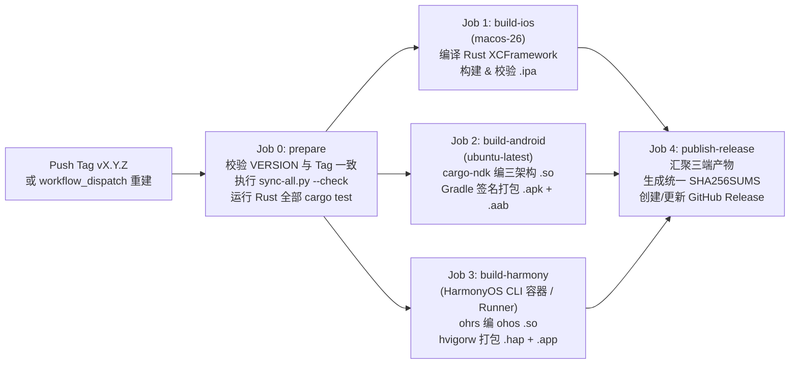

# MoviePilot-App 三端原生 + Rust 共享内核 最终架构设计文档

> **文档定位**：本文档是 `MoviePilot-App` 从纯 iOS（`v2` 分支）演进为 **单仓三端全原生（iOS + Android + HarmonyOS NEXT）+ Rust 共享内核** 的最终目标架构蓝图与施工规范，专门用于指导后续 AI 工程代理与开发者协作落地。  
> **参考基准**：现有 `v2` 分支全原生 SwiftUI iOS 客户端（约 7.7 万行 Swift 6 代码、30 个业务页面、60 张实测截图 [README.md](file:///Users/jxxghp/MPProjects/MoviePilot-App/screenshots/README.md)）作为功能、交互与视觉的**黄金参考基准（Golden Reference）**。

---

## 1. 核心目标与不可违背的工程红线

任何参与本工程的 AI 代理在编写代码、重构目录或引入依赖前，必须严格遵守以下红线：

1. **全原生 UI 铁律**：三端分别使用各自平台的一等原生声明式 UI 框架——**iOS（SwiftUI）**、**Android（Jetpack Compose）**、**鸿蒙（HarmonyOS NEXT ArkTS / ArkUI）**。严禁引入 Flutter、React Native、Uni-app、Ionic/Capacitor 等跨端 UI 壳，严禁在主流程使用 WebView 渲染页面。
2. **WebView 隔离边界**：仅保留遗留 `render_mode == "vue"` 插件的受控隔离容器（对齐 [NativePluginDataPageView.swift](file:///Users/jxxghp/MPProjects/MoviePilot-App/ios/MoviePilot/NativeV2/Pages/NativePluginDataPageView.swift) 的 Pinia/Cookie 免登注入机制）及历史清理逻辑，其余全部 30 个页面必须 100% 原生实现。
3. **系统原生材质与光感铁律（关键）**：实现透明、低雾感玻璃、流光背景、弹窗吸附和动态光感时，**必须优先使用各操作系统的原生渲染与材质能力**（iOS Liquid Glass / MeshGradient、Android RenderEffect / WindowBlur / AGSL RuntimeShader、鸿蒙 `backgroundEffect` / `backgroundBlurStyle` / `pointLight` 动态点光源 / `lightUpEffect`），禁止用低效 CPU 模糊或纯死板半透明黑灰遮罩伪造“假玻璃”。
4. **视觉同源、交互地道**：三端共享同一套 `shared/design-tokens/` 视觉色板、梯度色点、语义状态色、圆角与信息层级（默认「星夜紫玫」+ 5 套预设 + 自定义三色渐变 + 深/浅/跟随系统），但手势导航、弹窗物理弹性、系统栏避让、折叠屏/平板多栏布局必须遵循各平台原生人机交互规范。
5. **业务逻辑零漂移**：协议编解码、SSE 流解析、会话/JWT/权限状态机、DeepLink 路由、插件 JSON UI/表单规划、表达式求值、Cron 解析、Agent Markdown AST 等无 UI 核心逻辑统一下沉至 `shared/core-rust/`，通过同一套跨端测试夹具（Golden Fixtures）验证，禁止三端各自维护分叉逻辑。
6. **单仓统一发版**：一个 Git 仓库、一个根版本号文件 `VERSION`、一次 Git Tag（`vMAJOR.MINOR.PATCH`），通过 CI 并行产出三端安装包（`.ipa`、`.apk`/`.aab`、`.hap`/`.app`）并汇总发布到同一个 GitHub Release。
7. **安全与命名规范**：严禁在源码、日志、测试夹具或截图中写入真实凭据、Token、Cookie、证书；源码、注释与文档中禁止出现第三方竞品名称；所有新增类型与公共方法编写清晰的中文文档注释。

---

## 2. 总体架构与关键架构决策（ADR）

### 2.1 分层总架构图



### 2.2 关键架构决策记录（ADR）

| 编号 | 决策主题 | 最终决定 | 核心原因与避坑说明 |
| :--- | :--- | :--- | :--- |
| **ADR-01** | **Rust 网络传输边界（极重要）** | **Rust 负责协议编解码、请求构造、重试策略与 SSE 状态机；底层 HTTP/TLS 传输通过 `HttpTransport` Callback Trait 由三端原生注入**（iOS `URLSession`、Android `OkHttp`、鸿蒙 `@kit.NetworkKit` `rcp`） | MoviePilot 用户多为自托管 NAS 环境，广泛存在**自签名 HTTPS 证书、系统代理（Clash/Surge/VPN）、IPv6、企业证书及鸿蒙网络权限管控**。若在 Rust 内硬塞 `reqwest + rustls`：一方面绕过系统代理与信任证书链导致大量连接失败，另一方面引入重型 Tokio+TLS 会使二进制暴涨且在 iOS WidgetKit（30MB 内存上限）极易 OOM 崩溃。采用“原生 Transport 注入 + Rust 协议大脑”兼具跨端一致性与原生网络兼容性。 |
| **ADR-02** | **安全凭据与持久化边界** | **Rust 不直接触碰磁盘加密库，通过 `SecretStore` / `KvStore` Trait 委托给平台原生安全存储** | iOS 必须走 `Keychain`（含 App Group 供 Widget 共享），Android 走 `Android Keystore + EncryptedSharedPreferences / DataStore`，鸿蒙走 `@kit.UniversalKeystoreKit (HUKS) + Preferences`，确保符合三端商店隐私与安全审计规范。 |
| **ADR-03** | **FFI 选型双轨制** | **iOS + Android 使用 Mozilla UniFFI（Proc-Macro）；鸿蒙使用 `ohos-rs`（基于 napi-rs）** | UniFFI 对 Swift 6 严格并发和 Kotlin 协程生态最成熟；鸿蒙 ArkTS 原生原生层接口是 Node-API（NAPI），使用 `ohos-rs` 可直接生成带完整 `.d.ts` 类型声明的 `libmoviepilot_core.so` 与 HAR 包，零中间桥接损耗。核心 Crate（`mp-core-*`）与 FFI 适配层（`mp-ffi-uniffi`、`mp-ffi-ohos`）严格解耦。 |
| **ADR-04** | **现有 iOS `v2` 平滑演进** | **先通过 `git mv` 将原根目录 SwiftPM 收拢进 `ios/`，再按模块渐进式将 `Sources/` 替换为调用 `mp-core-*`** | 现有 7.7 万行 iOS 代码已上线可跑，必须保证每次迁移 PR 后 `ios/` 测试与 IPA 构建始终绿灯，绝不允许出现长期不可编译的大分支。 |
| **ADR-05** | **材质与光感统一哲学** | **“Token 同源 + 材质原生 + 降级保色”** | 同一份颜色/梯度/模糊强度语义 Token 映射到各端最优系统材质 API；在无障碍“减弱透明度”、低电量模式或旧系统上，统一降级为同色系通透渐变实底，绝不出现发灰、发黑或文字低对比度。 |
| **ADR-06** | **后端推送与多端兼容** | **客户端先按统一设备注册契约抽象 `PushProvider`，同步向 `MoviePilot` 后端提出 `platform`（`ios` / `android` / `harmony`）兼容扩展** | 目前 iOS 仅接 APNs；Android（FCM / 厂商 / 自建通道）与鸿蒙（Push Kit）需要后端按平台区分推送通道。主流程不阻塞于推送，推送作为 Phase 6 联调项。 |

---

## 3. 最终目标 Monorepo 文件结构

### 3.1 完整目录树

```text
MoviePilot-App/
├── VERSION                                  # 三端唯一语义版本号（例如 2.1.0）
├── BUILD_NUMBER                             # 统一构建号（正整数，供三端递增）
├── AGENTS.md                                # 多端仓库总约定（指向各子端与 Rust 规则）
├── README.md                                # 三端总览与构建入口
├── ROADMAP.md                               # 链接或承载本多端演进路线图
│
├── shared/                                  # 【单一事实源 SSOT】
│   ├── design-tokens/
│   │   ├── schema.json                      # Token JSON Schema 校验规则
│   │   ├── palette.json                     # 6 套深浅色 4 段渐变 + 强调色 + 语义状态色
│   │   ├── surfaces.json                    # 玻璃透明度/模糊等级/高光描边/投影/动态光感参数
│   │   ├── layout.json                      # 边距(20/24/28)、圆角(24)、断点(600/680/840/960)、栅格公式
│   │   └── icons.json                       # 跨端语义图标映射表 (semantic_id -> sf_symbol / material / ohos_symbol)
│   ├── l10n/
│   │   ├── app.strings.json                 # 主应用多语言词条单一源（zh-Hans / zh-Hant / en）
│   │   └── widgets.strings.json             # 桌面小组件多语言词条单一源
│   ├── assets/
│   │   ├── brand/                           # AppIcon 1024px 源图、BrandMark、LaunchMark（SVG/PNG）
│   │   ├── logos/                           # 30+ 平台与服务图标（tmdb/douban/emby/qb/115 等）
│   │   └── community-medals/                # 原 ios/.../CommunityMedals 73 个 .webp 与 .outline.json
│   ├── contracts/
│   │   ├── v3-endpoints.yaml                # 对齐 MoviePilot V3 后端 API 路由清单
│   │   ├── deeplinks.yaml                   # moviepilot:// 全量路由与 Web 路由映射表
│   │   └── plugin-ui-schema.json            # 插件 JSON 组件与表单协议规范
│   ├── fixtures/                            # 跨端黄金测试夹具（供 Rust 与三端测试共同验证）
│   │   ├── api/                             # 媒体详情、发现页、资源搜索、站点流量等 JSON 夹具
│   │   ├── plugin-ui/                       # 迁自 Tests/MoviePilotPluginUITests/Fixtures/
│   │   ├── plugin-forms/                    # 迁自 Tests/MoviePilotPluginFormsTests/Fixtures/
│   │   ├── deeplinks/                       # 路由解析用例集（输入 URL -> 期望路由对象）
│   │   └── markdown/                        # Agent 流式 Markdown 边界用例集
│   └── core-rust/                           # 【Rust 共享业务内核 Cargo Workspace】
│       ├── Cargo.toml                       # Workspace 根配置（edition = "2024" / MSRV 锁定）
│       ├── Cargo.lock
│       ├── rust-toolchain.toml              # 锁定 Rust 版本与三端交叉编译 targets
│       └── crates/
│           ├── mp-core-model/               # 领域模型、DeepLink、Markdown、勋章目录、进度、本地化辅助
│           ├── mp-core-api/                 # V3 请求构造器、强类型容错解码器、SSE 解析器、Transport Trait
│           ├── mp-core-session/             # 会话状态机、JWT 过期感知、权限矩阵、Passkey 协议
│           ├── mp-core-plugin/              # PluginJSON、PluginUIDecoder、NativeFormPlan、表达式、Cron、Combobox
│           ├── mp-ffi-uniffi/               # iOS (Swift 6) + Android (Kotlin) UniFFI 统一导出层
│           └── mp-ffi-ohos/                 # HarmonyOS NEXT (ArkTS) ohos-rs / NAPI 导出层
│
├── ios/                                     # 【iOS 原生端：Swift 6 + SwiftUI】
│   ├── AGENTS.md                            # 保留 iOS 专属构建缓存、Swift6 规范
│   ├── Package.swift                        # 从根目录迁入；消费 Rust XCFramework + 轻量化 Swift 适配层
│   ├── Sources/                             # 薄 Swift 适配层（注入 URLSession/Keychain + 兼容过渡封装）
│   ├── Tests/                               # iOS 核心与 FFI 集成测试
│   ├── Frameworks/                          # 生成的 MoviePilotRustCore.xcframework（gitignore 或构建产）
│   ├── project.yml                          # XcodeGen 配置（path 调整为 "."，新增 Rust 预构建脚本）
│   ├── NativeDesignSystem/                  # 消费生成 Token + Liquid Glass / MeshGradient 材质
│   ├── MoviePilot/                          # 30 个业务页面、VLCKit 播放器、SceneKit 3D 勋章、APNs
│   ├── MoviePilotWidgets/                   # WidgetKit 小组件
│   └── MoviePilotUITests/                   # XCUITest
│
├── android/                                 # 【Android 原生端：Kotlin + Jetpack Compose】
│   ├── AGENTS.md                            # Android 编码规范、Gradle 缓存与 Compose 性能红线
│   ├── settings.gradle.kts
│   ├── build.gradle.kts
│   ├── gradle.properties                      # 由 sync-version.py 同步版本号
│   ├── gradle/libs.versions.toml            # Version Catalog 集中管理依赖
│   ├── core-rust-bridge/                    # UniFFI 生成的 Kotlin 绑定 + jniLibs(.so) + OkHttp/Keystore 注入
│   ├── design-system/                       # 生成 Token + RenderEffect/Haze 玻璃 + AGSL 流光 + 4+1 底栏
│   ├── core-media/                          # Media3 + LibVLC 播放器、MediaSessionService、PiP、迷你音乐条
│   ├── core-medal3d/                        # Filament/GLES3 3D 勋章渲染 + Canvas 背面铭牌雕刻
│   ├── core-plugin-host/                    # Compose JSON 插件渲染器 + 隔离 WebView Vue 容器
│   ├── feature/                             # 按领域拆分的 10 个轻量功能模块（映射 iOS 30 页面）
│   │   ├── auth/                            # 连接服务、登录、切换实例
│   │   ├── discover/                        # 发现、模块编排、探索、全局搜索、音乐
│   │   ├── media/                           # 影视/豆瓣/演职员/媒体库详情与浏览
│   │   ├── subscribe/                       # 我的订阅、编辑弹窗、追剧日历、订阅广场
│   │   ├── download/                        # 站点资源 9 维筛选、下载确认弹窗、正在下载
│   │   ├── library/                         # 文件管理、手动整理、整理历史与队列
│   │   ├── dashboard/                       # 我的仪表盘、消息中心、捷径诊断中心
│   │   ├── automation/                      # 工作流列表、原生节点画布、站点管理与流量图
│   │   ├── agent/                           # AI 智能助手 SSE 对话、悬浮形象、语音录制与 TTS
│   │   └── settings/                        # 设置中心、系统配置、外观、用户、渠道授权、插件市场
│   ├── widget/                              # Jetpack Glance 桌面小组件
│   └── app/                                 # 主壳、NavHost/NavigationSuite、DeepLink、MIME 打开方式、签名
│
├── harmony/                                 # 【鸿蒙原生端：HarmonyOS NEXT API 12+ / ArkTS + ArkUI】
│   ├── AGENTS.md                            # 鸿蒙 ArkTS 严格类型规范、一多断点与光感性能红线
│   ├── build-profile.json5
│   ├── oh-package.json5
│   ├── hvigorfile.ts
│   ├── AppScope/                            # app.json5（由 sync-version.py 同步版本号）、全局资源
│   ├── commons/
│   │   ├── core_rust_bridge/                # HAR：ohos-rs 生成的 libmoviepilot_core.so + .d.ts + rcp/HUKS 注入
│   │   ├── design_system/                   # HAR：生成 Token + BackgroundEffect + PointLight 动态光感 + 4+1 底栏
│   │   ├── media_player/                    # HAR + C++ NAPI：AVPlayer + XComponent 原生解码器 + AVSession + PiP
│   │   ├── medal_3d/                        # HAR：ArkGraphics 3D / XComponent 勋章 + OffscreenCanvas 雕刻
│   │   └── plugin_host/                     # HAR：ArkUI JSON 插件渲染器 + ArkWeb 隔离 Vue 宿主
│   ├── features/                            # HSP/HAR 业务模块（与 android/feature/ 保持 1:1 领域对齐）
│   │   ├── auth/
│   │   ├── discover/
│   │   ├── media/
│   │   ├── subscribe/
│   │   ├── download/
│   │   ├── library/
│   │   ├── dashboard/
│   │   ├── automation/
│   │   ├── agent/
│   │   └── settings/
│   └── entry/                               # 主 HAP：EntryAbility、主导航壳、FormExtensionAbility 卡片、Push、DeepLink
│
├── tools/                                   # 【统一构建、代码生成与质检工具链】
│   ├── sync-all.py                          # 一键同步版本/Tokens/L10n/Assets 到三端，支持 --check CI 拦截
│   ├── sync-version.py
│   ├── sync-tokens.py                       # palette/surfaces/layout/icons -> Swift / Kotlin / ArkTS
│   ├── sync-l10n.py                         # app.strings.json -> .strings / strings.xml / string.json
│   ├── sync-assets.py                       # brand/logos/medals -> xcassets / drawable / rawfile
│   ├── rust/
│   │   ├── build-ios.sh                     # cargo build (aarch64-apple-ios / sim) + uniffi-bindgen + XCFramework
│   │   ├── build-android.sh                 # cargo-ndk (arm64-v8a/armeabi-v7a/x86_64) + uniffi-bindgen
│   │   └── build-harmony.sh                 # ohrs build (aarch64-unknown-linux-ohos / x86_64) -> HAR
│   ├── ios/                                 # 迁自原 scripts/（build-ipa.sh / verify-ipa.py / test-core.sh 等）
│   ├── android/                             # build-android.sh / verify-apk.py
│   ├── harmony/                             # build-harmony.sh / verify-hap.py / Dockerfile.ohos-ci
│   └── tests/                               # 迁自原 scripts/tests/ + 新增 sync 脚本单测
│
├── screenshots/
│   ├── README.md                            # 索引
│   ├── ios/                                 # 迁自原 screenshots/screens/（60 张黄金对照图）
│   ├── android/                             # Android 对标验收截图
│   └── harmony/                             # 鸿蒙对标验收截图
│
└── .github/
    ├── RELEASE_NOTES.md
    └── workflows/
        ├── ci.yml                           # 路径过滤 Matrix（Rust / iOS / Android / Harmony / SSOT 校验）
        └── release.yml                      # 单 Tag 并行打包三端 + 合并 SHA256SUMS + 统一 Release
```

### 3.2 现有 `v2` 根目录迁移对照表（给 Phase 0 执行 AI）

| 原路径（`v2` 当前） | 目标路径 | 迁移注意事项 |
| :--- | :--- | :--- |
| [Package.swift](file:///Users/jxxghp/MPProjects/MoviePilot-App/Package.swift), `Sources/`, `Tests/` | `ios/Package.swift`, `ios/Sources/`, `ios/Tests/` | 使用 `git mv` 保留历史；更新 `ios/project.yml` 中 `MoviePilotCore` 路径为 `.` |
| `Tests/MoviePilotPluginUITests/Fixtures/`、`Tests/MoviePilotPluginFormsTests/Fixtures/` | `shared/fixtures/plugin-ui/`、`shared/fixtures/plugin-forms/` | 作为跨端公共夹具，Rust 与三端测试统一读取 |
| `ios/MoviePilot/Resources/CommunityMedals/` | `shared/assets/community-medals/` | 由 `tools/sync-assets.py` 同步到三端构建资源目录 |
| `ios/MoviePilot/Resources/Assets.xcassets/logo-*.imageset` | `shared/assets/logos/` | 抽出原始高清图/SVG，同步生成三端图标资源 |
| `Sources/MoviePilotCore/Resources/*.lproj/Localizable.strings` | `shared/l10n/app.strings.json` | 写一次转换脚本导出为 JSON SSOT，之后单向生成三端 |
| `scripts/*` | `tools/ios/*` 与 `tools/tests/*` | 更新 CI、文档、脚本内相对路径 |

---

## 4. Rust 共享内核详细边界（现有 61 个 Swift 文件归属矩阵）

现有 `Sources/` 共 61 个 Swift 文件（13,843 行）。按“**纯逻辑与协议进 Rust，系统集成留各端原生**”原则逐一划分：

| 目标位置 | 包含的原 `Sources/` 模块与文件 | 说明与验证标准 |
| :--- | :--- | :--- |
| **`mp-core-model`**<br>（Rust Crate） | `ServerAddress`、`AppDeepLink`（954 行）、`AppLanguage`、`AgentMarkdownParser`、`MediaServerBrowseModel`（916 行）、`SubscribeProgressModel`、`CommunityMedalsModel`、`MediaLogoLanguagePolicy`、`PlaybackInterruptionState`、`NavigationSnapshot`、`NativePanelFeedState`、`OperationMenu`、`HomeShortcut`、`WebLink`、`RelativeTimeFormatter`、`ConnectionFailure`、`NotificationFailure`、`NotificationIntent`、`NotificationCenterAddress`、`UsageReporting`、`WidgetData`、`WidgetDisplay` | 100% 纯 Rust，无平台依赖；原有 `Tests/MoviePilotCoreTests/` 逻辑用例全部转为 `cargo test` 夹具测试 |
| **`mp-core-api`**<br>（Rust Crate） | `APIClient`（860 行）、`APIEndpoint`、`APIError`、`APIImage`、`APIResponse`、`DiscoverSource`、`MediaDetail`（925 行）+ 新增 `SseStreamParser`（统一 Agent 与系统检查 SSE 帧解析）+ 新增 `ResourceFilterEngine`（资源 9 维级联筛选与同规格分组） | 定义异步 `HttpTransport` Trait；Rust 产出标准 `HttpRequestSpec` 并接收原始字节/流块进行容错 JSON 解码与业务错误映射 |
| **`mp-core-session`**<br>（Rust Crate） | `NativeSession`、`NativeSessionManager`、`NativeSessionState`、`NativePermissions`、`SessionIdentity`、`NativeAuthenticationClient`、`Authentication`、`Passkey`、`LoginCredentialStore`（接口与模型） | Rust 负责 JWT `exp` 解析、401 登出状态机、权限判定、Passkey 协议编解码；凭据加解密读写回调原生 `SecretStore` |
| **`mp-core-plugin`**<br>（Rust Crate） | **全部** `MoviePilotPluginUI/*`（6 文件）与 `MoviePilotPluginForms/*`（7 文件：`NativeFormPlan`、`NativeFormExpression`、`NativeCron`、`NativeCombobox`、`NativePluginForm`、`PluginFormContract`、`NativeInstalledPlugin`）+ `PluginWebFrontend` | **跨端 ROI 最高模块**：三端只做最终声明式 UI 组件映射，绝不重复实现 Vuetify 组件规范解析、表达式求值或 Cron 解析；100% 通过 `shared/fixtures/plugin-*` 全部用例 |
| **保留在各端原生壳**<br>（不进 Rust） | `EdgeBackGesture`、`WidgetAppGroup`、`WidgetBridge`、`WidgetBridgeChannel`、`WidgetSharedStorage`、`WidgetSnapshotClient`、`WidgetStore`、`BridgeProtocol`、`ChromeSession` | 强耦合各端 AppGroup / Extension / Gesture / 生命周期，在各端写薄原生实现，数据载体直接复用 Rust 导出的 `WidgetData` / `WidgetDisplay` 模型 |

### 4.1 跨语言 FFI 设计规范（防坑指南）

1. **禁止大对象高频跨越 FFI 边界**：
   - 列表滚动（60/120fps）时禁止每帧调用 FFI；Rust 侧一次性返回已整理好的 ViewModel 切片或分页快照（如已分组的 `DiscoverContent`、已过滤排序的 `ResourceGroup[]`）。
2. **异步与流式调用统一模型**：
   - 请求-响应接口：`async fn`（UniFFI 自动映射为 Swift `async throws` 与 Kotlin `suspend fun`；`ohos-rs` 映射为 ArkTS `Promise<T>`）。
   - 流式接口（AI 智能助手 SSE、实时日志、系统健康检查流）：采用 Rust Pull 迭代器或回调接口 `StreamSink::on_event(event)`，在原生层分别转为 Swift `AsyncStream`、Kotlin `Flow`、鸿蒙 `Emitter` / 回调订阅。
3. **二进制体积极简**：
   - Rust Release Profile 开启 `lto = "thin"`、`opt-level = "z"`、`strip = true`、`panic = "abort"`，单架构 `.so` / `.a` 目标控制在 **2–4 MB** 内。

---

## 5. 三端原生美学与系统级玻璃 / 动态光感设计规范（重点）

本节是保证三端**“同样高级、同样通透、各自最原生”**的核心施工标准，AI 实现任何页面前必须先实现并通过 `design-system` 视觉基准页验证。

### 5.1 统一视觉基石（来自 `shared/design-tokens/`）

1. **外观模式**：`dark`（默认）、`light`、`system`（跟随系统）。
2. **6 套背景流光色板**（每套同时提供深色 4 段色点与浅色 4 段色点，默认 `cinematic`「星夜紫玫」，支持 `ocean`、`forest`、`amber`、`graphite`、`custom` 三色自定义）。
3. **统一结构尺寸**：主卡片圆角 `24pt/dp/vp`（连续曲率超椭圆），内容边距手机 `20` / 宽屏 `24` / 超宽屏 `28`，分隔线透明度深色 `11%` / 浅色 `9%`。
4. **低雾感原则（严格禁止灰雾脏底）**：
   - 深色玻璃卡片必须透出底层紫玫/极光渐变，**禁止**大面积不透明灰底或过浓白雾遮罩；
   - 浅色玻璃卡片采用高透洁净磨砂白 + 极淡主题色折射 + 清晰高对比度文字（对齐 [CinematicSurfaces.swift](file:///Users/jxxghp/MPProjects/MoviePilot-App/ios/NativeDesignSystem/CinematicSurfaces.swift) 的 `NativeTheme` 自适应色板）；
   - 模态弹窗内部**禁止**二次叠加不透明背景，必须透出主界面流光层次。

### 5.2 三端原生材质与光感 API 实现对照表（硬性约束）

| 视觉元素 | iOS 原生实现（基准） | Android 原生实现（Jetpack Compose） | 鸿蒙原生实现（HarmonyOS NEXT ArkUI） |
| :--- | :--- | :--- | :--- |
| **动态流光背景**<br>（`CinematicAmbientGradient`） | iOS 18+ 原生 GPU `MeshGradient`（3×3 网格，15fps 呼吸流动）；低电量/减弱动态/后台自动暂停 | Android 13+（API 33+）原生 **AGSL `RuntimeShader`** 在 GPU 绘制同款 3×3 呼吸流光网格（限 15fps）；API 31–32 回退端点漂移 `Brush.linearGradient`；监听 `PowerManager.isPowerSaveMode` 与 `ANIMATOR_DURATION_SCALE` 自动静止 | ArkUI 原生 **RenderNode / 图形着色器（`EffectKit` / `OH_Drawing` / `XComponent` 轻流光层）** 或原生动态渐变网格（限 15fps）；监听省电模式、窗口退后台自动暂停 |
| **玻璃内容卡片**<br>（`CinematicPanel`） | 连续圆角 + 轻 `.ultraThinMaterial` 低雾层 + 主题色微染色 + 渐变高光细边（`0.7pt`）+ 柔和投影 | API 31+ 基于系统 **`RenderEffect.createBlurEffect`** 的局部背景模糊（如 `Haze` 硬件管线，低模糊半径 + 轻色罩）+ 连续圆角（`RoundedCornerShape(24.dp)`）+ 对角渐变 `0.7.dp` 高光描边；低版本降级同源半透明渐变底 | **系统原生材质 + 动态光感**：`backgroundEffect({ radius, saturation, brightness, color, adaptiveColor: AdaptiveColor.AVERAGE })` 或 `backgroundBlurStyle(BlurStyle.COMPONENT_ULTRA_THIN, { policy: FOLLOWS_WINDOW_ACTIVE_STATE })` + **鸿蒙 `pointLight` 点光源边缘受光（`IlluminatedType.BORDER_CONTENT`）**，按压/触摸时玻璃边缘呈现自然流体光感扫过！ |
| **4+1 底部悬浮导航 & 二次点击 8 项快捷菜单** | iOS 26+ 原生 **Liquid Glass `TabView`** + 右侧 `+1` 动态动作/全局搜索独立液态玻璃圆钮 + 同心圆角玻璃弹层 | 沉浸式 Edge-to-Edge 悬浮胶囊底栏：**原生 `RenderEffect` 实时背景折射模糊** + Material 3 弹簧形变选中态胶囊 + 右侧分离式 `+1` 玻璃 FAB；二次点击底栏主图标以弹性曲线展开 8 项网格玻璃卡片 | **鸿蒙原生流体玻璃悬浮胶囊栏**：底层 `backgroundEffect`（高饱和低雾玻璃）+ **`pointLight` 随选中项/触控点平滑移动的动态光斑** + `lightUpEffect` 激活提亮 + 右侧独立 `+1` 悬浮光感圆钮；二次点击触发原生弹簧动画展开 8 项光感菜单卡片 |
| **模态弹窗**<br>（`NativeGlassSheet`） | 原生 `.sheet` 分档吸附手势 + `.presentationBackground` 低雾流光透色 + iOS 26 `ConcentricRectangle` 高光边 | Material 3 `ModalBottomSheet` + API 31+ 原生 **`Window.setBackgroundBlurRadius`**（`FLAG_BLUR_BEHIND`）叠加同源透色渐变层 + 原生 Predictive Back 预测性下拉关闭手势 | ArkUI 原生 **`bindSheet`**（配置 `detents` 分档吸附、`blurStyle: BlurStyle.COMPONENT_THIN`、`backgroundColor` 主题低透明度染色、`dragBar: true`），100% 保留鸿蒙原生跟手阻尼与边缘回弹，**禁止用 `Stack` 伪造弹窗** |
| **顶部导航栏安全区遮罩**<br>（`topSafeAreaVeil`） | 随背景首色点动态过渡的顶部柔光渐隐遮罩，滚动时内容自然隐入状态栏下 | `enableEdgeToEdge()` 全透明系统状态栏 + 顶部与 `palette[0]` 同色渐变柔化过渡 + `NestedScrollConnection` 联动标题渐显 | `window.setWindowLayoutFullScreen(true)` + 监听 `getWindowAvoidArea` 避让区 + 原生 `Navigation` 标题栏 `backgroundBlurStyle` 联动渐隐 |
| **无障碍与高对比降级** | 响应 `accessibilityReduceTransparency`、`colorSchemeContrast`、Dynamic Type | 响应系统高对比度文字、减弱动画、字体缩放（`LocalDensity.fontScale`）与省电模式 | 响应系统高对比度、深浅色切换、字体缩放（`fontSizeScale`）、省电模式自动降级动态光感与流光帧率 |

### 5.3 三端响应式多形态布局（手机 / 平板 / 折叠屏）

对齐 [NativeDeviceLayout.swift](file:///Users/jxxghp/MPProjects/MoviePilot-App/ios/MoviePilot/NativeV2/NativeDeviceLayout.swift) 的宽度栅格公式（写入 `shared/design-tokens/layout.json` 统一管理）：

- **手机竖屏（`< 600`）**：4+1 底部悬浮导航 + 单列业务卡片 + 3 列竖版海报（2:3）/ 2 列方形音乐卡（1:1）。
- **折叠屏展开 / 平板中屏（`600 ~ 840`）**：
  - Android：使用 `NavigationSuiteScaffold` 自动切为侧边 `NavigationRail` + 监听 `Jetpack WindowManager` `FoldingFeature` 避开折痕；
  - 鸿蒙：使用鸿蒙**一多断点（`md`）** + `display.getFoldStatus()` 感知折态，自动切换侧边栏导航或 `NavigationMode.Split` 双栏。
- **平板横屏 / 桌面宽屏（`>= 840 / 960`）**：左侧玻璃工作台侧栏（直达发现/探索/仪表盘/全部快捷入口）+ 2 列业务卡片 + 5~6 列海报网格 + 宽幅弹窗（iOS `.presentationSizing(.page)` / Android 居中圆角 Dialog Sheet / 鸿蒙 `SheetType.CENTER`）。

---

## 6. 30 个业务页面与重型原生子系统对标总表

### 6.1 10 大功能域与 iOS 黄金源文件映射

AI 开发 Android 与鸿蒙页面时，必须逐一对照下表对应的 iOS 黄金源码文件（位于 `ios/MoviePilot/NativeV2/`）及 `screenshots/ios/` 对应截图：

| 功能模块域 | 包含页面 / 弹层 | 黄金参考 iOS 源码 | 关键交互与技术要点 |
| :--- | :--- | :--- | :--- |
| **1. 主壳与认证** (`auth`) | 启动过渡屏、连接服务、登录（账号/Passkey）、主导航壳、全局溢出菜单、悬浮助手、迷你音乐条 | `NativeV2RootView.swift`、`NativeV2MainShell.swift`、`NativeAppModel.swift`、`NativeDynamicActionCenter.swift` | 4+1 导航、各 Tab 独立导航栈、溢出菜单单层不污染历史栈、JWT 超时自动清空缓存退回登录 |
| **2. 发现与探索** (`discover`) | 发现首页（透明片名 Logo 主视觉 + 横向栏 + 自动翻页网格）、模块编排、探索（TMDB/豆瓣/Bangumi 横向小卡切换）、全局搜索、音乐发现 | `NativeDiscoverPage.swift`、`NativeDiscoverModulesSheet.swift`、`NativeExplorePage.swift`、`NativeMediaSearchPage.swift`、`NativeMusicPage.swift` | 透明片名 Logo 适配（优先后端 `logo_language`，兜底 Android ML Kit / 鸿蒙 Core Vision Kit）；全局搜索仅媒体库直放，其余进详情 |
| **3. 详情与媒体库** (`media`) | 影视详情、豆瓣详情、剧集分季、演职员/人物详情、媒体服务器库浏览、媒体库条目详情 | `NativeMediaDetailPage.swift`、`NativeMediaServerLibraryPage.swift`、`NativeMediaServerDetailPage.swift` | 沉浸式无遮挡影院首屏头图（按屏幕高宽比动态计算）、订阅/搜索/直放联动 |
| **4. 订阅与日历** (`subscribe`) | 我的订阅、订阅编辑全量弹窗（影视+音乐 5 项音质）、追剧日历、订阅广场（热门+社区分享） | `NativeSubscriptionsPage.swift`、`NativeSubscribeEditorSheet.swift`、`NativeCalendarPage.swift`、`NativeSubscribeCommunityPage.swift` | 复用 Rust `SubscribeProgressModel` 与规则参数映射；日历点击直达详情 |
| **5. 资源与下载** (`download`) | 站点资源（关键词搜索 / 首页浏览 + 9 维级联筛选 + 同规格分组）、下载确认弹窗、正在下载管理 | `NativeResourceSearchPage.swift`、`NativeDownloadsPage.swift` | 9 维级联筛选与分组算法放进 Rust；点击整张资源卡弹下载确认原生分组 Sheet |
| **6. 文件与整理** (`library`) | 多存储文件浏览、手动整理/智能重命名弹窗、整理历史（常驻搜索 + 链式路径）、整理队列 | `NativeFileManagerPage.swift`、`NativeTransferHistoryPage.swift` | 长按上下文菜单（整理/重命名/删除 4 种源目标组合）；点击音视频直接调用原生播放器 |
| **7. 仪表盘与诊断** (`dashboard`) | 我的仪表盘（含插件 JSON 卡片）、编辑仪表盘、消息中心玻璃弹层、捷径菜单、系统检查/识别测试/实时日志/定时服务/词表管理 | `NativeDashboardPage.swift`、`NativeMessagesPage.swift`、`NativeDiagnosticsToolsPage.swift` | CPU/内存/网络/下载器/7天趋势全量组件；系统检查与日志复用 Rust 流解析器与结构化正则 |
| **8. 工作流与站点** (`automation`) | 我的工作流、社区分享、纯原生工作流节点画布、站点管理 CRUD、站点双向流量统计与历史图表 | `NativeWorkflowsPage.swift`、`NativeWorkflowCanvasPage.swift`、`NativeSitesPage.swift` | 原生 Canvas 手势缩放平移节点画布；双向绿/玫红上下行流量图示与趋势折线图 |
| **9. AI 智能助手** (`agent`) | SSE 流式对话、工具调用/思考计时、Markdown 卡片、交互选择卡、图片/文件上传、原生录音与 TTS 播放、可自由拖动悬浮机器人 | `NativeAgentChatPage.swift`、`NativeAgentFloatingMascot.swift` | SSE 解析与 Markdown AST 100% 走 Rust；悬浮形象自由拖动不贴边并持久化坐标（零残影） |
| **10. 设置与插件生态** (`settings`) | 设置主中心、系统模块设置、外观设置、用户管理、渠道授权、插件市场与源绑定、已安装插件（含分身）、JSON 插件表单/数据页、隔离 Vue 插件容器 | `NativeSettingsHubPage.swift`、`NativeSystemSettingsPage.swift`、`NativeSystemModulesPage.swift`、`NativeAppearanceSettingsPage.swift`、`NativeUsersPage.swift`、`NativePluginMarketPage.swift`、`NativePluginDataPageView.swift`、`NativePluginFormView.swift`、`NativePluginCronEditor.swift`、`NativePluginComboboxEditor.swift` | 原生分组列表卡片零阴影裁切；插件 JSON 树/表单计划/Cron/表达式 100% 走 Rust；遗留 Vue 插件用原生 WebView 注入免登状态 |

### 6.2 四大重型原生子系统专项架构

1. **全格式音视频播放器与悬浮音乐条**
   - **架构分层**：定义三端一致的播放清单模型 `MediaPlaybackManifest` 与播放队列 `MediaPlaybackQueueItem`（由 Rust 提供），各端原生实现 `NativePlayerEngine`：
     - **视频双内核策略**：常规 MP4/HLS/音频优先走系统低功耗硬解（iOS `AVKit` / Android `Media3 ExoPlayer` / 鸿蒙 `AVPlayer`），遇到 MKV/TS/M2TS/FLV/ASS 内嵌字幕/多音轨自动无缝切换全格式软硬解引擎（iOS `VLCKit` / Android `LibVLC Android` 或 `mpv-android` / 鸿蒙 `XComponent` + C++ NAPI 封装 `FFmpeg/mpv/VLC`）。
     - **极简播控 UI（严格对齐 Milestone 2）**：右上角仅保留画中画按钮；锁定/解锁纯图标居中靠右且仅横屏显示；进度条下方左（字幕、音轨）右（填充模式、倍速）全纯图标。
     - **音频后台与迷你悬浮条**：音乐页收起后缩为底栏上方原生玻璃/光感悬浮播放条，接入系统锁屏与控制中心（iOS `MPNowPlayingInfoCenter` / Android `MediaSessionService` / 鸿蒙 `AVSession`）。

2. **3D 社区勋章与背面金属动态雕刻**
   - **资产 100% 共享**：`shared/assets/community-medals/` 下的 73 个 `.webp` 纹理与 `.outline.json` 轮廓点集直接打包进三端资源目录。
   - **背面铭牌凹雕算法统一**：将配色计算逻辑放入 Rust `CommunityMedalsModel`，三端各自用原生 2D 画布（`CoreGraphics` / `android.graphics.Canvas` / ArkUI `OffscreenCanvas`）在 `dial` 区域完成三遍凹雕并生成纹理贴图。
   - **3D 实时交互渲染**：iOS `SceneKit`、Android `Google Filament`（或轻量化 OpenGL ES 3.0 挤压网格 Shader）、鸿蒙 `ArkGraphics 3D`（或 `XComponent + OpenGL ES 3.0`），支持跟手 3D 旋转惯性与金属反光。

3. **动态插件系统（JSON 原生引擎 + Vue 隔离宿主）**
   - **JSON 原生渲染**：Rust `mp-core-plugin` 输出扁平化、已求值的 `RenderedNodeTree` 与 `FormPlan`；三端 UI 层只需维护一份 1:1 组件映射表（`VRow/VCol/VCard/VAlert/VExpansionPanels/VDataTable/VTabs/VChipGroup/VSlider/VRangeSlider/VAutocomplete/VCarousel/VAceEditor/VDialog/VBtn` 等）和原生 `CronEditor` / `ComboboxEditor`。
   - **Vue 遗留插件隔离宿主**：仅对 `render_mode == "vue"` 开启独立 WebView，注入 Pinia `auth`/`user` 状态、资源 Cookie 与 `MoviePilotNative` 隐藏 Web 壳，拦截非法跳出导航，登出或切换实例时立即清空 WebView 缓存与 Cookie。

4. **系统生态集成（DeepLink / 文件打开方式 / 桌面小组件 / 推送）**
   - **`moviepilot://` 全路由**：所有路由解析委托 Rust `AppDeepLink::parse(url)` 返回强类型路由枚举，三端路由枢纽执行页面跳转或直链播放（严格校验外部直链不携带任何 MoviePilot 凭据）。
   - **系统文件打开方式**：注册全部常见视频（MP4/MKV/MOV/AVI/TS/M2TS/WebM/FLV/WMV/RMVB）与音频（MP3/FLAC/M4A/AAC/WAV/OGG/Opus/ALAC/APE/WMA/MKA）格式，未登录状态下也支持直接调起原生播放器播放本地文件。
   - **桌面小组件**：三端共享 `WidgetData` 模型与刷新策略，UI 分别用原生 `WidgetKit`、`Jetpack Glance`、`FormExtensionAbility` 实现，延续星夜紫玫透色风格。

---

## 7. 单仓三端构建、签名与 CI/CD 流水线设计

### 7.1 统一版本与资源同步门禁（`tools/sync-all.py`）

每次修改 `VERSION`、`BUILD_NUMBER` 或 `shared/` 下任意文件后，执行：
```zsh
python3 tools/sync-all.py
```
该脚本自动完成 4 件事（CI 中跑 `python3 tools/sync-all.py --check`，若存在未同步的 diff 直接拦截合并）：
1. **同步版本号**：`VERSION` + `BUILD_NUMBER` → `ios/project.yml`、`android/gradle.properties`、`harmony/AppScope/app.json5`。
2. **生成 Design Tokens 代码**：`shared/design-tokens/*.json` → `ios/NativeDesignSystem/GeneratedTokens.swift`、`android/design-system/.../GeneratedTokens.kt`、`harmony/commons/design_system/.../GeneratedTokens.ets`。
3. **生成多语言资源**：`shared/l10n/*.json` → iOS `*.lproj/Localizable.strings`、Android `values(-zh-rCN|-zh-rTW)/strings.xml`、鸿蒙 `resources/(base|zh_CN|zh_TW)/element/string.json`。
4. **同步静态与 3D 资产**：`shared/assets/` → iOS `Assets.xcassets` + `CommunityMedals`、Android `res/drawable` + `assets/community_medals`、鸿蒙 `resources/base/media` + `rawfile/community_medals`。

### 7.2 GitHub Actions 单 Tag 三端并行发版编排



### 7.3 三端构建产物与签名实操约定

| 平台 | Release 产物命名规范 | 签名与分发说明 |
| :--- | :--- | :--- |
| **iOS** | `MoviePilot-{ver}-ios-unsigned.ipa`（如配置证书另出签名版） | 沿用现有 [build-ipa.sh](file:///Users/jxxghp/MPProjects/MoviePilot-App/scripts/build-ipa.sh) 与 [verify-ipa.py](file:///Users/jxxghp/MPProjects/MoviePilot-App/scripts/verify-ipa.py) 校验链路 |
| **Android** | `MoviePilot-{ver}-android-arm64-v8a.apk`<br>`MoviePilot-{ver}-android-universal.apk`<br>`MoviePilot-{ver}-android.aab` | 通过 GitHub Secrets 注入 Release Keystore 环境变量签名；`verify-apk.py` 校验包名、版本号、最小 SDK、ABI 与签名有效性 |
| **HarmonyOS NEXT** | `MoviePilot-{ver}-harmony-unsigned.hap`<br>（配置 AGC Secrets 时追加签名 `.hap` / 上架用 `.app`） | **重要限制**：鸿蒙 NEXT 真机不支持安装未签名 `.hap`；CI 通过预制包含华为 Command Line Tools（`ohpm` / `hvigorw` / HarmonyOS SDK）的镜像构建，未签名包供开发者自签审计，正式分发通过华为应用市场或 AGC 邀测链接 |

---

## 8. 给 AI 工程代理的协作规范（Agent Operating Protocol）

所有被指派执行本路线图的 AI 代理，每次领受任务必须遵守以下工作流：

1. **先读基准再写代码**：实现某个页面或模块前，**必须先读取对应的 iOS 黄金源码文件**（见第 6.1 节映射表）和 `shared/contracts/`，严禁凭空猜测 V3 API 字段或遗漏交互细节（如长按菜单项、空态、错误提示、权限隐藏条件）。
2. **禁止绕过 SSOT 硬编码**：任何颜色、渐变、圆角、文案、图标名严禁散落硬编码在页面中；若缺 Token 或词条，先补进 `shared/` 并运行 `python3 tools/sync-all.py`。
3. **坚持使用系统原生材质 API**：评审 Android 与鸿蒙 UI 代码时，若发现用普通不透明色块替代玻璃效果、用 `Stack` 伪造模态半屏弹窗、或鸿蒙端关键玻璃容器未按规范启用原生模糊与动态光感能力，一律判定为不通过。
4. **验证先行、不假报绿灯**：每个任务交付前必须运行对应端的编译、单元测试与格式化检查（Swift `swift-format` + `swift test`、Rust `cargo fmt --check` + `cargo clippy` + `cargo test`、Android `./gradlew ktlintCheck testDebugUnitTest assembleDebug`、鸿蒙 `hvigorw assembleHap` + ArkTS Lint）。
5. **跨仓修改边界**：若发现需要 `MoviePilot` 主后端配合（例如多端推送设备注册），仅在本仓完成接口适配与 Mock 测试，跨仓修改需单独按 `/Users/jxxghp/MPProjects/AGENTS.md` 规范另行确认提交。
