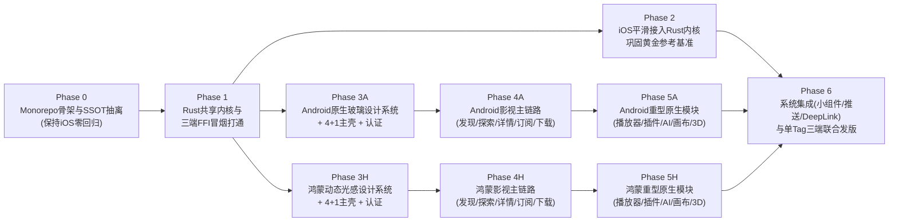

# MoviePilot-App 三端原生 + Rust 共享内核 实施路线图（AI 代理执行手册）

> **配套设计文档**：执行任何任务前，必须先通读《[MoviePilot-App 三端原生 + Rust 共享内核 最终架构设计文档](file:///Users/jxxghp/.gemini/antigravity/brain/b8300f85-f3fa-4393-b2f4-39e6d769cd3b/multiplatform-architecture-design.md)》。  
> **使用方式**：本文档将整项工程拆解为 **Phase 0 – Phase 6** 共 7 个阶段、26 个原子工作包（`WP-*`）。每个工作包均给出**明确边界、必读黄金参考源、核心原生约束与硬性验收命令**，可直接逐个或并行派发给不同的 AI 工程代理执行。

---

## 1. 全局推进拓扑与并行策略



> **并行加速建议**：完成 **Phase 0 + Phase 1**（奠定单仓结构、SSOT 生成脚本与三端可调用的 Rust 内核）后，**iOS 迁移（Phase 2）、Android 全量实现（Phase 3A→5A）、鸿蒙全量实现（Phase 3H→5H）三条主线可完全并行推进**，互不阻塞。

---

## 2. 分阶段工作包清单（Phase 0 – Phase 6）

### Phase 0：Monorepo 骨架改造与 `shared/` SSOT 抽离（iOS 零回归）

> **阶段目标**：不新增任何业务功能，仅完成目录升级、单一事实源抽离与同步脚本落地，确保现有 iOS 端所有测试与 IPA 打包 100% 保持绿灯。

- **`WP-0.1` 收拢现有 iOS 工程并建立根版本控制**
  - **必读参考**：[Package.swift](file:///Users/jxxghp/MPProjects/MoviePilot-App/Package.swift)、[project.yml](file:///Users/jxxghp/MPProjects/MoviePilot-App/ios/project.yml)、[ci.yml](file:///Users/jxxghp/MPProjects/MoviePilot-App/.github/workflows/ci.yml)、[build-ipa.sh](file:///Users/jxxghp/MPProjects/MoviePilot-App/scripts/build-ipa.sh)
  - **执行内容**：
    1. 新增根目录 `VERSION`（初始与当前 `MARKETING_VERSION` 一致）与 `BUILD_NUMBER`。
    2. 使用 `git mv` 将根目录 `Package.swift`、`Sources/`、`Tests/` 迁入 `ios/`；原 `scripts/` 迁至 `tools/ios/` 与 `tools/tests/`；原 `screenshots/screens/` 迁至 `screenshots/ios/`。
    3. 更新 `ios/project.yml` 中 `MoviePilotCore` 路径为 `.`，修正 CI 与脚本内相对路径。
  - **验收门禁**：
    - `zsh tools/ios/test-core.sh` 全绿；
    - `python3 -m unittest discover -s tools/tests` 全绿；
    - `(cd ios && xcodegen generate)` + iOS Simulator `xcodebuild build` 零报错。

- **`WP-0.2` 抽离 `shared/` 单一事实源（Tokens / L10n / Assets / Fixtures）**
  - **必读参考**：[NativeAppearanceStore.swift](file:///Users/jxxghp/MPProjects/MoviePilot-App/ios/NativeDesignSystem/NativeAppearanceStore.swift)、[CinematicSurfaces.swift](file:///Users/jxxghp/MPProjects/MoviePilot-App/ios/NativeDesignSystem/CinematicSurfaces.swift)、[NativeDeviceLayout.swift](file:///Users/jxxghp/MPProjects/MoviePilot-App/ios/MoviePilot/NativeV2/NativeDeviceLayout.swift)
  - **执行内容**：
    1. 抽出 6 套深浅渐变色点、语义状态色、圆角/边距/断点、图标映射至 `shared/design-tokens/*.json`。
    2. 将 3 语种 `Localizable.strings`（主应用 + Widgets）转换沉淀为 `shared/l10n/*.strings.json`。
    3. 将 `BrandMark` / `LaunchMark` / `logo-*.imageset` 原始高清图与 73 个 `CommunityMedals` 文件迁入 `shared/assets/`。
    4. 将 `PluginUITests/Fixtures` 与 `PluginFormsTests/Fixtures` 提升至 `shared/fixtures/`。
    5. 沉淀 `shared/contracts/deeplinks.yaml` 与 `v3-endpoints.yaml`。

- **`WP-0.3` 编写跨端同步与校验工具链（`tools/sync-*.py`）**
  - **执行内容**：实现 `sync-version.py`、`sync-tokens.py`、`sync-l10n.py`、`sync-assets.py`、`sync-all.py`（支持 `--check` 校验模式，不修改文件仅判断产物是否过期）并补齐 `tools/tests/` 单元测试。
  - **验收门禁**：
    - `python3 tools/sync-all.py && python3 tools/sync-all.py --check` 退出码为 0；
    - iOS 生成后的色板与词条和迁移前字节级/语义级等价，全量测试通过。

---

### Phase 1：Rust 共享内核与三端 FFI 冒烟打通

> **阶段目标**：建成 `shared/core-rust/` Cargo Workspace，按 100% 黄金夹具通过率重写无 UI 核心层，并跑通 iOS（Swift 6）、Android（Kotlin）、鸿蒙（ArkTS）三端的真编译调用。

- **`WP-1.1` Rust Workspace 初始化与 `mp-core-model`**
  - **必读参考**：`ios/Sources/MoviePilotCore/*.swift`（重点 `AppDeepLink.swift`、`AgentMarkdownParser.swift`、`MediaServerBrowseModel.swift`、`SubscribeProgressModel.swift`、`CommunityMedalsModel.swift`）
  - **执行内容**：创建 `shared/core-rust/`（锁定 `rust-toolchain.toml`，对齐 `MoviePilot-Rust` 风格），实现 `mp-core-model` 及全部 `shared/fixtures/deeplinks/`、`markdown/` 单元测试。
  - **验收门禁**：`cargo fmt --check && cargo clippy --all-targets -- -D warnings && cargo test -p mp-core-model`。

- **`WP-1.2` `mp-core-api` 与 `mp-core-session`（严格遵循原生 Transport 注入 ADR-01/02）**
  - **必读参考**：`ios/Sources/MoviePilotAPI/*.swift`、`ios/Sources/MoviePilotSession/*.swift`
  - **执行内容**：
    1. 定义平台无关异步 `HttpTransport` Trait（支持普通请求、Multipart 文件上传、流式字节回调）和 `SecretStore` Trait；**严禁在核心 Crate 内强绑 `reqwest` 绕过系统代理/证书链**。
    2. 实现全部 V3 端点构造器、容错 JSON 解码器、`SseStreamParser`、资源 9 维级联筛选与分组引擎、JWT 过期感知状态机、401 自动失效与 `NativePermissions` 权限矩阵。
  - **验收门禁**：使用 Mock `HttpTransport` 跑通全部 API 与 Session 生命周期用例（覆盖登录、Token 过期、401 清理、SSE 分块解析、9 维筛选）。

- **`WP-1.3` `mp-core-plugin`（动态插件 UI 与表单引擎）**
  - **必读参考**：`ios/Sources/MoviePilotPluginUI/*.swift`、`ios/Sources/MoviePilotPluginForms/*.swift`
  - **执行内容**：完整实现 `PluginJSON`、`PluginUIDecoder`、`NativeFormPlan`、`NativeFormExpression`、`NativeCron`、`NativeCombobox`、`PluginFormDraft`、`PluginWebFrontend`。
  - **验收门禁**：100% 通过 `shared/fixtures/plugin-ui/`（17 份真实插件夹具）与 `shared/fixtures/plugin-forms/`（`combobox-vuetify-3.7.3.json`、`cron-constructors.json`）所有测试，与原 Swift 输出逐字段一致。

- **`WP-1.4` 三端 FFI 绑定与工程骨架冒烟（UniFFI + ohos-rs）**
  - **执行内容**：
    1. `mp-ffi-uniffi`：配置 UniFFI 生成 Swift 6（Strict Concurrency 兼容）XCFramework 与 Kotlin Coroutines JNI 绑定（`tools/rust/build-ios.sh`、`tools/rust/build-android.sh`）。
    2. `mp-ffi-ohos`：配置 `ohos-rs` 生成 `libmoviepilot_core.so` + `index.d.ts` HAR 包（`tools/rust/build-harmony.sh`）。
    3. 初始化 `android/`（Gradle + Compose + `core-rust-bridge`）与 `harmony/`（Hvigor + ArkUI + `commons/core_rust_bridge`）空工程骨架，各端注入原生 `HttpTransport`（`URLSession` / `OkHttp` / `@kit.NetworkKit` `rcp`）和 `SecretStore`（`Keychain` / `Keystore` / `HUKS`），跑通一个端到端 FFI 冒烟单测（如解析 `moviepilot://media/tmdb/550?type=movie` 与解析一份插件表单夹具）。
  - **验收门禁**：三条构建脚本在本地/CI 跑通，三端冒烟单测全部通过，单架构二进制体积 <= 4 MB。

---

### Phase 2：iOS 端平滑接入 Rust 内核与 SSOT（巩固黄金基准）

> **阶段目标**：消除 iOS 端与 Rust 内核的重复逻辑，保持全部 30 个页面与 60 张截图表现 100% 无视觉与功能退化。

- **`WP-2.1` iOS `NativeDesignSystem` 切换消费 `GeneratedTokens.swift`**
  - **验收门禁**：视觉回归比对无色差，Liquid Glass 与深浅色切换表现完全一致。
- **`WP-2.2` iOS `Sources/` 逐步切换委托给 `MoviePilotRustCore`**
  - **执行顺序**：`MoviePilotPluginUI/Forms` → `MoviePilotCore` 纯逻辑 → `MoviePilotAPI` 解码与端点 → `MoviePilotSession` 状态机（薄 Swift 层仅保留 `URLSession`、`Keychain`、Widget AppGroup 桥接）。
  - **验收门禁**：原有 `ios/Tests/` 与 `ios/MoviePilotUITests/` 全绿，[verify-ipa.py](file:///Users/jxxghp/MPProjects/MoviePilot-App/scripts/verify-ipa.py) 校验通过，IPA 体积受控。

---

### Phase 3：Android & 鸿蒙原生视觉设计系统、主导航壳与认证（双线并行）

> **阶段目标**：打造两端的视觉“灵魂”——在两平台上各自使用**系统原生材质与光感能力**，1:1 复刻星夜紫玫流光、低雾玻璃、4+1 底部悬浮导航、8 项快捷菜单、连接服务与登录页，并达到与 iOS 截图同等级别的美观度。

- **`WP-3A.1` Android 原生设计系统（`android/design-system`）**
  - **必读参考**：[CinematicSurfaces.swift](file:///Users/jxxghp/MPProjects/MoviePilot-App/ios/NativeDesignSystem/CinematicSurfaces.swift)、[NativeAppearanceStore.swift](file:///Users/jxxghp/MPProjects/MoviePilot-App/ios/NativeDesignSystem/NativeAppearanceStore.swift)、[NativeDeviceLayout.swift](file:///Users/jxxghp/MPProjects/MoviePilot-App/ios/MoviePilot/NativeV2/NativeDeviceLayout.swift)
  - **原生视觉硬约束**：
    - `CinematicAmbientGradient`：API 33+ 使用原生 **AGSL `RuntimeShader`** 3×3 呼吸流光（15fps，低电量/减弱动画/退后台自动暂停）；API 31–32 平滑回退端点漂移渐变。
    - `CinematicPanel`：API 31+ 使用原生 **`RenderEffect` 硬件模糊管线（`Haze`）** + `RoundedCornerShape(24.dp)` + 对角 `0.7.dp` 高光描边；低版本降级为同源通透色层（严禁灰雾脏底）。
    - `NativeGlassSheet`：Material 3 `ModalBottomSheet` + API 31+ **`Window.setBackgroundBlurRadius`** + Predictive Back；内部禁止二次叠不透明背景。
    - 全局 `enableEdgeToEdge()` 透明系统栏 + `topSafeAreaVeil` 首色柔光遮罩。
    - 平板与折叠屏接入 `WindowSizeClass` + `Jetpack WindowManager` 折痕感知。

- **`WP-3H.1` 鸿蒙原生动态光感设计系统（`harmony/commons/design_system`）**
  - **必读参考**：同 `WP-3A.1`
  - **原生视觉与动态光感硬约束（重点）**：
    - `CinematicAmbientGradient`：使用鸿蒙原生 GPU 渲染节点/流光渐变（15fps，退后台/省电自动暂停），严格消费 `GeneratedTokens.ets`。
    - `CinematicPanel`：必须采用 ArkUI 原生 **`backgroundEffect`** / **`backgroundBlurStyle(BlurStyle.COMPONENT_ULTRA_THIN, { adaptiveColor: AdaptiveColor.AVERAGE, policy: FOLLOWS_WINDOW_ACTIVE_STATE })`**，并原生叠加 **鸿蒙动态光感 `pointLight`**（`lightSource` 随触控/焦点位置动态响应，`illuminated: IlluminatedType.BORDER_CONTENT`）与按压 **`lightUpEffect`**，呈现通透且富有灵动边缘折光的鸿蒙级质感！
    - `NativeGlassSheet`：必须使用原生 **`bindSheet`**（配置多档 `detents`、`blurStyle: BlurStyle.COMPONENT_THIN`、`backgroundColor` 主题微染色、`dragBar: true`），严禁 `Stack` 伪造弹窗。
    - 全面启用 `setWindowLayoutFullScreen(true)` + 避让区监听，并按鸿蒙**一多断点（`sm/md/lg`）+ `display.getFoldStatus()`** 响应手机/阔折叠/平板布局。

- **`WP-3A.2` & `WP-3H.2` 4+1 底部悬浮导航主壳 + 8 项快捷菜单 + 连接服务与登录**
  - **必读参考**：[NativeV2MainShell.swift](file:///Users/jxxghp/MPProjects/MoviePilot-App/ios/MoviePilot/NativeV2/NativeV2MainShell.swift)、`NativeV2RootView.swift`、`NativeDynamicActionCenter.swift`、截图 `01-connection` / `02-login` / `overflow-menu`
  - **核心要求**：
    - 4 主 Tab（发现/探索/我的/设置）各自独立导航栈 + 右侧动态 `+1` 独立玻璃圆钮（默认全局搜索，子页按上下文动态变为主操作）；
    - 重复点击任意主图标，以原生弹簧曲线展开 8 项快捷菜单（`我的订阅`、`订阅日历`、`站点资源`、`下载`、`文件管理`、`整理历史`、`工作流`、`插件`），溢出页不污染主 Tab 导航历史；
    - 完整实现连接服务（历史实例管理/切换）、账号密码登录、Passkey 登录、401 会话过期自动清理缓存回登录页。
  - **验收门禁**：产出登录、连接服务、4+1 底栏（深色+浅色）、8 项溢出菜单真机/模拟器截图，与 `screenshots/ios/` 逐张视觉评审通过。

---

### Phase 4：核心影视自动化主链路全量复刻（Android & 鸿蒙并行）

> **阶段目标**：完整跑通「发现 → 探索 → 搜索 → 详情 → 订阅 → 追剧日历 → 资源搜索与下载 → 正在下载」主链路。以下工作包在 Android（`4A.*`）与鸿蒙（`4H.*`）按相同编号对称执行。

- **`WP-4*.1` 发现页、模块编排与音乐发现**
  - **必读参考**：`NativeDiscoverPage.swift`、`NativeDiscoverModulesSheet.swift`、`NativeMusicPage.swift`
  - **核心要求**：透明片名 Logo 主视觉（优先后端 `logo_language`，兼容旧后端调用 Android ML Kit / 鸿蒙 Core Vision Kit 兜底）、继续观看 16:9 横幅、豆瓣热门音乐、分类浏览、模块显隐与长按拖拽排序、榜单网格自动翻页、卡片右键/长按菜单（搜索/订阅）。
- **`WP-4*.2` 探索片库与全局搜索**
  - **必读参考**：`NativeExplorePage.swift`、`NativeMediaSearchPage.swift`
  - **核心要求**：TMDB/豆瓣/Bangumi 带来源 Logo 的横向小卡片一级导航 + 筛选胶囊；顶部玻璃搜索框 + 分类胶囊（媒体/媒体库/人物/音乐/合集），点击策略严格统一为“仅媒体库直放，其余进对应详情页”。
- **`WP-4*.3` 影视/豆瓣/剧集/人物详情与媒体库浏览**
  - **必读参考**：`NativeMediaDetailPage.swift`、`NativeMediaServerLibraryPage.swift`、`NativeMediaServerDetailPage.swift`
  - **核心要求**：沉浸式无遮挡大海报头图（使用 `layout.json` 动态首屏比例）、分季折叠/展开、演职员横滑与人物详情、一键订阅/搜索资源/直放媒体库。
- **`WP-4*.4` 订阅管理、订阅编辑弹窗、追剧日历与订阅广场**
  - **必读参考**：`NativeSubscriptionsPage.swift`、`NativeSubscribeEditorSheet.swift`、`NativeCalendarPage.swift`、`NativeSubscribeCommunityPage.swift`
  - **核心要求**：全量订阅参数编辑（画质/分辨率/特效/站点/间隔/洗版集数/IMDB/规则组/剧集组/目录建议/自定义词/音乐 5 项音质/删除）、无边框周切换追剧日历、热门订阅与社区分享。
- **`WP-4*.5` 站点资源（9 维级联筛选）与正在下载管理**
  - **必读参考**：`NativeResourceSearchPage.swift`、`NativeDownloadsPage.swift`
  - **核心要求**：全部筛选与同规格分组逻辑调用 Rust `ResourceFilterEngine`；点击整张资源卡弹出原生分组下载确认弹窗（下载器 + 保存目录选择）；正在下载实时进度与暂停/恢复/删除。

- **Phase 4 验收门禁**：主链路 20+ 核心页面截图齐全，连接真实 MoviePilot V3 测试实例完成“发现 → 详情 → 添加订阅 → 搜索资源 → 提交下载 → 查看进度”全流程冒烟通过。

---

### Phase 5：重型原生子系统与进阶业务复刻（Android & 鸿蒙并行）

> **阶段目标**：逐个攻克技术含量最高的 6 大重型模块，实现与 iOS `v2` 的 100% 功能平齐。

- **`WP-5*.1` 全格式音视频播放器、画中画与悬浮迷你音乐条**
  - **必读参考**：[MediaPlaybackController.swift](file:///Users/jxxghp/MPProjects/MoviePilot-App/ios/MoviePilot/MediaPlaybackController.swift)、`MediaPictureInPictureController.swift`、`NativeMediaPlaybackLauncher.swift`
  - **平台原生要点**：
    - Android：`Media3 (ExoPlayer)` + `LibVLC Android`（或 `mpv-android`）双核切换 + `MediaSessionService` + `enterPictureInPictureMode`；
    - 鸿蒙：`AVPlayer` + `XComponent` C++ NAPI 全格式解码器 + `AVSession` + `PiPWindow`；
    - 严格复刻极简纯图标播放控件、LRC 同步歌词、音乐退回底栏上方玻璃/光感悬浮迷你条且后台无缝续播。
- **`WP-5*.2` 文件管理、手动整理与整理历史**
  - **必读参考**：`NativeFileManagerPage.swift`、`NativeTransferHistoryPage.swift`
  - **核心要求**：多存储目录浏览、长按手动整理与智能重命名、整理队列弹窗、常驻搜索框历史记录与 4 组合删除弹窗、点击音视频直接起播。
- **`WP-5*.3` 「我的」仪表盘、消息中心与捷径诊断中心**
  - **必读参考**：`NativeDashboardPage.swift`、`NativeMessagesPage.swift`、`NativeDiagnosticsToolsPage.swift`
  - **核心要求**：全量系统监控卡片（CPU 1m/5m/15m、内存、网络、下载器、7 天整理趋势、最近入库、媒体库最新）+ 插件 JSON 仪表盘卡片；右上角双图标（消息中心 + 捷径）；流式系统检查、识别与规则测试、结构化实时日志、定时服务与 5 类词表管理。
- **`WP-5*.4` 工作流节点画布与站点管理/流量图表**
  - **必读参考**：`NativeWorkflowsPage.swift`、`NativeWorkflowCanvasPage.swift`、`NativeSitesPage.swift`
  - **核心要求**：纯原生手势缩放/平移工作流节点画布 + 社区分享；站点 CRUD + 双向绿/玫红上下行流量图示与历史趋势图表。
- **`WP-5*.5` AI 智能助手（SSE + 语音/TTS + 自由悬浮机器人）**
  - **必读参考**：`NativeAgentChatPage.swift`、`NativeAgentFloatingMascot.swift`
  - **核心要求**：消费 Rust `SseStreamParser` 与 `AgentMarkdownParser`，支持工具调用卡片、思考计时、交互选择卡、安全敏感交付、运行中追问、图片/文件上传、原生录音与 TTS 播放；悬浮机器人支持任意位置自由拖动停靠且零拖影。
- **`WP-5*.6` 设置中心、动态插件引擎（JSON + 隔离 Vue）与 3D 社区勋章**
  - **必读参考**：`NativeSettingsHubPage.swift`、`NativeSystemModulesPage.swift`、`NativeUsersPage.swift`、`NativeAppearanceSettingsPage.swift`、`NativePluginMarketPage.swift`、`NativePluginFormView.swift`、`NativePluginDataPageView.swift`、[NativeCommunityMedal3D.swift](file:///Users/jxxghp/MPProjects/MoviePilot-App/ios/MoviePilot/NativeV2/CommunityMedals/NativeCommunityMedal3D.swift)
  - **核心要求**：
    - 设置中心零阴影裁切分组列表（含渠道授权、用户管理、外观 6 主题自定义）；
    - 对接 Rust `mp-core-plugin`，补齐全部 Vuetify 映射组件、原生 Cron/Combobox 编辑器、已安装插件分身与市场源管理、遗留 Vue 插件隔离 WebView（Pinia/Cookie 注入）；
    - 加载共享 73 个勋章资源，用 Android `Filament`/GLES3 与鸿蒙 `ArkGraphics 3D`/`XComponent` 实现 3D 勋章与背面动态雕刻。

---

### Phase 6：系统生态深度集成与单 Tag 三端联合发版

> **阶段目标**：补齐跨应用系统能力，上线单仓三端自动打包发布流水线，完成三端 60 屏终审。

- **`WP-6.1` DeepLink (`moviepilot://`) 与系统音视频打开方式**
  - **验收门禁**：三端均支持未登录状态从系统文件管理器“打开方式/分享”直接原生播放本地 MKV/MP4/FLAC，且全量 `moviepilot://` 路径经 Rust 解析精准跳转。
- **`WP-6.2` 三端原生桌面小组件**
  - Android `Jetpack Glance`、鸿蒙 `FormExtensionAbility`、iOS 保持 `WidgetKit`，统一样式与 `WidgetData` 数据结构。
- **`WP-6.3` 三端推送通知对接**
  - Android 通知渠道 + 推送通道、鸿蒙 `Push Kit`；同步与 `MoviePilot` 后端确认设备令牌注册 `platform` 字段兼容性。
- **`WP-6.4` 三端并行 CI 与单 Tag Release 流水线**
  - **执行内容**：
    1. 完成 `tools/android/build-android.sh`、`verify-apk.py` 与 `tools/harmony/build-harmony.sh`、`verify-hap.py`、`Dockerfile.ohos-ci`。
    2. 升级 `.github/workflows/ci.yml`（路径过滤 Matrix）与 `.github/workflows/release.yml`（`prepare → [build-ios, build-android, build-harmony] → publish-release`）。
  - **终审验收门禁**：
    - 推送测试预发布 Tag（如 `v2.1.0-rc.1`），一次 CI 运行自动产出 `.ipa` + `.apk` + `.aab` + `.hap` 与合并 `SHA256SUMS`；
    - 归档 `screenshots/android/` 与 `screenshots/harmony/` 核心对比图，与 `screenshots/ios/` 完成深浅色 + 手机/平板/折叠屏全量目视终审。

---

## 3. AI 代理任务派发标准模板（复制即用）

当你把上述任意一个 `WP-*` 派发给其他 AI 代理时，可以直接套用以下指令模板，能显著降低幻觉与返工率：

```markdown
你正在参与 MoviePilot-App 的三端原生（iOS SwiftUI + Android Compose + HarmonyOS NEXT ArkUI）+ Rust 共享内核改造工程。

## 本次认领任务
- 任务编号：WP-X.Y（填入具体编号与名称）
- 所属范围：严格限定在以下目录内修改：[列出允许修改的目录]

## 强制前置阅读（动手前必须先完整读取）
1. 架构总纲：multiplatform-architecture-design.md（特别遵守第 1 节红线与第 5 节原生材质规范）
2. 路线图定义：multiplatform-implementation-roadmap.md 中对应的 WP-X.Y 条目
3. 黄金参考源码：[填入对应 iOS Swift 源码路径与截图路径]

## 关键工程约束
- 所有颜色/渐变/圆角/文案/图标必须来自 shared/ 生成代码，禁止在业务页面硬编码；
- 所有无 UI 业务规则、API 模型解码、筛选排序、路由解析必须走 shared/core-rust/，禁止在端侧重写分叉逻辑；
- 玻璃、模糊、半屏弹窗与动效必须调用该平台系统原生 API（Android 使用 RenderEffect/Haze/AGSL/WindowBlur；鸿蒙使用 backgroundEffect/backgroundBlurStyle/pointLight 动态光感/lightUpEffect/bindSheet），严禁用普通半透明黑底或 Stack 伪造；
- 所有新增类型和公共函数编写中文注释。

## 交付与验收要求
1. 完成后必须真实运行本任务对应的编译、Lint 与单元测试命令，并在汇报中贴出真实命令输出；
2. 如涉及 UI 页面，列出与 iOS 黄金源码对照后的交互核对清单及未覆盖差异（若有）；
3. 严禁修改与本 WP 无关的文件或擅自回退他人改动。
```

---

## 4. 高风险项与防踩坑总览（给主控与评审 AI 核查用）

| 风险点 | 常见错误做法（必须拦截） | 正确做法 |
| :--- | :--- | :--- |
| **NAS 自签证书与系统代理失效** | 在 Rust 内核里用 `reqwest` 直接发网络请求 | 严格按 **ADR-01**，Rust 输出请求规格，回调原生 `URLSession` / `OkHttp` / `rcp` 执行 |
| **Android 玻璃发灰或滑动掉帧** | 用纯黑半透明卡片代替，或在滚动列表项内部套多层全屏模糊 | 用 GPU `RenderEffect` 局部背景模糊并限制单屏活跃模糊层数，列表项用轻透色玻璃叠加描边，底栏/弹窗/弹层用真背景模糊 |
| **鸿蒙光感滥用导致眩光或耗电** | 全屏所有元素都挂 `pointLight`，或后台不暂停流光动画 | 仅在核心卡片/悬浮底栏/主操作钮/溢出菜单上按需配置克制的 `pointLight`（受光强度与半径克制柔和），窗口失焦/后台/省电自动停动画与降级模糊 |
| **插件 JSON 引擎三端行为不一致** | Android/鸿蒙 AI 偷懒自己用 Kotlin/ArkTS 重写一份简化版 `NativeFormPlan` | 100% 调用 Rust `mp-core-plugin` 输出的规划树，端侧只做纯组件渲染映射 |
| **鸿蒙 CI 无法构建 `.hap`** | 试图在标准 `ubuntu-latest` 上直接调用不存在的 `hvigorw` | 在 Phase 1 / Phase 6 尽早准备含华为 Command Line Tools + SDK 的 Docker 镜像或自建 Runner |
| **Swift 6 严格并发报错** | UniFFI 生成的 Swift 类型未标记 `Sendable` 导致编译失败 | 在 `uniffi.toml` 启用 Swift 6 / `Sendable` 支持，所有跨隔离域模型保持不可变值类型 |
