# MoviePilot-App 多平台原生客户端界面图册

本图册按平台目录归档真机/模拟器运行验收截图：
- `screenshots/ios/`：iOS 26 模拟器（iPhone 17）60 张黄金验收图
- `screenshots/android/`：Android 15（API 35 ARM64 硬件 GPU 模拟器）20 张 **纯正 Material Design 3** 真实后端实测验收图
- `screenshots/harmony/`：HarmonyOS NEXT / HarmonyOS 7（已完成 HarmonyOS 原生交互与一多自适应重设计、HarmonyOS 7 `uiMaterial.ImmersiveMaterial` 动态光感与低版本自动回退、Vue 联邦协议接管，以及 Rust OHOS NAPI 动态库与 16 模块 `entry-default-unsigned.hap` 零报错编译及 `verify-hap.py` 校验；待 DevEco Studio Device Manager 下载 `HarmonyOS-7.0.1-B1` 系统镜像后补齐真机/模拟器截图）

---

## Android（Jetpack Compose + 纯正 Material Design 3 + Rust UniFFI · API 35 实测验收）

以下 20 张截图均采集自 Android 15（API 35，`MoviePilot_API35` ARM64 模拟器，Apple M4 Vulkan `gfxstream` 硬件加速）直连真实 MoviePilot V3 后端实例运行界面：
- **纯正 Material Design 3 视觉体系**：不透明 Tonal Surface 色阶（`surface` → `surfaceContainerLow` → `surfaceContainer` → `surfaceContainerHigh`）、贴底标准 5 Tab `NavigationBar`（发现 · 探索 · 订阅 · 更多 · 我的）+ 宽屏 `NavigationRail`、支持 Android 12+ Material You 壁纸动态取色；
- **标准 Android 交互层级**：一级平级页签使用 `PrimaryTabRow` + `HorizontalPager` 左右跟手滑动、二级页内章节使用 `SecondaryTabRow`、互斥模式选择使用 `SingleChoiceSegmentedButtonRow`、多维筛选使用 `FilterChip`；
- **完整业务与插件生态**：发现/详情视差渐变溶解 + 顶部状态栏渐进模糊、Emby 媒体库实时浏览与直放、原生 Vuetify JSON 表单与数据页、以及 1:1 复刻 iOS `moviepilot.chrome` v1 协议的 Vue 模块联邦插件（零点击直开 + 标题栏/关闭按钮/原背景原生接管）。

### 核心导航、发现滚动、媒体库与详情

| 发现首页（贴底 5 Tab 导航） | 发现滚动（状态栏渐进模糊 + 媒体库） | Emby 媒体库实时浏览（753 部电影） |
| :---: | :---: | :---: |
|  |  | 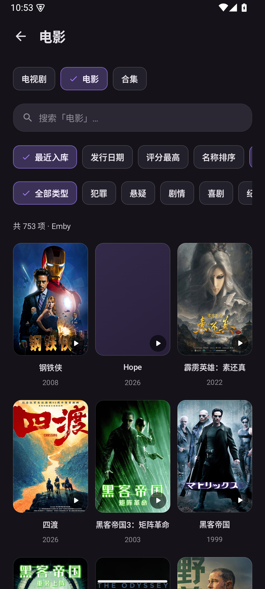 |

| 媒体详情（沉浸主视觉） | 人物独立全屏详情页 | 探索片库（多源筛选网格） |
| :---: | :---: | :---: |
|  |  | 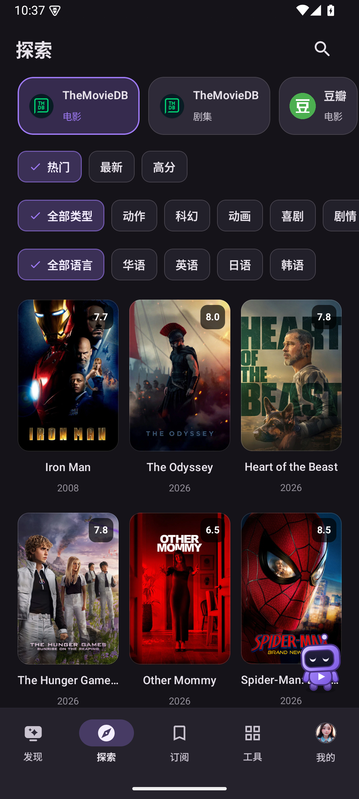 |

### 订阅、更多工具中心与工作流（Material 3 页签与分段控件）

| 订阅（PrimaryTabRow 滑动切换） | 订阅广场（SegmentedButton 切换） | 更多（实时速率与功能中心） |
| :---: | :---: | :---: |
| 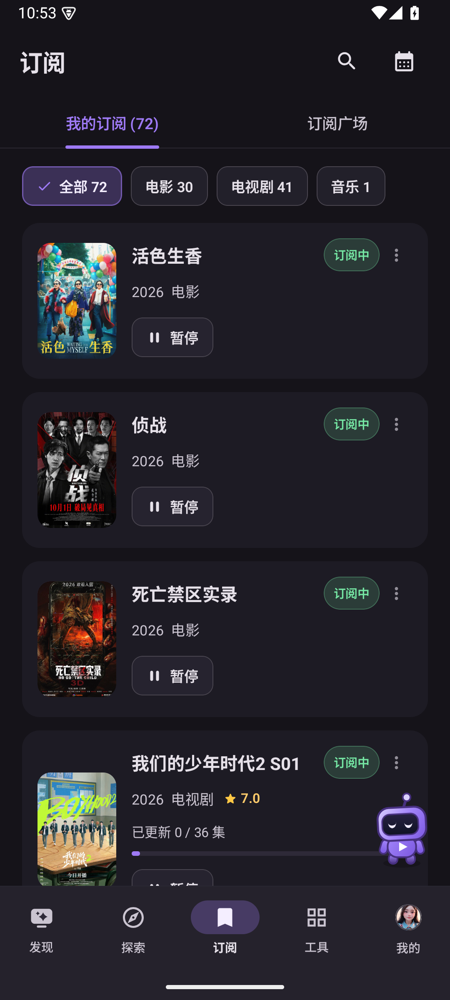 | 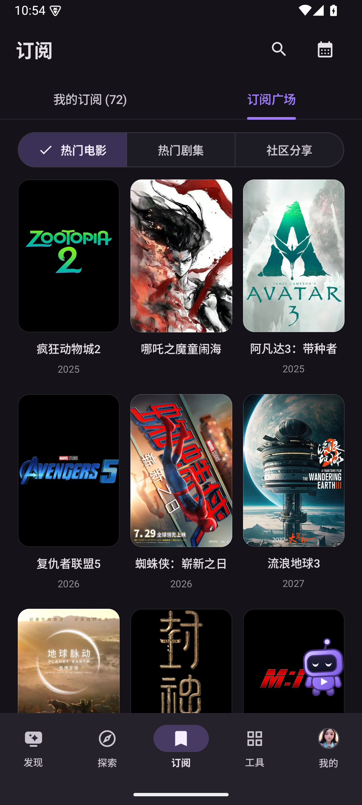 | 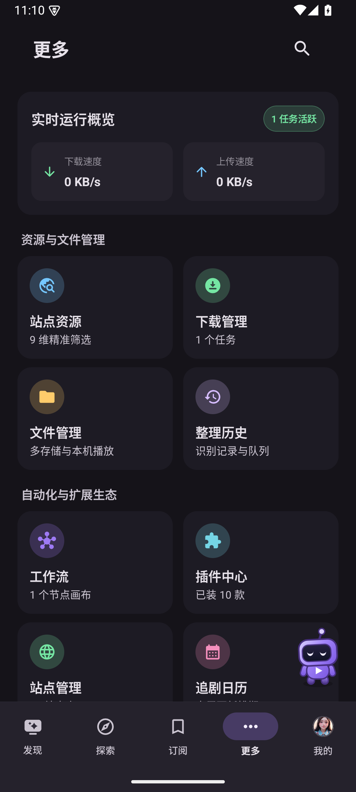 |

| 工作流（PrimaryTabRow + M3 FAB） | 文件管理（本机 SAF 媒体直放） | 我的仪表盘 |
| :---: | :---: | :---: |
| 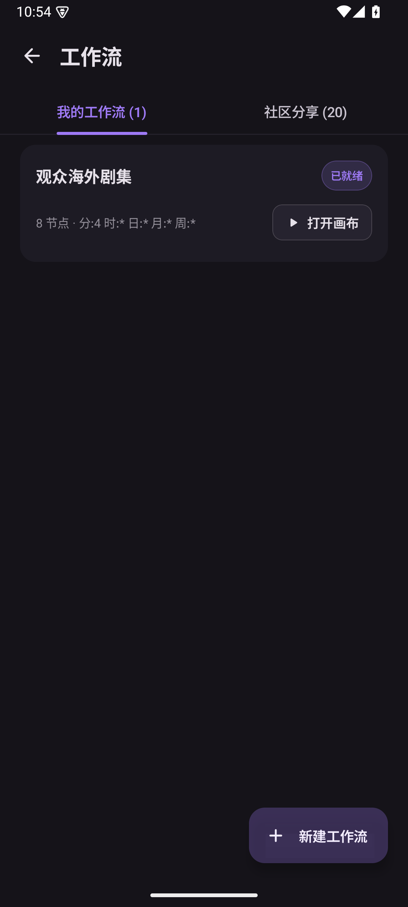 | 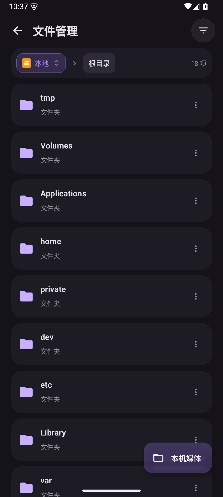 | 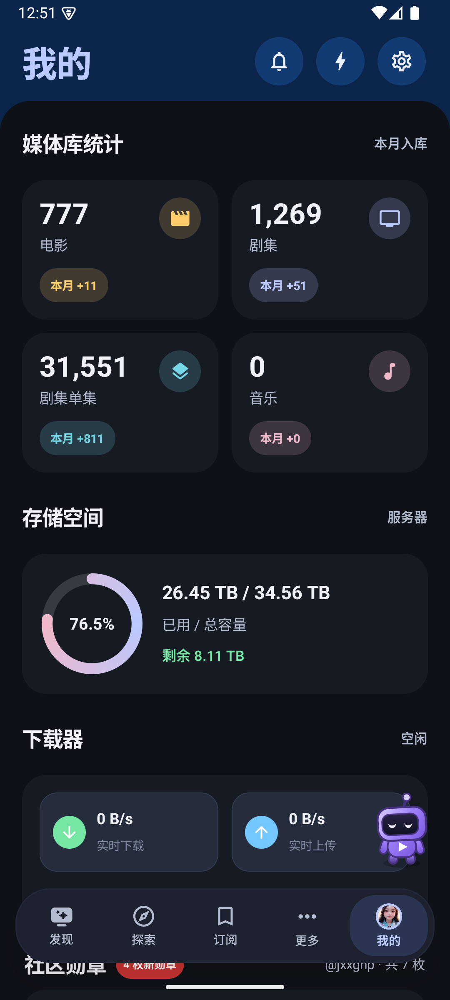 |

### 插件中心（原生 Vuetify 表单/数据页 + Vue 模块联邦原生接管）

| 插件中心（PrimaryTabRow） | 原生数据页（SecondaryTabRow） | 原生 Vuetify JSON 配置表单 |
| :---: | :---: | :---: |
| 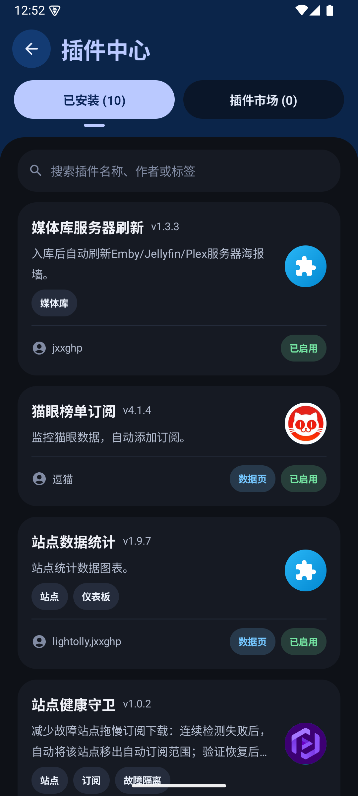 | 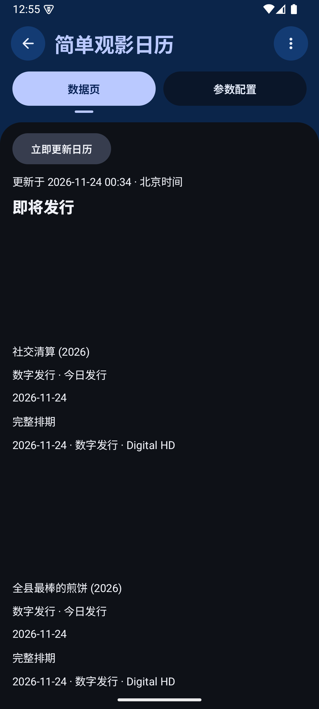 | 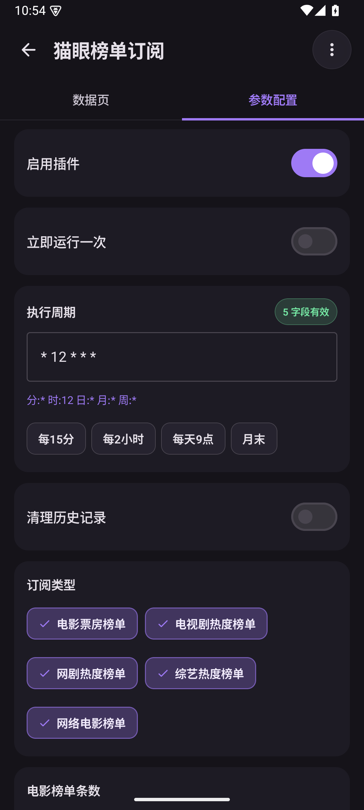 |

| Vue 模块联邦（零点击直开 + 接管顶栏/去背景） | 消息中心（全屏含真实配图） | 设置中心（Material 3 分组） |
| :---: | :---: | :---: |
|  | 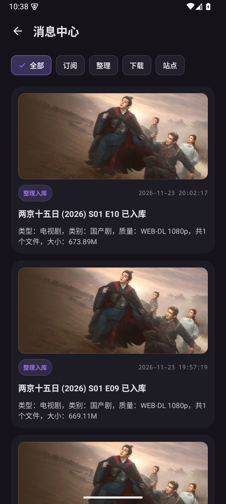 |  |

### 外观与播放设置（Material You + SegmentedButton）

| 主题与外观（Material You + 分段模式） | 播放偏好（清晰度与倍速分段选择） | |
| :---: | :---: | :---: |
| 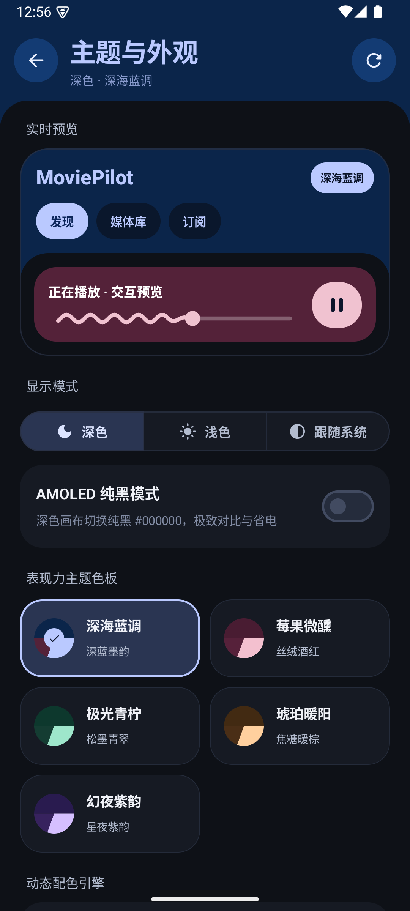 |  | |

---

## iOS（SwiftUI + Liquid Glass · iOS 26 模拟器）

以下全部 60 张截图采集自 iPhone 17（iOS 26 模拟器）真实运行界面，展示全原生 SwiftUI v2 客户端（零主流程 WebView）的 4+1 Liquid Glass 导航、玻璃弹层、原生图表与完整业务交互。

## 连接服务与登录

| 连接服务 | 已保存服务与连接按钮 | 登录 |
| :---: | :---: | :---: |
|  |  |  |

## 4+1 底部导航、弹出菜单与设置中心

| 发现（透明片名 Logo） | 探索 | 我的（仪表盘） |
| :---: | :---: | :---: |
|  |  | 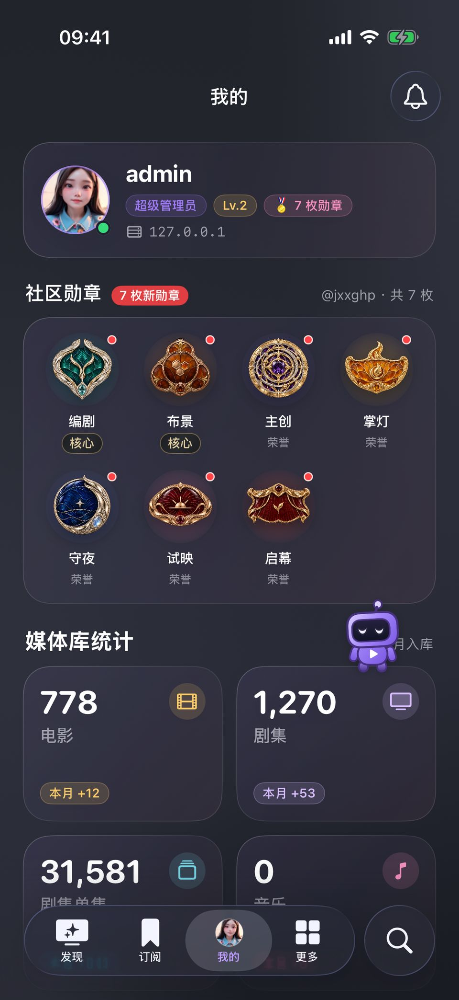 |

| 设置主中心 | 重复点击底栏弹出菜单 | 全局搜索（+1 默认回退） |
| :---: | :---: | :---: |
|  | 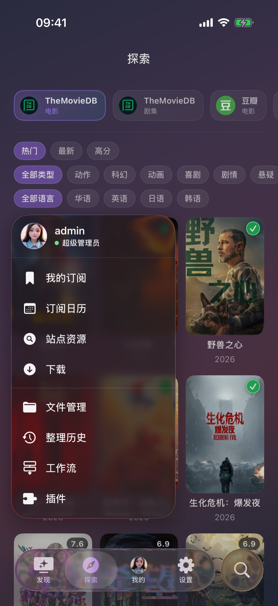 |  |

## 发现滚动、模块编排、详情与人物

| 发现滚动阶段 2 | 发现滚动阶段 3 | 发现滚动阶段 4 |
| :---: | :---: | :---: |
|  |  | 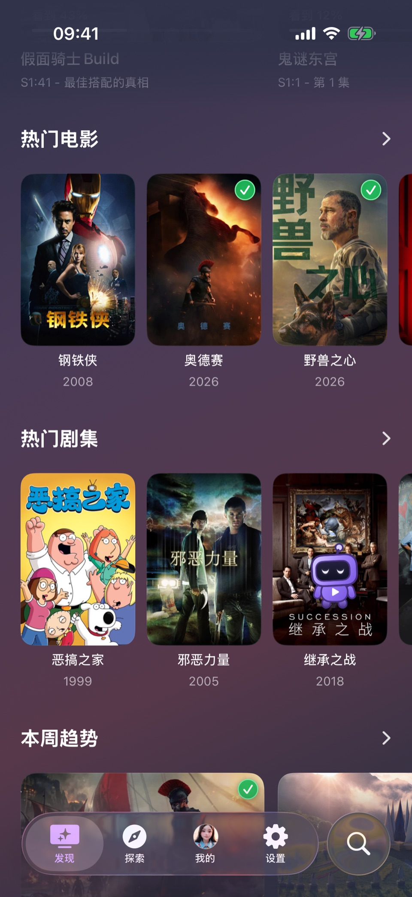 |

| 发现模块编辑（独立媒体库/分类浏览） | 榜单网格（分页前） | 榜单网格（自动翻页） |
| :---: | :---: | :---: |
|  |  |  |

| 媒体详情（订阅 + 搜索资源） | 媒体详情演职员 | 人物详情 |
| :---: | :---: | :---: |
|  |  |  |

| 剧集详情 | 剧集分季 | 网格翻页状态 |
| :---: | :---: | :---: |
|  |  | 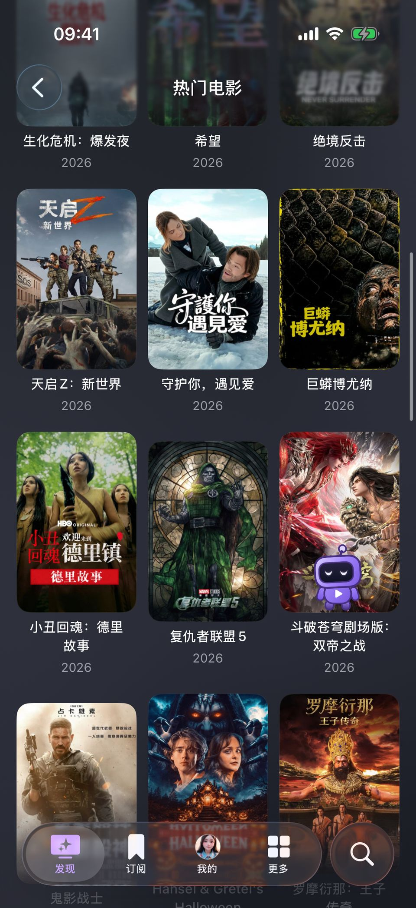 |

## 探索、豆瓣详情、音乐、订阅与资源下载

| 探索（豆瓣筛选） | 豆瓣作品详情 | 豆瓣演职员与推荐 |
| :---: | :---: | :---: |
| 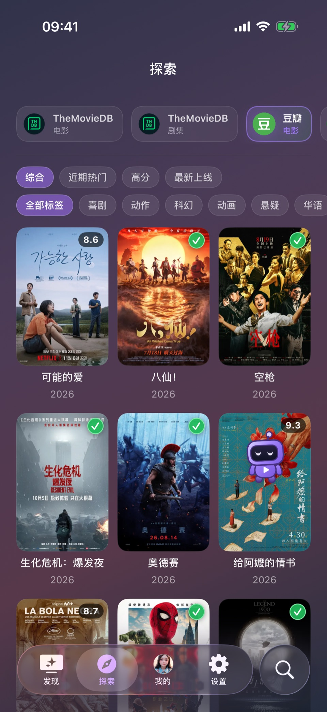 |  |  |

| 音乐发现 | 音乐专辑与曲目播放 | 站点资源（关键词搜索 / 首页浏览） |
| :---: | :---: | :---: |
|  |  |  |

| 我的订阅 | 订阅规则编辑 | 追剧日历 |
| :---: | :---: | :---: |
|  |  |  |

| 订阅广场（热门订阅） | 订阅广场（社区分享） | 正在下载 |
| :---: | :---: | :---: |
|  | 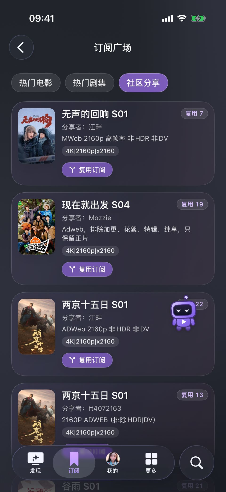 | 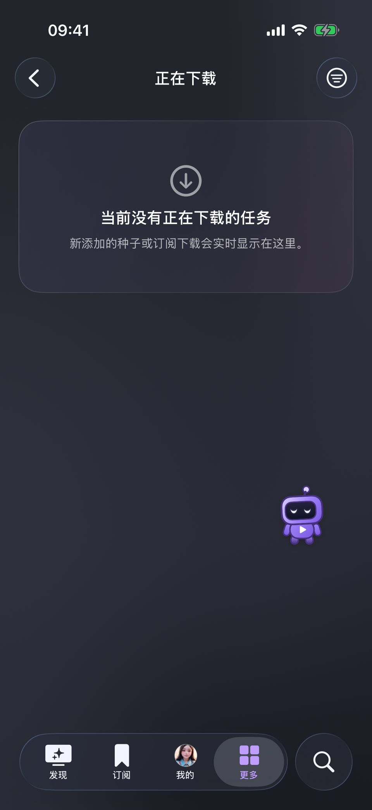 |

## 消息、智能助手与捷径诊断中心

| 消息中心（玻璃弹层） | 智能助手（SSE 流式对话） | 捷径菜单（玻璃弹层） |
| :---: | :---: | :---: |
|  |  |  |

| 捷径：词表与语法说明 | 捷径：定时服务 | 捷径：实时日志 |
| :---: | :---: | :---: |
| 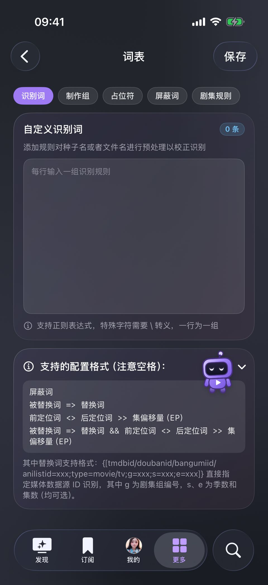 |  |  |

## 整理历史、队列、文件管理与工作流

| 整理历史（相对时间 + 链式路径） | 整理队列弹窗 | 文件管理（长按删除 + 动态 +1 按钮） |
| :---: | :---: | :---: |
| 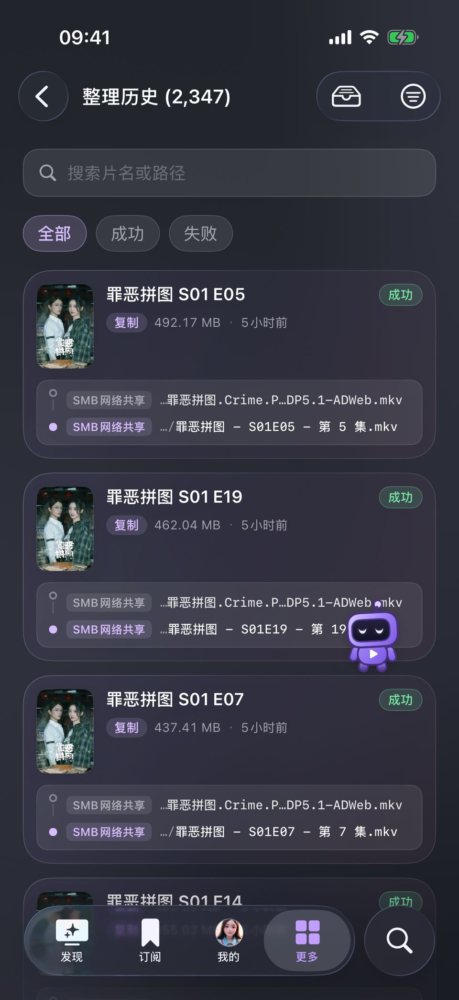 |  |  |

| 工作流列表 | 纯原生工作流节点画布 | 工作流社区分享 |
| :---: | :---: | :---: |
|  |  |  |

## 站点、系统配置与外观

| 站点管理（上下行流量图示） | 站点数据（历史流量趋势图） | 订阅与搜索设置 |
| :---: | :---: | :---: |
|  |  |  |

| 媒体数据源配置 | 下载器管理 | 媒体服务器管理 |
| :---: | :---: | :---: |
|  |  |  |

| 目录与存储 | 服务端通知渠道 | 主题与外观 |
| :---: | :---: | :---: |
|  |  |  |

## 用户管理与插件生态

| 用户管理 | 插件市场 | 已安装插件管理 |
| :---: | :---: | :---: |
|  |  | 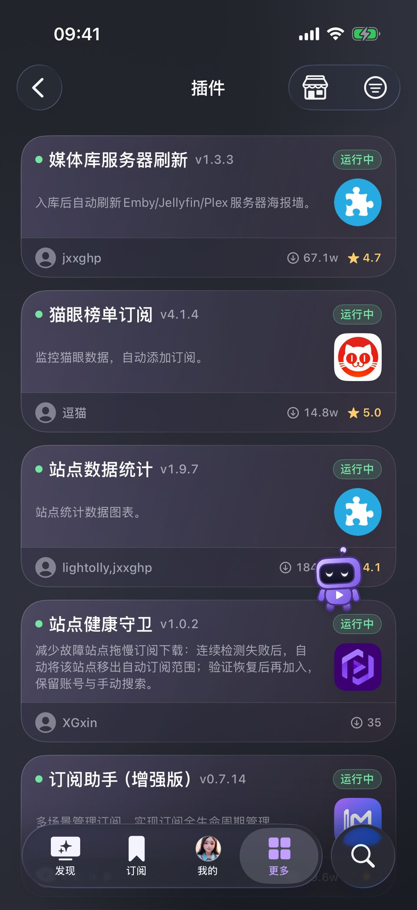 |

| 仪表盘无缝插件图表 | 插件数据页（站点统计环形图） | 插件数据页（猫眼票房排行） |
| :---: | :---: | :---: |
|  |  |  |

