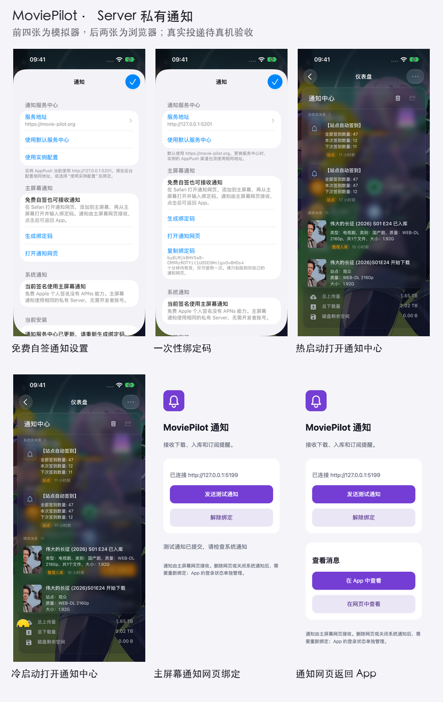

# 界面截图

[返回项目首页](../README.md) · [离线交互截图册](index.html)

截图册包含 69 张图：原生界面来自 **iPhone 17 Pro / iOS 27.0（24A434）模拟器**，原图为 1206 × 2622；另有主屏幕通知网页、自动接入设置及中心管理后台的浏览器截图。配置页的实例地址与密钥采用演示值。

GitHub 不直接运行 HTML。下载仓库后，在浏览器中打开 `screenshots/index.html`，即可按分类筛选和放大图片。

## 总览

## 页面

### 下载管理

### 仪表盘

### 媒体整理

### 工作流

### 探索

### 推荐

### 插件

### 搜索结果

### 文件管理

### 日历

### 更多

### 用户管理

### 电影订阅

### 电视剧订阅

### 站点管理

### 设定

### 音乐订阅

## 页内分类

### 工作流 · 工作流分享

### 工作流 · 我的工作流

### 插件 · 我的插件

### 插件 · 插件市场

### 电影订阅 · 我的订阅

### 电影订阅 · 热门订阅

### 电视剧订阅 · 我的订阅

### 电视剧订阅 · 热门订阅

### 电视剧订阅 · 订阅分享

### 设定 · 存储 & 目录

### 设定 · 搜索 & 下载

### 设定 · 站点

### 设定 · 系统

### 设定 · 规则

### 设定 · 订阅

### 设定 · 通知

### 音乐订阅 · 我的订阅

## 导航与弹窗

### HTML主题菜单

### HTML全屏设置弹窗

### HTML用户菜单

### HTML页面跳转与导航联动

### 中文分类联动

### 单行原生导航

### 原生中文分类菜单

### 原生页内分类菜单

### 文件管理刷新菜单

### 更多菜单搜索

### 框架打开原HTML站点筛选

### 站点标题操作进入三点菜单

### 站点统一标题与渐变顶栏

### 静态启动画面

### 顶部操作横向展开

## 连接与登录

### 密码可见切换

### 密码可见切换 · 深色

### 登录

### 登录 · 深色

### 登录键盘

### 空白登录键盘

### 空白登录键盘 · 深色

### 连接

### 连接 · 深色

### HTTPS 证书错误提示

## 通知

前四张来自 iPhone 17 Pro 模拟器的实际操作，后两张为 402 × 874 浏览器验证。通知设置已更新为 1.0.0，展示内置的 `https://movie-pilot.org` 默认中心及按实例切换；图中的本地中心为隔离演示服务。
网页绑定和测试请求使用独立 Server；外部推送传输使用测试替身，截图不代表真实 iPhone 收到通知。绑定码为已失效演示值。

### 免费自签通知设置

### 一次性绑定码

### 热启动打开通知中心

### 冷启动打开通知中心

### 主屏幕通知网页绑定

### 通知网页返回 App

## 中心服务自动接入

以下四张为浏览器实际操作截图；独立测试库验证自动登记、轮换保留绑定、停用与恢复。服务端使用真实协议及 Web Push 加密，外部网络传输使用测试替身，不表示真机已收到通知。

### 自动接入通知渠道 · 手机浏览器

### 中心推送实例 · 桌面浏览器

### 中心推送实例 · 手机浏览器

### 停用实例确认 · 手机浏览器

